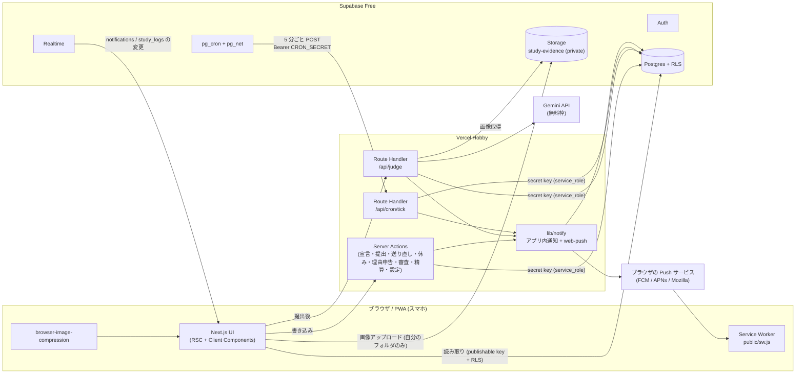
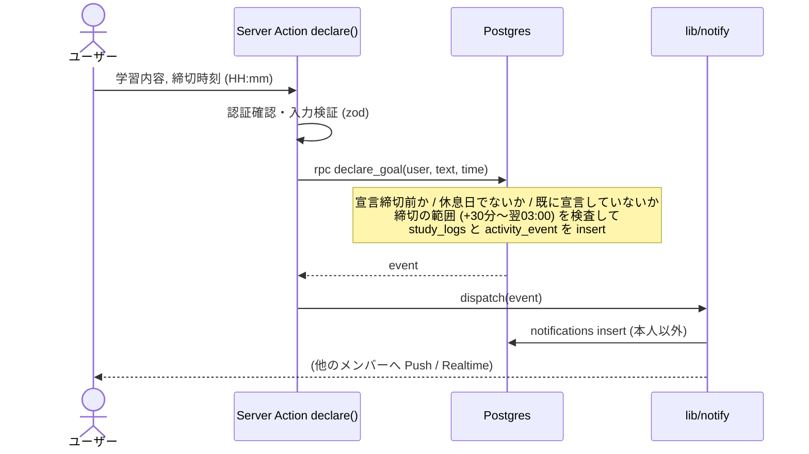
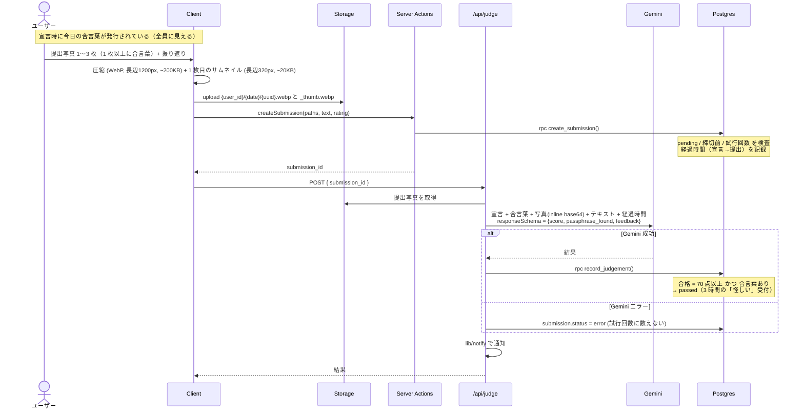
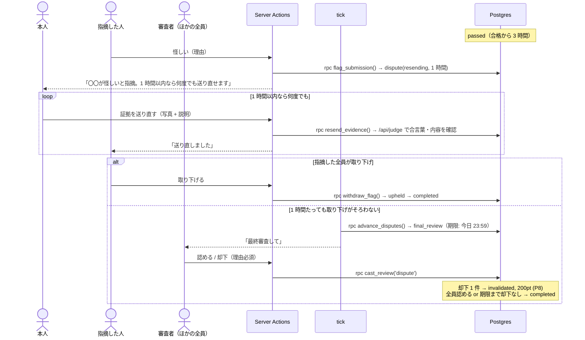
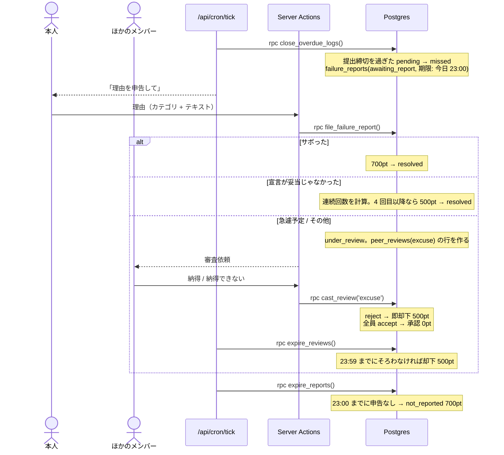
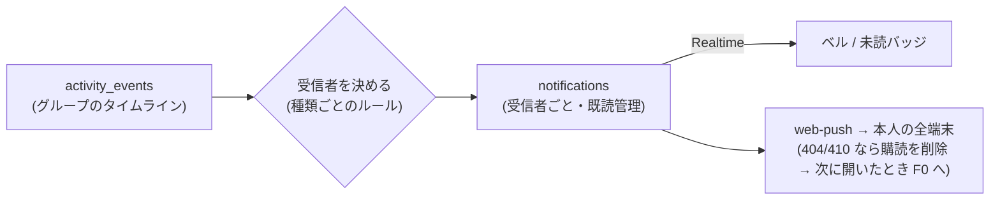

# アーキテクチャ

要件は [requirements.md](requirements.md)、DB は [database.md](database.md)、判断の理由は [decisions.md](decisions.md) を参照。

## 1. 全体構成



### 基本方針
1. **読み取りはクライアントから、書き込みはサーバーから。**
   クライアントは publishable key と RLS で自分のグループのデータを読むだけ。状態を変える操作はすべて Server Action / Route Handler を通し、サーバーが service role で書き込む。これでポイントやステータスの改ざんを構造的に防ぐ（例外はプロフィールの表示項目の更新と、自分のフォルダへの画像アップロードだけ）。
2. **時刻の基準は DB の `now()`。** 「今日」は `(now() at time zone 'Asia/Tokyo')::date`。
3. **状態遷移とペナルティは Postgres 関数にまとめる。** 「未達成にする」「理由申告を確定する」「審査を締める」などを、ペナルティの記録・イベントの記録と同じ 1 トランザクションで行い、一意制約で冪等にする。TypeScript 側は関数を呼んで、返ってきたイベントを通知に回すだけ。
4. **通知は「イベント → 通知 → Push」の一方向。** ドメイン操作は `activity_events` に 1 行書く。`lib/notify` がそこから受信者ごとの `notifications` を作り、Push の設定を見て `web-push` で送る。

## 2. 主要フロー

### 2.1 宣言


### 2.2 提出と AI 判定

- 判定は `/api/judge` で同期実行する（Gemini Flash は数秒。Vercel Hobby の関数時間の上限に収まる）。
- `error` の提出は、本人が「再判定」を押すか、次の cron tick が再実行する。

### 2.3 「怪しい」指摘

誰も押さないまま 3 時間たったら、tick の `confirm_passed_logs()` が `completed` にする。

### 2.4 未達成 → 理由申告 → 審査


### 2.5 定期実行 (`/api/cron/tick`)
Supabase の `pg_cron` が 5 分ごとに `pg_net` で `POST /api/cron/tick` を呼ぶ（`Authorization: Bearer <CRON_SECRET>`。シークレットは Supabase Vault に保存）。

tick は以下を順に実行する。各ステップは冪等なので、重複・遅延・取りこぼしがあっても次の tick で回復する。

| # | 処理 | 実体 |
|---|---|---|
| 1 | 判定待ち・エラーの提出を再判定（最大 N 件） | `/api/judge` と同じロジック |
| 2 | 0:00・11:00 の宣言リマインド | `rpc run_declaration_reminders()` |
| 3 | 12:00 の宣言なしを確定 (P1) | `rpc close_declarations()` |
| 4 | 書き直しの期限 (P6) と残り 15 分のリマインド | `rpc expire_revisions()` |
| 5 | 提出締切 1 時間前のリマインド | `rpc due_submit_reminders()` |
| 6 | 提出締切超過を未達成にする（判定待ちには 60 分の猶予） | `rpc close_overdue_logs()` |
| 7 | 「怪しい」の受付終了 → 達成で確定 | `rpc confirm_passed_logs()` |
| 8 | 送り直しの期限 → 最終審査、最終審査の期限 → 確定 | `rpc advance_disputes()` |
| 9 | 理由申告の期限 (P5)、審査の期限（理由 P4・休会） | `rpc expire_reports()` / `rpc expire_reviews()` |
| 10 | 理由申告（22:00・22:45）と審査（22:00・23:00・23:30）のリマインド | `rpc due_deadline_reminders()` |
| 11 | 毎週土曜 23:59 の精算と、未払いへの P7。**同じ tick の 2〜10（土曜の決着）が終わってから**実行する | `rpc run_weekly_settlement()` |
| 11b | 週の振り返りを作り、Gemini で要約を書く（失敗したら次の tick で再試行） | `rpc create_weekly_reviews()` + `lib/gemini/weeklySummary` |
| 12 | 保持期間を過ぎた原寸の画像、800MB を超えたぶんの古い原寸を削除（サムネイルは残す） | Storage API |
| 13 | 2〜11 で返ってきたイベントを通知に回す | `lib/notify` |

tick は 5 分ごとなので、「23:59」の処理（その日の決着・土曜の精算・週の振り返り）は実際には日付が変わった直後の 0:00〜0:05 の tick で、**前の学習日に対して**行う。どの期限も記録された時刻で判定するので、結果は変わらない。

5 分ごとなので、リマインドは最大 5 分遅れる（0:00 のリマインドは 0:00〜0:05 の間に届く）。期限ちょうどの確定も最大 5 分遅れるが、判定は記録された時刻で行うので結果は変わらない。

> Vercel Hobby の Cron は 1 日 1 回までなので使わない。GitHub Actions を使わない理由は ADR-003。

### 2.6 通知

- `notifications` は Realtime（`postgres_changes`、`recipient_id = 自分` で絞る）でベルに即時反映する。
- Push の本文は短くし、タップで該当ページ（`/logs/{id}` など）を開く。
- 本人の対応が必要な通知は `requireInteraction: true`（タップするまで消えない。Android・PC で有効）。同じ件のリマインドは `tag` をそろえて `renotify: true` で鳴らし直す。音は OS の通知音（Web からは変えられない）。

### 2.7 通知の強制 (F0)
`src/app/(app)/layout.tsx` で、ログイン済みの全画面の手前に「通知ゲート」を置く。
1. サーバー側: `profiles.notifications_verified_at` と、有効な `push_subscriptions`（`verified_at` あり）があるかを見る。なければ `/onboarding/notifications` へリダイレクト。
2. クライアント側: 開くたびに `Notification.permission === 'granted'` と `pushManager.getSubscription()` を確かめ、だめなら同じ画面へ。iOS は `display-mode: standalone`（ホーム画面から開いたか）も確かめる。
3. オンボーディング画面: 許可 → 購読登録 → テスト通知の送信 → OS ごとのバナー・サウンド設定の手順 → 本人が「表示され、音も鳴った」を押す → `verified_at` を記録。

## 3. 認証とアクセス制御

| 対象 | 方法 |
|---|---|
| セッション | `@supabase/ssr` の Cookie セッション。`src/proxy.ts`（Next.js 16 で middleware から改名）でトークンを更新し、未ログインなら `/login` へ（`/login` と `/auth/callback` だけは未ログインでも開ける）。proxy はログインの有無だけを見る楽観的なチェック |
| ログイン | Google OAuth（Supabase Auth の Google プロバイダー、PKCE）。`signInWithOAuth` → Google → `/auth/callback` で `exchangeCodeForSession` |
| 参加 | ログインしただけでは**メンバーではない**。`/join` で招待コードを入れると、Server Action が `INVITE_CODE` と定数時間で比べ、`rpc join_group` で profile を作る（最初の 1 人が管理者）。profile のない人は、RLS の `private.is_member()` によって何も読めない |
| メンバーの確認 | `src/lib/auth.ts`（Data Access Layer）の `requireMember()`。自分の profile を RLS 越しに読み、見えなければ `/join` へ。`(app)/layout.tsx` が `<Suspense>` の中で呼ぶので、メンバーでない人にはどのページも描画されない。Server Action も毎回これで確かめ直す |
| DB 読み取り | RLS: **メンバー**（profile があり、抜けていない人）は全行を読める。`notifications` と `push_subscriptions` は本人の行だけ |
| DB 書き込み | `authenticated` ロールには `profiles` の表示項目の update だけを許可（列単位の GRANT）。プロフィール編集の Server Action はこの権限を使い、本人のセッションで書く。それ以外はサーバーの service role が書く |
| Storage | private バケット。insert は `{auth.uid()}/` 配下だけ、select は認証済みユーザー。表示には署名付き URL を使う |
| cron | `CRON_SECRET` との定数時間比較 |
| Gemini | 提出テキストはデータとして扱うようシステム指示に明記（プロンプトインジェクション対策）。合否は点数からサーバーが決める |

## 4. ディレクトリ構成（予定）

```
.
├── CLAUDE.md / AGENTS.md          # AI エージェント向けの規約
├── README.md
├── docs/                          # 要件・設計・ADR
├── supabase/
│   ├── config.toml
│   ├── migrations/                # スキーマ・RLS・RPC・pg_cron（正本）
│   └── seed.sql
├── public/
│   ├── sw.js                      # Service Worker（push / notificationclick）
│   └── icons/                     # PWA アイコン
└── src/
    ├── proxy.ts                   # セッション更新・認証ガード
    ├── app/
    │   ├── manifest.ts            # PWA manifest
    │   ├── (auth)/                # 未ログイン・未参加向け（下部メニューなし）
    │   │   ├── login/             # 「Google でログイン」
    │   │   └── join/              # 招待コードの入力（profile がない人はここへ）
    │   ├── auth/callback/route.ts # OAuth のコード交換
    │   ├── onboarding/notifications/  # 通知ゲート (F0)
    │   ├── (app)/
    │   │   ├── page.tsx           # ダッシュボード
    │   │   ├── declare/           # 宣言
    │   │   ├── submit/            # 提出
    │   │   ├── logs/[id]/         # その日の詳細（1 日のタイムライン）
    │   │   ├── members/[id]/      # 振り返り: カレンダー・統計・指摘と却下の一覧・次の計画の追跡
    │   │   ├── members/[id]/weeks/[weekEnd]/  # 週の振り返り
    │   │   ├── search/            # 学習内容の検索
    │   │   ├── reports/[logId]/   # 理由申告・審査
    │   │   ├── leave/             # 休会の申請・審査
    │   │   ├── settlements/       # 毎週の精算
    │   │   ├── notifications/     # 通知一覧
    │   │   └── settings/          # プロフィール・Push・グループ設定
    │   └── api/
    │       ├── judge/route.ts
    │       ├── export/route.ts    # 自分の記録の CSV / JSON 書き出し
    │       └── cron/tick/route.ts
    ├── components/
    │   ├── ui/                    # shadcn/ui（Chart・Table を含む）
    │   └── charts/                # G1〜G14 のグラフ（Client Components）と達成カレンダー
    ├── lib/
    │   ├── supabase/              # client.ts / server.ts / admin.ts / proxy.ts
    │   ├── auth.ts                # Data Access Layer: getSessionUser / requireMember
    │   ├── secure-compare.ts      # 招待コード・CRON_SECRET の定数時間比較
    │   ├── validation/            # フォーム入力の zod スキーマ
    │   ├── gemini/                # judge(): プロンプト・スキーマ
    │   ├── passphrase.ts          # 合言葉の単語リストと生成
    │   ├── notify/                # dispatch(): 受信者ルール・web-push
    │   ├── time.ts                # JST の日付計算
    │   ├── env.ts                 # 公開してよい環境変数の検証 (zod)
    │   └── env.server.ts          # 秘密の環境変数の検証（機能ごとに遅延して検証）
    ├── actions/                   # Server Actions
    └── types/database.ts          # supabase gen types で生成
```

## 5. 表とグラフの作り方
- グラフは **shadcn/ui の Chart**（中身は Recharts）を使う。色はテーマの CSS 変数から取るので、ダークモードにもそのまま対応する。
- 表は **shadcn/ui の Table + TanStack Table**（並べ替え・絞り込み）。
- 達成カレンダー（G2・G12）はライブラリを使わず、CSS Grid のマス目で作る（軽くて、スマホでも崩れない）。
- データの集計は DB のビュー（`daily_history`・`weekly_stats`・`user_stats`・`received_objections`）で行い、Server Component で取って、グラフの Client Component に渡す。ブラウザでは集計しない。
- 結果の色（達成・未達成・宣言なし・休み）とペナルティ理由の色は 1 か所（`src/lib/chart-colors.ts`）で決め、全グラフで同じ色にする。

## 6. 無料枠の見積もり（6 人想定）

| サービス | 無料枠 | 想定使用量 |
|---|---|---|
| Vercel Hobby | 関数の呼び出し・帯域とも十分 | tick 8,640 回/月 + 画面操作 |
| Supabase DB | 500MB | 数 MB/年 |
| Supabase Storage | 1GB | 通常 ~220MB、最悪 ~600MB（800MB 超で古い順に削除） |
| Supabase Realtime | 同時接続 200 | 最大 6 人 × 端末数 |
| Supabase Auth | MAU 50,000 | 6 |
| Gemini（Flash 系） | 1 日あたり数百〜1,500 リクエスト（モデルによる） | 最大 ~30 回/日（判定 + 送り直し） |
| Web Push | 無料（ブラウザベンダーが提供） | 最大 ~100 通/日 |

注意: Supabase Free は **API アクセスのない状態が 7 日続くとプロジェクトが一時停止**する。毎日使っていれば問題ない。
