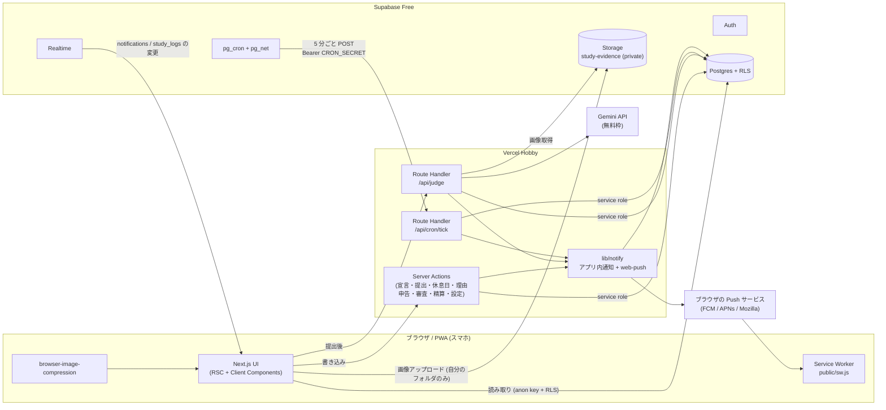
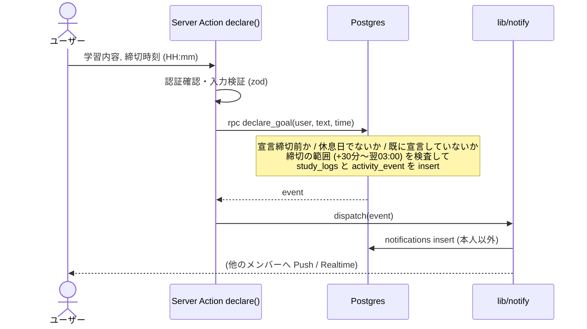
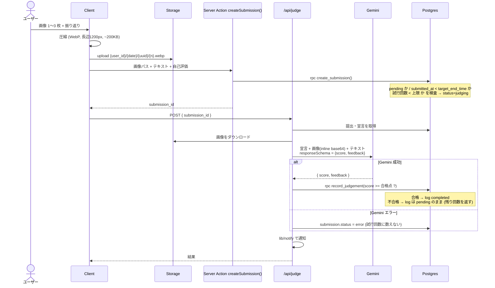
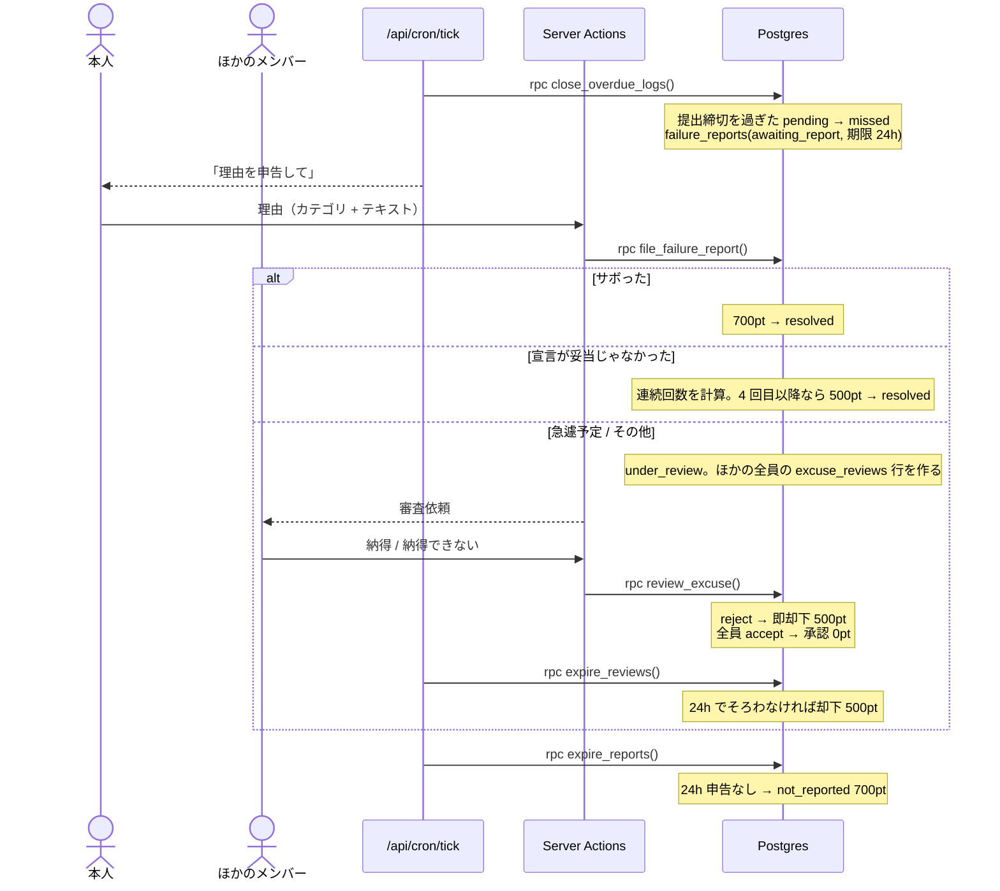
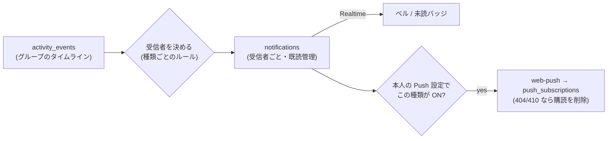

# アーキテクチャ

要件は [requirements.md](requirements.md)、DB は [database.md](database.md)、判断の理由は [decisions.md](decisions.md) を参照。

## 1. 全体構成



### 基本方針
1. **読み取りはクライアントから、書き込みはサーバーから。**
   クライアントは anon key と RLS で自分のグループのデータを読むだけ。状態を変える操作はすべて Server Action / Route Handler を通し、サーバーが service role で書き込む。これでポイントやステータスの改ざんを構造的に防ぐ（例外はプロフィールの表示項目の更新と、自分のフォルダへの画像アップロードだけ）。
2. **時刻の基準は DB の `now()`。** 「今日」は `(now() at time zone 'Asia/Tokyo')::date`。
3. **状態遷移とペナルティは Postgres 関数にまとめる。** 「未達成にする」「理由申告を確定する」「審査を締める」などを、ペナルティの記録・イベントの記録と同じ 1 トランザクションで行い、一意制約で冪等にする。TypeScript 側は関数を呼んで、返ってきたイベントを通知に回すだけ。
4. **通知は「イベント → 通知 → Push」の一方向。** ドメイン操作は `activity_events` に 1 行書く。`lib/notify` がそこから受信者ごとの `notifications` を作り、Push の設定を見て `web-push` で送る。

## 2. 主要フロー

### 2.1 宣言


### 2.2 提出と AI 判定

- 判定は `/api/judge` で同期実行する（Gemini Flash は数秒。Vercel Hobby の関数時間の上限に収まる）。
- `error` の提出は、本人が「再判定」を押すか、次の cron tick が再実行する。

### 2.3 未達成 → 理由申告 → 審査


### 2.4 定期実行 (`/api/cron/tick`)
Supabase の `pg_cron` が 5 分ごとに `pg_net` で `POST /api/cron/tick` を呼ぶ（`Authorization: Bearer <CRON_SECRET>`。シークレットは Supabase Vault に保存）。

tick は以下を順に実行する。各ステップは冪等なので、重複・遅延・取りこぼしがあっても次の tick で回復する。

| # | 処理 | 実体 |
|---|---|---|
| 1 | 判定待ち・エラーの提出を再判定（最大 N 件） | `/api/judge` と同じロジック |
| 2 | 1 日の始まり・11:00 の宣言リマインド | `rpc run_declaration_reminders()` |
| 3 | 12:00 の宣言なしを確定 (P1) | `rpc close_declarations()` |
| 4 | 提出締切超過を未達成にする（判定待ちには 60 分の猶予） | `rpc close_overdue_logs()` |
| 5 | 理由申告の期限切れ (P5) と 3 時間前リマインド | `rpc expire_reports()` |
| 6 | 審査の期限切れ (P4) と 3 時間前リマインド | `rpc expire_reviews()` |
| 7 | 提出締切 1 時間前のリマインド | `rpc due_submit_reminders()` |
| 8 | 月の最終日の精算 | `rpc run_monthly_settlement()` |
| 9 | 保持期間を過ぎた画像を削除 | Storage API |
| 10 | 2〜8 で返ってきたイベントを通知に回す | `lib/notify` |

5 分ごとなので、リマインドは最大 5 分遅れる（「1 日の始まりの瞬間」は 07:00〜07:05 の間に届く）。

> Vercel Hobby の Cron は 1 日 1 回までなので使わない。GitHub Actions を使わない理由は ADR-003。

### 2.5 通知

- `notifications` は Realtime（`postgres_changes`、`recipient_id = 自分` で絞る）でベルに即時反映する。
- Push の本文は短くし、タップで該当ページ（`/logs/{id}` など）を開く。

## 3. 認証とアクセス制御

| 対象 | 方法 |
|---|---|
| セッション | `@supabase/ssr` の Cookie セッション。`src/proxy.ts`（Next.js 16 で middleware から改名）でトークンを更新し、未ログインなら `/login` へ |
| サインアップ | Supabase の公開サインアップは OFF。Server Action が招待コードを検証し、`auth.admin.createUser(email_confirm: true)` で作る。profile はトリガーで自動作成 |
| DB 読み取り | RLS: 認証済みユーザーは全行を読める（ユーザーは全員メンバーなので）。ただし `notifications` と `push_subscriptions` は本人の行だけ |
| DB 書き込み | `authenticated` ロールには `profiles` の表示項目の update だけを許可（列単位の GRANT）。それ以外はサーバーの service role が書く |
| Storage | private バケット。insert は `{auth.uid()}/` 配下だけ、select は認証済みユーザー。表示には署名付き URL を使う |
| cron | `CRON_SECRET` との定数時間比較 |
| Gemini | 提出テキストはデータとして扱うようシステム指示に明記（プロンプトインジェクション対策）。合否は点数からサーバーが決める |

## 4. ディレクトリ構成（予定）

```
.
├── CLAUDE.md / AGENTS.md          # AI エージェント向けの規約
├── README.md
├── docs/                          # 要件・設計・ADR
├── supabase/
│   ├── config.toml
│   ├── migrations/                # スキーマ・RLS・RPC・pg_cron（正本）
│   └── seed.sql
├── public/
│   ├── sw.js                      # Service Worker（push / notificationclick）
│   └── icons/                     # PWA アイコン
└── src/
    ├── proxy.ts                   # セッション更新・認証ガード
    ├── app/
    │   ├── manifest.ts            # PWA manifest
    │   ├── (auth)/login, signup/
    │   ├── (app)/
    │   │   ├── page.tsx           # ダッシュボード
    │   │   ├── declare/           # 宣言
    │   │   ├── submit/            # 提出
    │   │   ├── logs/[id]/         # 学習ログ詳細
    │   │   ├── members/[id]/      # メンバー履歴
    │   │   ├── reports/[logId]/   # 理由申告・審査
    │   │   ├── settlements/       # 月末の精算
    │   │   ├── notifications/     # 通知一覧
    │   │   └── settings/          # プロフィール・Push・グループ設定
    │   └── api/
    │       ├── judge/route.ts
    │       └── cron/tick/route.ts
    ├── components/
    │   └── ui/                    # shadcn/ui
    ├── lib/
    │   ├── supabase/              # client.ts / server.ts / admin.ts / proxy.ts
    │   ├── gemini/                # judge(): プロンプト・スキーマ
    │   ├── notify/                # dispatch(): 受信者ルール・web-push
    │   ├── time.ts                # JST の日付計算
    │   └── env.ts                 # 環境変数の検証 (zod)
    ├── actions/                   # Server Actions
    └── types/database.ts          # supabase gen types で生成
```

## 5. 無料枠の見積もり（6 人想定）

| サービス | 無料枠 | 想定使用量 |
|---|---|---|
| Vercel Hobby | 関数の呼び出し・帯域とも十分 | tick 8,640 回/月 + 画面操作 |
| Supabase DB | 500MB | 数 MB/年 |
| Supabase Storage | 1GB | 保持 60 日で最大 ~600MB |
| Supabase Realtime | 同時接続 200 | 最大 6 人 × 端末数 |
| Supabase Auth | MAU 50,000 | 6 |
| Gemini（Flash 系） | 1 日あたり数百〜1,500 リクエスト（モデルによる） | 最大 ~20 回/日 |
| Web Push | 無料（ブラウザベンダーが提供） | 最大 ~100 通/日 |

注意: Supabase Free は **API アクセスのない状態が 7 日続くとプロジェクトが一時停止**する。毎日使っていれば問題ない。
