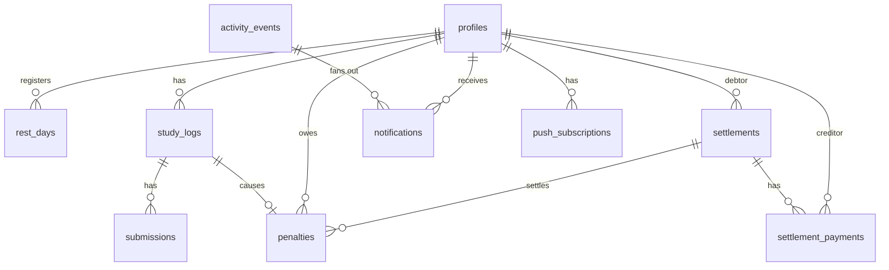

# データベース設計

正本は `supabase/migrations/`。このドキュメントは設計意図をまとめたもので、マイグレーションを変えたらここも更新する。

## 1. ER 図



## 2. テーブル

型の表記は Postgres。`timestamptz` はすべて `default now()`。

### group_settings（1 行だけ）
| 列 | 型 | 既定 | 説明 |
|---|---|---|---|
| id | boolean PK | `true`, `check (id)` | 1 行に固定するためのダミー |
| declaration_cutoff | time | `12:00` | 宣言締切 (JST) |
| rest_days_per_week | int | 1 | 週あたりの休息日上限（月曜始まり） |
| passing_score | int | 70 | 合格点 |
| max_attempts | int | 3 | 1 学習日の最大提出回数 |
| settlement_threshold | int | 3 | 精算が発生するポイント |
| settlement_amount_yen | int | 500 | 精算 1 件で 1 人に払う金額 |
| image_retention_days | int | 60 | 証拠画像の保持日数 |
| judge_grace_minutes | int | 60 | 締切後、判定待ちの提出を待つ時間 |

### profiles
| 列 | 型 | 説明 |
|---|---|---|
| id | uuid PK → auth.users | |
| display_name | text not null | |
| avatar_url | text | |
| paypay_link | text | `https://` で始まるもの |
| is_admin | boolean default false | 最初のユーザーを true にする（トリガー） |
| push_prefs | jsonb default `{}` | 通知の種類ごとの Push ON/OFF。キーがなければ既定値 |
| created_at | timestamptz | |

`auth.users` の insert トリガーで作る（`display_name` は `raw_user_meta_data` から取る）。

### rest_days
| 列 | 型 | 説明 |
|---|---|---|
| user_id | uuid → profiles | PK (user_id, date) |
| date | date | JST の学習日 |
| created_at | timestamptz | |

### study_logs（1 ユーザー × 1 学習日）
| 列 | 型 | 説明 |
|---|---|---|
| id | uuid PK | |
| user_id | uuid → profiles | |
| date | date | JST。**`current_date` を既定値にしない**（UTC になるため）。RPC が決める |
| declaration | text | 宣言なしで失敗した場合は null |
| target_end_time | timestamptz | 同上 |
| status | text | `pending` / `completed` / `failed` |
| fail_reason | text | `no_declaration` / `deadline_missed`（提出なし） / `not_passed`（提出したが不合格） |
| declared_at, completed_at, failed_at | timestamptz | |

制約: `unique (user_id, date)`、`check` で status と fail_reason・declaration の組み合わせを検査。

### submissions（提出 1 回分）
| 列 | 型 | 説明 |
|---|---|---|
| id | uuid PK | |
| study_log_id | uuid → study_logs | |
| user_id | uuid → profiles | 非正規化（RLS と Storage パスの検査用） |
| attempt_no | int | 1 から。`unique (study_log_id, attempt_no)` |
| image_paths | text[] | Storage のパス（URL ではない）。1〜3 件 |
| learned_text, struggled_text | text | |
| self_rating | int | 1〜5 |
| status | text | `judging` / `passed` / `rejected` / `error` |
| ai_score | int | 0〜100 |
| ai_feedback | text | |
| ai_model | text | 判定に使ったモデル ID |
| judge_error | text | |
| submitted_at | timestamptz | **締切判定に使う時刻** |
| judged_at | timestamptz | |

Gemini がエラーのときは同じ提出を `error` → 再判定するので、新しい attempt は使わない。

### penalties（ペナルティ台帳。1 行 = 1pt）
| 列 | 型 | 説明 |
|---|---|---|
| id | uuid PK | |
| user_id | uuid → profiles | |
| study_log_id | uuid → study_logs **unique** | 1 学習日につき最大 1pt（二重ペナルティを DB で防ぐ） |
| reason | text | study_logs.fail_reason と同じ |
| settlement_id | uuid → settlements null | null = 未精算 |
| created_at | timestamptz | |

ポイントは**カウンター列を持たず、台帳から集計する**（ずれない・あとから監査できる）。

### settlements / settlement_payments
| settlements | 型 | 説明 |
|---|---|---|
| id | uuid PK | |
| debtor_id | uuid → profiles | 払う人 |
| amount_per_member_yen | int | 発生時の金額をコピーして保存 |
| status | text | `open` / `completed` |
| created_at, completed_at | timestamptz | |

| settlement_payments | 型 | 説明 |
|---|---|---|
| settlement_id | uuid → settlements | PK (settlement_id, creditor_id) |
| creditor_id | uuid → profiles | 受け取る人（債務者以外の全員。発生時点のメンバー） |
| sent_at | timestamptz | 債務者が「送金した」を押した時刻 |
| confirmed_at | timestamptz | 受取人が「受け取った」を押した時刻 |

全員の `confirmed_at` が埋まったら settlements を `completed` にする（RPC 内）。

### activity_events（グループのタイムライン ＝ 通知の元）
| 列 | 型 | 説明 |
|---|---|---|
| id | uuid PK | |
| type | text | `declared` / `rest_day_registered` / `judged_passed` / `judged_rejected` / `failed` / `reminder_declare` / `reminder_submit` / `settlement_created` / `payment_sent` / `payment_confirmed` / `settlement_completed` |
| actor_id | uuid → profiles | |
| study_log_id, submission_id, settlement_id | uuid null | |
| payload | jsonb | 表示用（スコア・講評・締切時刻など） |
| dedupe_key | text **unique** null | リマインドなどの重複防止（例: `reminder_submit:{user}:{date}`） |
| created_at | timestamptz | |

リマインドは本人にだけ届けるので、タイムラインには出さない（type で除外）。

### notifications（受信者ごと）
| 列 | 型 | 説明 |
|---|---|---|
| id | uuid PK | |
| recipient_id | uuid → profiles | |
| event_id | uuid → activity_events | `unique (recipient_id, event_id)` |
| title, body, url | text | 表示用に作った文言 |
| read_at | timestamptz | |
| pushed_at | timestamptz | Push を送った時刻（送らなければ null） |
| created_at | timestamptz | |

### push_subscriptions
| 列 | 型 | 説明 |
|---|---|---|
| id | uuid PK | |
| user_id | uuid → profiles | |
| endpoint | text **unique** | |
| p256dh, auth | text | |
| user_agent | text | 設定画面で端末を見分けるため |
| created_at, last_success_at | timestamptz | |

### ビュー: penalty_summary
`user_id, display_name, total_points, unsettled_points, open_settlement_count`
ダッシュボードのランキングと「奢り確定」バッジに使う。`security_invoker = true` にする。

## 3. RPC（Postgres 関数）

状態を変える処理はすべてここに置く。`security definer` で、**`service_role` だけに EXECUTE を GRANT** する（Server Action / Route Handler から呼ぶ）。どの関数も、記録した `activity_events` の行を返す。

| 関数 | 処理 |
|---|---|
| `declare_goal(user_id, declaration, end_time_hhmm)` | 今日 (JST)、宣言締切前、休息日でない、未宣言であることを検査。`target_end_time` を「今日 HH:mm、早ければ翌日」に変換して範囲 (+30分〜翌03:00) を検査 → insert |
| `register_rest_day(user_id, date)` / `cancel_rest_day` | 明日以降か、週の上限内か、その日に宣言していないか |
| `create_submission(user_id, paths[], ...)` | pending か、`now() < target_end_time` か、試行回数が上限未満か、パスが `{user_id}/` で始まるか → `judging` で insert |
| `record_judgement(submission_id, score, feedback, model)` | 合格点で合否を決め、合格なら log を `completed` にする |
| `record_judge_error(submission_id, message)` | `error` にする |
| `fail_missing_declarations()` | 宣言締切を過ぎた今日、レコードも休息日もないメンバー → `failed(no_declaration)` + penalty |
| `fail_overdue_logs()` | `pending` で `target_end_time` を過ぎ、締切前の提出で判定待ち・エラーのもの（猶予内）がない → `failed` + penalty |
| `create_due_settlements()` | 未精算 >= しきい値の人ごとに、古い順にしきい値ぶんの penalties を束ねて settlement と payments を作る（何件でも） |
| `mark_payment_sent(debtor_id, settlement_id, creditor_id)` / `confirm_payment(creditor_id, settlement_id)` | 本人確認つき。最後の確認で settlement を完了する |
| `due_reminders()` | 締切 1 時間前のリマインド対象に、`dedupe_key` つきでイベントを作る |

同時実行対策: 失敗確定系は `for update skip locked` で対象行をロックし、penalties の一意制約を最終防衛線にする。

## 4. RLS とアクセス権

| テーブル | authenticated の select | authenticated の書き込み |
|---|---|---|
| group_settings | 全行 | なし（管理者の更新は Server Action が `is_admin` を確認して service role で） |
| profiles | 全行 | update: 本人の行の `display_name, avatar_url, paypay_link, push_prefs` **だけ**（列単位 GRANT） |
| rest_days, study_logs, submissions, penalties, settlements, settlement_payments, activity_events | 全行 | なし |
| notifications | `recipient_id = auth.uid()` | update: 本人の行の `read_at` だけ |
| push_subscriptions | `user_id = auth.uid()` | なし（登録・削除は Server Action） |

`anon` ロールにはどのテーブルも許可しない。

### Storage: `study-evidence`（private）
- insert: `bucket_id = 'study-evidence' and (storage.foldername(name))[1] = auth.uid()::text`
- select: 認証済みユーザー全員（表示は署名付き URL）
- update / delete: なし（削除は cron が service role で行う）
- バケットの制限: `file_size_limit = 1MB`、`allowed_mime_types = {image/webp, image/jpeg, image/png}`

## 5. pg_cron

```sql
-- 5 分ごとに Vercel の tick を呼ぶ（URL とシークレットは Vault から読む）
select cron.schedule('tick', '*/5 * * * *', $$
  select net.http_post(
    url     := (select decrypted_secret from vault.decrypted_secrets where name = 'tick_url'),
    headers := jsonb_build_object(
      'Authorization', 'Bearer ' || (select decrypted_secret from vault.decrypted_secrets where name = 'cron_secret'),
      'Content-Type', 'application/json'),
    body    := '{}'::jsonb,
    timeout_milliseconds := 30000
  );
$$);
```

## 6. Realtime
`notifications`、`study_logs`、`activity_events` を `supabase_realtime` パブリケーションに追加する。RLS が効くので、クライアントには読める行だけが届く。
