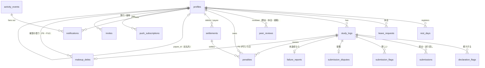

# データベース設計

正本は `supabase/migrations/`。このドキュメントは設計意図をまとめたもので、マイグレーションを変えたらここも更新する。

## 1. ER 図



補習（M11・F8b）の 1 回分は `study_logs` の `is_makeup = true` の行。宣言・合言葉・提出・AI 判定・「怪しい」の仕組みをそのまま使う。

## 2. テーブル

型の表記は Postgres。`timestamptz` はすべて `default now()`。**ポイントは円と同じ単位の整数**（1pt = 1 円）。

### groups（M10・ADR-034）
| 列 | 型 | 説明 |
|---|---|---|
| id | uuid PK | |
| name | text | 1〜40 文字。管理者が変えられる（更新できるのはこの列だけ。削除は禁止） |
| created_by | uuid | 作った人（auth のユーザー id） |
| created_at | timestamptz | |

### app_limits（1 行だけ。アプリ全体の上限）
| 列 | 型 | 既定 | 説明 |
|---|---|---|---|
| max_groups | int | 10 | グループの数の上限 |
| max_total_members | int | 50 | 全グループの合計人数の上限（無料枠を共有するため） |

RLS は有効、GRANT なし。運営者が SQL で変える。

### group_settings（グループごとに 1 行）
| 列 | 型 | 既定 | 説明 |
|---|---|---|---|
| group_id | uuid PK → groups | | どのグループの設定か（M10 で 1 行固定の `id` から変更） |
| declaration_cutoff | time | `12:00` | 宣言締切 (JST) |
| last_declaration_reminder | time | `11:00` | 2 回目の宣言リマインド |
| submit_deadline_max | time | `21:00` | （使わない。ADR-032 で提出締切は翌日の `declaration_cutoff` になった） |
| dispute_cutoff | time | `22:00` | （使わない。ADR-032） |
| resend_cutoff | time | `23:00` | （使わない。ADR-032） |
| report_deadline | time | `23:00` | 理由申告の期限（学習日の翌日のこの時刻） |
| review_deadline | time | `23:59` | 休会の審査の期限（申請した日のこの時刻） |
| report_reminder_times | time[] | `{22:00,22:45}` | 理由申告のリマインド |
| review_reminder_times | time[] | `{22:00,23:00,23:30}` | 審査のリマインド（未回答の人へ） |
| rest_days_per_week | int | 1 | 週あたりの休息日上限（週は日曜〜土曜） |
| passing_score | int | 70 | 合格点 |
| max_attempts | int | 3 | 1 学習日の最大提出回数（送り直しは数えない） |
| judge_grace_minutes | int | 60 | 締切後、判定待ちの提出を待つ時間 |
| flag_window_hours | int | 3 | 宣言から何時間「軽すぎる」を押せるか |
| revision_minutes | int | 60 | 「軽すぎる」から書き直すまでの期限 |
| dispute_window_hours | int | 24 | 合格した提出から何時間「怪しい」を押せるか |
| review_hours | int | 24 | 理由の審査・「怪しい」の最終審査の期限（始まってから） |
| ai_fallback_minutes | int | 30 | AI の判定がないまま、何分たったら仮合格にするか（ADR-033） |
| resend_minutes | int | 1440 | 最初の「怪しい」から証拠を送り直せる時間 |
| penalty_no_declaration | int | 500 | P1 |
| penalty_slacked | int | 700 | P2・P5 |
| penalty_unrealistic_streak | int | 500 | P3 |
| unrealistic_streak_threshold | int | 4 | P3 が始まる連続回数 |
| penalty_excuse_rejected | int | 500 | P4 |
| penalty_unrevised | int | 500 | P6 |
| penalty_late_payment | int | 500 | P7（1 週ごと） |
| penalty_fake_evidence | int | 200 | P8 |
| min_explanation_chars | int | 30 | 次の計画・理由の最小文字数 |
| settlement_weekday | int | 6 | 精算する曜日（0 = 日曜 … 6 = 土曜） |
| settlement_time | time | `23:59` | 精算する時刻（その日の決着のあと） |
| image_retention_days | int | 60 | 証拠画像の保持日数 |
| storage_soft_limit_mb | int | 800 | これを超えたら古い画像から消す |
| max_members | int | 6 | メンバー（抜けた人を除く）の上限。達したら招待の発行も参加もできない |
| invite_minutes | int | 15 | 招待コードの有効時間（分） |
| slack_streak_threshold | int | 3 | P9: サボり（P1・P2・P5・P6）が何回続いたら補習が付くか（M11） |
| makeup_per_streak | int | 1 | P9 で付く補習の回数（0 なら付けない） |
| makeup_per_overdue | int | 1 | P10: 期限切れの週の締めごとに足す回数（0 なら足さない） |
| makeup_hours | int | 24 | 補習を宣言してから提出できる時間 |
| makeup_since | date null | null | **この日以降の学習日だけ** P9 に数える。null のあいだは補習を付けない。管理者が設定の「補習を使う」をオンにすると今日、オフにすると null（`update_group_settings` の `makeup_enabled`。それより前のサボりにさかのぼって付けないため。ADR-040） |

### profiles
| 列 | 型 | 説明 |
|---|---|---|
| id | uuid PK | **メンバーとしての id（1 回の所属ごとに 1 つ）**。記録はすべてこの id を指す。ADR-035 より前に入った人は、アカウントの id と同じ値 |
| auth_user_id | uuid → auth.users | ログインしているアカウント。**有効な所属はアカウントごとに 1 つ**（`deactivated_at is null` の部分一意インデックス） |
| display_name | text not null | |
| avatar_url | text | |
| paypay_link | text | `https://` で始まるもの |
| payee_id | uuid → profiles null | 支払先。**管理者が入力する**（グループで話し合って決める）。`check (payee_id <> id)` |
| group_id | uuid → groups not null | 入っているグループ。**1 人 1 グループ**で、あとから変えない（ADR-034） |
| is_admin | boolean default false | グループを作った人を true にする（`create_group`）。管理者が `set_admin` で増やしたり外したりできる（0 人にはできない） |
| trial_ends_at | timestamptz | お試し期間の終わり = 登録後の最初の日曜 0:00 JST（日曜に登録したら翌週の日曜） |
| notifications_verified_at | timestamptz null | テスト通知を本人が確認した時刻（F0）。null のあいだはアプリを使えない |
| rules_accepted_at | timestamptz null | レクチャー「はじめに」で「このルールで始める」を押した時刻（F15）。null のあいだはアプリを使えない（F0 より手前のゲート）。M12 のマイグレーションで、その時点のメンバーには `created_at` を入れる |
| seen_tips | text[] not null default '{}' | 見たコーチマークのキー（F15）。`'*'` が入っていたら全部見たことにする（M12 の時点のメンバーと、2 回目以降の所属） |
| deactivated_at | timestamptz null | 退会した・外された時刻。行は消さず、記録はこの所属に残る。同じアカウントはあとで別のグループに（同じグループにも）新しい行で入れる |
| left_reason | text null | `left`（自分で退会）/ `removed`（管理者が外した）。`deactivated_at` とそろう |
| removed_by | uuid → profiles null | 外した管理者 |
| created_at | timestamptz | |

Google でログインしただけでは作らない。招待コードを確かめた Server Action が `join_group()` で（招待した人のグループに）、またはグループを作るときに `create_group()` で作る（`display_name`・`avatar_url` は Google の情報を初期値にする）。**profile があり `deactivated_at` が null の人だけがメンバー**で、RLS はこれを `private.is_member()` で判定する。

### invites（招待コード。1 回だけ使える・短命。ADR-026）
| 列 | 型 | 説明 |
|---|---|---|
| id | uuid PK | |
| code_hash | text **unique** | コードを正規化（大文字・区切りなし）した SHA-256（16 進 64 文字）。**コードそのものは保存しない** |
| created_by | uuid → profiles | 発行したメンバー |
| created_at | timestamptz | |
| expires_at | timestamptz | `created_at + invite_minutes`。判定は DB の `now()` |
| used_by | uuid → profiles **unique** null | 使って参加した人 |
| used_at | timestamptz null | `(used_by is null) = (used_at is null)` |
| group_id | uuid → groups | 発行した人のグループ。このコードで入った人はこのグループのメンバーになる |

コードは 10 文字（紛らわしい 0/O・1/I/L を除いた 31 文字、約 49.5 ビット）を Node の `crypto.randomInt` で作る。表示は `K7QM-3XRP-WD`。削除は禁止、更新は `used_by`・`used_at` だけ。

### rest_days
| 列 | 型 | 説明 |
|---|---|---|
| user_id | uuid → profiles | PK (user_id, date) |
| date | date | JST の学習日 |
| created_at | timestamptz | |

### leave_requests（休会）
| 列 | 型 | 説明 |
|---|---|---|
| id | uuid PK | |
| user_id | uuid → profiles | |
| start_date, end_date | date | 長さの上限なし。開始日は申請日の翌日以降 |
| reason | text | 30 字以上 |
| status | text | `under_review` / `approved` / `rejected` / `cancelled` |
| review_due_at | timestamptz | 申請した日の 23:59 |
| approved_at, resolved_at | timestamptz | |
| cancelled_from | date | 途中でやめたとき、この日以降は休会でない |

ある日が休会かどうか = `status = 'approved'` で期間内、`approved_at` がその日の始まり（0:00 JST）より前、`cancelled_from` より前。

### study_logs（1 ユーザー × 1 学習日）
| 列 | 型 | 説明 |
|---|---|---|
| id | uuid PK | |
| user_id | uuid → profiles | |
| date | date | JST。**`current_date` を既定値にしない**（UTC になるため）。RPC が決める |
| status | text | `pending`（進行中） / `passed`（合格・確定待ち。疑義中もここ） / `completed`（達成で確定） / `missed`（未達成） / `no_declaration`（宣言なし。P6 で無効になった宣言も含む） / `invalidated`（証拠不認定, P8） |
| declaration | text | `no_declaration` のときは null |
| target_end_time | timestamptz | 同上。宣言時刻 + 30 分〜当日 21:00 |
| passphrase | text | 今日の合言葉。宣言時に発行し、書き直しても変えない |
| original_declaration | text | 書き直す前の宣言（指摘されたときだけ） |
| revision_due_at | timestamptz | 「軽すぎる」が押されたとき `now() + revision_minutes` |
| revised_at | timestamptz | |
| declared_at | timestamptz | 経過時間の起点 |
| passed_at | timestamptz | AI が合格にした時刻 |
| dispute_window_ends_at | timestamptz | `least(passed_at + dispute_window_hours, 当日の dispute_cutoff)`。過ぎて疑義がなければ `completed` |
| completed_at, missed_at | timestamptz | |
| is_makeup | boolean default false | **補習の 1 回分**（M11・F8b）。学習日ではない。変えない |

制約: 学習日は `(user_id, date) where not is_makeup` で 1 日 1 件、補習は `(user_id, date) where is_makeup` で 1 日 1 件（どちらも部分一意インデックス。M11 で `unique (user_id, date)` から置き換え）。`check` で status と declaration の組み合わせを検査。

**補習の行**: `date` は宣言した日 (JST)、`target_end_time` は宣言から `makeup_hours`。状態は学習日と同じ列を使い、`pending` → `passed`（「怪しい」の受付中）→ `completed`（1 回返した）。うまくいかなかったとき（提出期限切れ・「できなかった」・「軽すぎる」の書き直しなし）は `missed` にするだけで、理由申告もペナルティも付けない（`add_penalty` は補習の行には何もしない）。証拠不認定は `invalidated`（P8 は付けない）。学習日を見る処理（宣言・締め・前の日の片付け・P3 の連続・`daily_history`・週の振り返り）は補習の行を数えない。
公開中の古いコード（ADR-031）は「1 人 1 日 1 行」と思って `study_logs` を日付で読むので、**補習を宣言できる画面は DB の変更と一緒に main へ出す**。借りの記録（`makeup_debts`）と新しい種類のイベントだけなら、古いコードは読まない・通知を作らないだけで壊れない。
「理由申告待ち・審査中」は `failure_reports` が、「疑義あり・最終審査」は `submission_disputes` が持つ。

### declaration_flags（宣言への「軽すぎる」）
| 列 | 型 | 説明 |
|---|---|---|
| study_log_id | uuid → study_logs | PK (study_log_id, flagger_id) |
| flagger_id | uuid → profiles | 本人以外 |
| comment | text not null | |
| created_at | timestamptz | |

最初の 1 件で `study_logs.revision_due_at` が入る。書き直した後は新しい指摘を受け付けない（RPC で検査）。

### submissions（提出 1 回分。「怪しい」のあとの送り直しも同じテーブル）
| 列 | 型 | 説明 |
|---|---|---|
| id | uuid PK | |
| study_log_id | uuid → study_logs | |
| user_id | uuid → profiles | 非正規化（RLS と Storage パスの検査用） |
| kind | text | `regular`（通常の提出） / `resend`（「怪しい」のあとの送り直し） |
| attempt_no | int null | `regular` のときだけ 1 から。`unique (study_log_id, attempt_no)` |
| image_paths | text[] | Storage のパス `{user_id}/{date}/{uuid}.webp`（URL ではない）。1〜3 件。保持期間を過ぎたら空にする |
| thumb_path | text | 1 枚目のサムネイル（長辺 320px）。`{user_id}/{date}/{uuid}_thumb.webp`。**永久に残す** |
| images_purged_at | timestamptz null | 原寸を消した時刻 |
| unverified_at | timestamptz null | AI が判定できず仮合格にした時刻（ADR-033）。点数は null |
| learned_text, struggled_text | text | `regular` で必須 |
| explanation | text | `resend` の説明 |
| self_rating | int | 1〜5（`regular`） |
| status | text | `judging` / `passed` / `rejected` / `error` |
| reject_reason | text null | `no_passphrase`（合言葉なし） / `low_score` |
| ai_score | int | 0〜100 |
| ai_passphrase_found | boolean | |
| ai_feedback | text | |
| ai_model | text | 判定に使ったモデル ID |
| judge_error | text | |
| elapsed_minutes | int | 宣言から提出までの分数（表示用・判定材料） |
| submitted_at | timestamptz | **締切判定に使う時刻** |
| judged_at | timestamptz | |

Gemini がエラーのときは同じ提出を `error` → 再判定するので、新しい attempt は使わない。

### submission_flags（合格した提出への「怪しい」。複数人が押せる）
| 列 | 型 | 説明 |
|---|---|---|
| study_log_id | uuid → study_logs | PK (study_log_id, flagger_id) |
| flagger_id | uuid → profiles | 本人以外 |
| comment | text not null | |
| created_at | timestamptz | `dispute_window_ends_at` より前 |
| withdrawn_at | timestamptz null | 「取り下げる（納得した）」を押した時刻 |

### submission_disputes（疑義。最初の「怪しい」で作る）
| 列 | 型 | 説明 |
|---|---|---|
| study_log_id | uuid PK → study_logs | |
| status | text | `resending`（送り直し受付中） / `final_review`（最終審査） / `upheld`（達成で確定） / `invalidated`（P8） |
| first_flagged_at | timestamptz | |
| resend_due_at | timestamptz | `least(first_flagged_at + resend_minutes, 当日の resend_cutoff)` |
| review_due_at | timestamptz | 学習日の 23:59 |
| resolved_at | timestamptz | |

- `resending` 中に全員の `withdrawn_at` が埋まったら `upheld`。
- `resend_due_at` を過ぎて取り下げがそろっていなければ `final_review` にして `peer_reviews('dispute')` の行を作る。
- 最終審査は `reject`（理由必須）が 1 件でもあれば `invalidated`。全員 `accept` か、期限までに `reject` がなければ `upheld`（ほかの審査と逆なので注意）。

### failure_reports（未達成の理由申告。study_log が `missed` になったときに作る）
| 列 | 型 | 説明 |
|---|---|---|
| study_log_id | uuid PK → study_logs | |
| user_id | uuid → profiles | |
| status | text | `awaiting_report`（申告待ち） / `under_review`（審査中） / `resolved`（確定） |
| category | text null | `unrealistic` / `slacked` / `sudden_plan` / `other` / `not_reported`（期限切れ） |
| reason_text | text | 急遽予定・その他の理由、サボりのひとこと |
| next_plan_text | text | 「宣言が妥当じゃなかった」ときの次の計画（必須） |
| unrealistic_streak | int | `unrealistic` のとき、これを含めて何回連続か（申告時に計算して保存） |
| report_due_at | timestamptz | 学習日の 23:00 |
| reported_at | timestamptz | |
| review_due_at | timestamptz | 学習日の 23:59（審査があるときだけ） |
| outcome | text null | `no_penalty` / `penalized` |
| resolved_at | timestamptz | |

`check` で category と必須テキストの組み合わせ、文字数を検査する。申告後は書き換えない。

### peer_reviews（審査。理由申告・休会・疑義の最終審査で共通）
| 列 | 型 | 説明 |
|---|---|---|
| id | uuid PK | |
| subject_type | text | `excuse`（理由申告） / `leave`（休会） / `dispute`（疑義の最終審査） |
| subject_id | uuid | `excuse`・`dispute` は study_log_id、`leave` は leave_request_id |
| reviewer_id | uuid → profiles | 対象の本人は除く（RPC で検査） |
| verdict | text null | null = まだ押していない / `accept` / `reject` |
| comment | text | `dispute` の `reject` では必須（`check`）。ほかは任意 |
| decided_at | timestamptz | |

`unique (subject_type, subject_id, reviewer_id)`。審査が始まった時点で、休会中でないほかのメンバーぶんの行を作って固定する。
`reject` が 1 行でもあれば即却下。全行 `accept` なら承認。**期限切れのとき**: `excuse`・`leave` は却下、`dispute` は承認（達成で確定）。
`subject_id` は種類によって参照先が変わるので外部キーは張らず、審査を始める RPC が整合を保証する。

### penalties（ペナルティ台帳）
| 列 | 型 | 説明 |
|---|---|---|
| id | uuid PK | |
| user_id | uuid → profiles | |
| study_log_id | uuid → study_logs null | P1〜P6・P8 のとき |
| late_settlement_id | uuid → settlements null | P7 のとき、未払いの精算 |
| dedupe_key | text **unique** not null | `log:{study_log_id}`（1 学習日 1 件）/ `late:{settlement_id}:{締めた日}`（1 週 1 件）。二重ペナルティを DB で防ぐ |
| points | int `check (points > 0)` | = 円 |
| reason | text | `no_declaration` / `unrevised` / `slacked` / `not_reported` / `unrealistic_streak` / `excuse_rejected` / `excuse_expired` / `fake_evidence` / `late_payment` |
| waived | text null | `trial`（お試し期間中。記録だけして精算しない） |
| settlement_id | uuid → settlements null | null = 未精算 |
| created_at | timestamptz | |

ポイントは**カウンター列を持たず、台帳から集計する**（ずれない・あとから監査できる）。お試し期間中も行は作り（「本番なら 〇pt」の表示用）、`waived = 'trial'` の行は精算・ランキングから除く。

### makeup_debts（補習の借り。M11・F8b）
| 列 | 型 | 説明 |
|---|---|---|
| id | uuid PK | |
| user_id | uuid → profiles | |
| reason | text | `slack_streak`（P9: サボりが続いた） / `overdue`（P10: 期限を過ぎた） |
| study_log_id | uuid → study_logs null | P9 が付いた学習日（`slack_streak` のときだけ） |
| period_end | date null | P10 を付けた週の締め日（`overdue` のときだけ） |
| count | int `check (count > 0)` | 借りた回数 |
| waived | text null | `trial`（お試し期間の日の分。記録だけして返さなくていい） |
| due_at | timestamptz | 期限。P9 は付いた週の次の週の締め（`private.makeup_due_after`）、P10 は付けた締めの 1 週後 |
| dedupe_key | text **unique** | `streak:{study_log_id}` / `overdue:{user_id}:{締め日}` |
| created_at | timestamptz | `private.now()`（P10 は締めの時刻） |

**残りの回数は台帳から計算する**（カウンター列を持たない。ADR-005）。`private.makeup_balance(user_id, at)` が、`waived` でない借りの合計から、`at` までに合格した補習（`passed` と `completed`）を**期限の早い借りから順に**引いて、`owed`・`trial_owed`・`completed`・`reviewing`（「怪しい」の受付中）・`open`（宣言中）・`remaining`・`overdue`（期限が `at` 以前で返していない分）・`next_due_at`（返していない借りでいちばん早い期限）を返す。記録の保全のため、更新も削除もできない（トリガー）。

### settlements（毎週の精算。1 人 1 週 1 件）
| 列 | 型 | 説明 |
|---|---|---|
| id | uuid PK | |
| debtor_id | uuid → profiles | 払う人 |
| payee_id | uuid → profiles | 支払先（作成時点の `profiles.payee_id` をコピー） |
| period_end | date | 締めた日（土曜）。`unique (debtor_id, period_end)` |
| amount_yen | int | 束ねた penalties の points の合計 |
| status | text | `open` / `sent`（送金した） / `completed`（受け取った）。「届いていない」で `sent` → `open` |
| created_at, sent_at, completed_at | timestamptz | |

支払先が入力されていない人の精算は作らずに持ち越し、管理者に通知する。

### activity_events（グループのタイムライン ＝ 通知の元）
| 列 | 型 | 説明 |
|---|---|---|
| id | uuid PK | |
| type | text | 下の一覧 |
| actor_id | uuid → profiles | |
| study_log_id, submission_id, settlement_id, leave_request_id | uuid null | |
| payload | jsonb | 表示用（スコア・講評・締切・理由・金額など） |
| dedupe_key | text **unique** null | リマインドなどの重複防止（例: `reminder_review:{log}:{reviewer}:23:30`） |
| created_at | timestamptz | |

type（requirements N1 の表の 1 行 = 1 種類）:
- 宣言: `declared` / `rest_day_registered` / `no_declaration` / `declaration_flagged` / `declaration_revised` / `revision_expired`
- 提出: `submitted` / `judged_passed` / `judged_rejected` / `completion_confirmed`
- 疑義: `submission_flagged` / `evidence_resent` / `flag_withdrawn` / `dispute_final_review_started` / `review_vote_cast` / `dispute_upheld` / `dispute_invalidated`
- 未達成: `missed` / `reported` / `review_requested` / `review_approved` / `review_rejected` / `report_expired`
- 休会: `leave_requested` / `leave_approved` / `leave_rejected` / `leave_ending`
- 振り返り: `weekly_review_created`
- 精算: `payee_assigned` / `settlement_created` / `weekly_summary` / `settlement_sent` / `settlement_completed` / `settlement_not_received` / `late_payment`
- 称号・ランク（M11・ADR-041）: `title_awarded` / `title_removed`（payload に `title`）/ `rank_changed`（`from`・`to`・`up`）/ `crown_moved`（`from`）。`standing_snapshot`（actor なし。その時点の全員のランク・称号・王冠。通知もタイムラインもない、比べるための記録）
- 補習（M11）: `makeup_warning`（サボりが P9 の 1 回手前。直近の日だけ）/ `makeup_assigned`（P9。payload に `count`・`streak`・`waived`・`due_at`）/ `makeup_declared` / `makeup_failed`（payload の `cause` は `gave_up` / `deadline` / `unrevised`）/ `makeup_completed` / `makeup_overdue`（P10）/ `makeup_due`（週の締めで、残りがある人へ）/ `reminder_makeup_due`（期限の 24 時間前）。補習の提出・判定・「軽すぎる」・「怪しい」は学習日と同じ type（`study_log_id` の行の `is_makeup` で見分ける）
- その他: `penalized` / `trial_ending` / `member_joined`（payload に `invited_by`）
- リマインド: `reminder_declare_midnight` / `reminder_declare_last_call` / `reminder_submit` / `reminder_revision_due` / `reminder_resend_due` / `reminder_report_due` / `reminder_review_due` / `reminder_late_payment`

`reminder_*` と `review_vote_cast` は本人（または未回答者）にだけ届けるので、タイムラインには出さない。誰に届けるかは `lib/notify` の受信者ルール（requirements N1 の表）で決める。

### notifications（受信者ごと）
| 列 | 型 | 説明 |
|---|---|---|
| id | uuid PK | |
| recipient_id | uuid → profiles | |
| event_id | uuid → activity_events | `unique (recipient_id, event_id)` |
| title, body, url | text | 表示用に作った文言 |
| requires_action | boolean | 本人の対応が必要か（Push で `requireInteraction` を付ける） |
| read_at | timestamptz | |
| pushed_at | timestamptz | Push を送った時刻 |
| created_at | timestamptz | |

### push_subscriptions
| 列 | 型 | 説明 |
|---|---|---|
| id | uuid PK | |
| user_id | uuid → profiles | |
| endpoint | text **unique** | |
| p256dh, auth | text | |
| user_agent | text | 設定画面で端末を見分けるため |
| verified_at | timestamptz null | この端末でテスト通知を確認した時刻 |
| created_at, last_success_at | timestamptz | |

### weekly_reviews（週の振り返り。土曜 23:59 に 1 人 1 件）
| 列 | 型 | 説明 |
|---|---|---|
| user_id | uuid → profiles | PK (user_id, week_end) |
| week_end | date | 締めた日（土曜） |
| stats | jsonb | 達成数・宣言数・休み・平均点・平均経過時間・ペナルティ合計と内訳・未達成理由の内訳 |
| ai_summary | text | 学んだこと・できなかったことの要約と来週への一言（Gemini）。失敗したら null で、次の tick で作り直す |
| ai_model | text | |
| self_note | text | 本人が書き足す振り返りメモ（あとから追記できる唯一の列） |
| created_at, self_note_updated_at | timestamptz | |

### ビュー: daily_history
1 メンバー × 1 日 = 1 行（登録日から今日まで、`generate_series` で日付を埋める。「今日」は `private.jst_today()`）。カレンダーと統計の元。
`user_id, date, kind (completed / missed / no_declaration / invalidated / pending / rest / leave / none), study_log_id, declaration, final_score, attempts, elapsed_minutes, submitted_hour, penalty_points, trial_points, penalty_reason, failure_category, in_trial`
`pending` は今日か確定待ち、`none` は記録のない日（定期実行が入る前や、締切後に参加した日）。

### ビュー: weekly_stats
1 メンバー × 1 週 = 1 行。G3・G7・G11・G13 の元。
`user_id, week_end（土曜）, counted_days, completed_days, achievement_rate, avg_score, avg_elapsed_minutes, penalty_points, trial_points`
達成率 = 達成 ÷（達成 + 未達成 + 証拠不認定 + 宣言なし）。理由ごとのペナルティ（G7）は画面側で `penalties` から週ごとに集める。

### ビュー: user_stats
**ビューは作らず**、`src/lib/stats.ts`（サーバー側の純粋な関数・テストあり）で `daily_history` から計算する。連続達成日数は休み・休会・進行中・記録なしを飛ばし、未達成・宣言なし・証拠不認定で切れる。

### ビュー: received_objections
本人が受けた指摘・却下の一覧（`declaration_flags`、`submission_flags`、`peer_reviews` の `reject`、AI の不合格）を 1 つの形にそろえたもの: `user_id, occurred_at, kind (too_light / suspicious / excuse_rejected / dispute_rejected / leave_rejected / ai_rejected), by_user_id, reason, study_log_id`。

### ビュー: makeup_summary（M11）
`user_id` と `private.makeup_balance(user_id, now)` の列（`owed, trial_owed, completed, reviewing, open, remaining, overdue, next_due_at`）。有効なメンバーごとに 1 行。ダッシュボードの補習の残り・「逃走者」・補習の画面に使う。`security_invoker = true` で、`makeup_balance` も security definer ではないので、元のテーブルの RLS で読む。

### ビュー: penalty_summary
`user_id, display_name, total_points, unsettled_points, this_week_points, trial_points, open_settlement_id, this_week_trial_points`
ダッシュボードのランキングと「奢り確定」バッジに使う。`waived` の行は `trial_points` にだけ数える。`security_invoker = true` にする。

## 3. RPC（Postgres 関数）

状態を変える処理はすべてここに置く。`security definer` で、**`service_role` だけに EXECUTE を GRANT** する（Server Action / Route Handler から呼ぶ）。どの関数も、記録した `activity_events` の行を返す。

### 共通の関数
| 関数 | 処理 |
|---|---|
| `now()`（private） | ルールが使う現在時刻。ふだんは `now()`。テストのセッションだけ `set app.now = '...'` で固定できる（ADR-029） |
| `jst_today()` | `(private.now() at time zone 'Asia/Tokyo')::date` |
| `day_at(date, time)` | 学習日 + 時刻 → timestamptz (JST)。期限の計算はすべてこれを使う |
| `is_member()` | 呼び出した人がメンバーか（RLS で使う。`authenticated` が実行できる唯一の関数） |
| `create_invite(user_id, code_hash)` | 招待を発行する。発行者がメンバーか、上限人数に達していないかを確かめ、`expires_at = now() + invite_minutes` で insert |
| `join_group(user_id, display_name, avatar_url, invite_hash, bootstrap)` | profile を作る。`bootstrap` なら（Server Action が `INVITE_CODE` と照合済み）グループが空のときだけ通す（`bootstrap_closed`）。それ以外は未使用・期限内の招待を `for update` で取り、profile を作ったあと使用済みにする（`invalid_invite`。違う・期限切れ・使用済みは区別しない）。上限人数なら `group_full`。最初の 1 人を管理者にし、`member_joined` を記録する。advisory lock で同時実行を 1 件ずつにする |
| `active_member_count()` | 抜けた人を除くメンバー数 |
| `add_penalty(user_id, study_log_id, reason, points)` | `dedupe_key` つきで insert。本人がお試し期間中なら `waived = 'trial'` |
| `reviewers_for(user_id)` | 本人以外で、今日休会中でないメンバー |
| `is_on_leave(user_id, date)` / `is_rest_day(user_id, date)` | その日が休会か（その日の 0:00 より前に承認・期間内・`cancelled_from` より前）/ 休息日か |
| `week_start(date)` | その週の日曜（週は日〜土） |
| `require_member(user_id)` | メンバーでなければ `not_a_member` |

### 宣言・休み
| 関数 | 処理 |
|---|---|
| `declare_goal(user_id, declaration, end_time, passphrase)` | 今日 (JST)、宣言締切前、休息日・休会でない、未宣言であることを検査。**前の日が終わっていなければ拒否**（`private.unfinished_day`: まだ `pending` なら `previous_day_open`、未達成で理由が未申告なら `previous_report_due`）。`target_end_time` は **明日の `declaration_cutoff`**（`end_time` は互換のために残して無視。ADR-032）。合言葉はサーバー（`lib/passphrase.ts`）が作って渡す。`declared` を記録 |
| `give_up_day(user_id, study_log_id)` | 「できなかった」。本人の `pending` で判定中の提出がないか検査 → `missed` + `failure_reports(awaiting_report, 期限 = 学習日の翌日の report_deadline)`。`missed`（`gave_up: true`）を記録 |
| `register_rest_day(user_id, date)` / `cancel_rest_day` | 明日以降（60 日先まで）か、週（日〜土）の上限内か、休会と重ならないかを検査（人ごとの advisory lock で同時登録を防ぐ）。取り消しも明日以降の日だけ |
| `request_leave(user_id, start, end, reason)` | 開始日は明日以降、理由は `min_explanation_chars` 以上、自分の休会と重ならないかを検査。審査者（`reviewers_for`）ぶんの `peer_reviews('leave')` を作って固定し、期限は申請した日の `review_deadline`。審査者がいなければその場で承認 |
| `cancel_leave(user_id, leave_request_id)` | 審査中なら取り下げ、承認済みなら明日以降（開始前なら全部）を取り消す（`cancelled_from`） |
| `flag_declaration(flagger_id, study_log_id, comment)` | 本人以外か、今日の `pending` か、宣言から `flag_window_hours` 以内かつ提出締切前か、まだ書き直していないか、同じ人が二度押していないかを検査。最初の指摘なら `revision_due_at` を入れる |
| `revise_declaration(user_id, study_log_id, declaration)` | 本人の書き直し待ちか、期限内か、内容が変わったかを検査。`original_declaration` を残して上書き（1 回だけ） |

### 提出・疑義
| 関数 | 処理 |
|---|---|
| `create_submission(user_id, study_log_id, image_paths[], thumb_path, learned, struggled, self_rating)` | 本人の今日の `pending` か、`now() < target_end_time` か（提出時刻で判定）、判定中の提出がないか、試行回数（`error` を除く）が上限未満か、パスが `{user_id}/{学習日}/{uuid}.webp` の形か（1〜3 枚）を検査 → `regular` / `judging` で insert。経過時間を計算して `submitted` を記録 |
| `record_judgement(submission_id, score, passphrase_found, feedback, model)` | `judging` か `error` の提出だけ。書き直し待ちなら `revision_pending`、`regular` で log が `pending` でなければ `not_open`。合格 = 点数 >= 合格点 かつ 合言葉あり。`regular` の合格なら log を `passed` にして `dispute_window_ends_at = その提出の submitted_at + dispute_window_hours`（24 時間）。`judged_passed` / `judged_rejected`（残り回数つき）を記録 |
| `record_judge_error(submission_id, message)` | `error` にする（試行回数に数えない。あとで判定し直せる） |
| `flag_submission(flagger_id, study_log_id, comment)` | 本人以外か、`passed` で `dispute_window_ends_at` 前か、疑義があれば `resending` で `resend_due_at` 前か、同じ人の二度押しでないかを検査。最初の 1 件なら `submission_disputes(resending, resend_due_at = 今 + resend_minutes)`（24 時間）を作る |
| `resend_evidence(user_id, study_log_id, image_paths[], thumb_path, explanation)` | 本人の `resending` で `resend_due_at` 前か、判定中の提出がないかを検査 → `resend` の提出を作る（回数制限なし。判定は `lib/judging`）。判定が出たら `record_judgement` が `evidence_resent`（点数・合言葉・まだ取り下げていない指摘者）を記録する |
| `withdraw_flag(flagger_id, study_log_id)` | `resending` の間だけ、自分の指摘を取り下げる。全員取り下げたら `upheld` → log を `completed` |
| `advance_disputes()`（定期実行） | 送り直しの 1 時間前のリマインド。`resend_due_at` を過ぎた `resending` → `final_review`（期限は今 + `review_hours`、審査者を `peer_reviews('dispute')` に固定。審査者がいなければ `upheld`）。`review_due_at` を過ぎた `final_review` → `upheld` |
| `cast_review(..., 'dispute', ...)` | 最終審査。却下は理由が必須（`comment_required`）。却下 1 件で `invalidated` + P8、全員が認めたら `upheld` |

### 未達成・審査
| 関数 | 処理 |
|---|---|
| `file_failure_report(user_id, study_log_id, category, text)` | 本人の `awaiting_report` か、期限内か、`slacked` 以外は `min_explanation_chars` 以上かを検査（1 回だけ）。<br>・`unrealistic`: `text` を次の計画にして、`private.unrealistic_streak()` で連続回数を計算 → しきい値以上なら P3、`resolved`<br>・`slacked`: P2、`resolved`（`text` は任意のひとこと）<br>・`sudden_plan` / `other`: `under_review`（期限は申告から `review_hours`）にして、審査者ぶんの `peer_reviews('excuse')` を作る（審査者がいなければその場で承認）。`reported`（と `review_requested`）を記録 |
| `expire_reports()`（定期実行） | `report_due_at` を過ぎた `awaiting_report` → `not_reported` + P5 |
| `cast_review(reviewer_id, subject_type, subject_id, verdict, comment)` | 審査者本人の未回答の行か、期限内か（`dispute` の `reject` は comment 必須）を検査。`reject` なら即却下、全員 `accept` なら承認として、種類ごとの後処理（excuse: penalty の有無 / leave: 休会の成立 / dispute: 達成で確定 or P8）を行う。**`leave`（M4）・`dispute`（M5）・`excuse`（M7）に対応**。`excuse` は却下 1 件で P4、全員納得で 0 円 |

### 精算
| 関数 | 処理 |
|---|---|
| `update_group_settings(admin_id, changes jsonb)` | 管理者だけ。決まったキーだけを受け付け（`makeup_enabled` は true で `makeup_since` を今日に〔すでに入っていればそのまま〕、false で null にする）（`invalid_setting`）、表の制約と 1 日の時刻の順番（リマインド < 宣言締切 < 提出締切の上限 ≤ 「怪しい」 ≤ 送り直し ≤ 審査の期限、理由申告 ≤ 審査の期限）を検査（`invalid_schedule`）。変わった項目だけを `settings_changed` に記録 |
| `assign_payee(admin_id, user_id, payee_id)` | 管理者だけ（`not_admin`）。自分自身・抜けた人は不可（`invalid_payee`）、同じなら `unchanged`。`payee_assigned` で全員に通知 |
| `mark_settlement_sent(debtor_id, settlement_id)` / `confirm_settlement(payee_id, settlement_id)` / `report_not_received(payee_id, settlement_id)` | 本人確認つきで `open` → `sent` → `completed`、「届いていない」は `sent` → `open` |
| `run_weekly_settlement()`（定期実行。tick の最後） | `current_period_end()`（設定の曜日・時刻を過ぎた直近の締め日）について 1 回だけ。① 前の週までの `open` の精算に P7（`late:{settlement}:{締め日}`）② 人ごとに、締め日までの学習日（P7 は作成時刻）の未精算・`waived` でないペナルティを束ねて支払先への精算を作る（支払先が未設定なら作らずに持ち越して `payee_missing` を管理者へ）③ その週に記録があれば `weekly_summary` |
| `late_payment_reminders()`（定期実行） | 次の締めの 24 時間前に、`open` の精算の本人へ |

### 補習（M11・F8b）
| 関数 | 処理 |
|---|---|
| `declare_makeup(user_id, declaration, passphrase)` | まだ始めていない借りがあるか（`remaining - open > 0`、なければ `no_makeup_due`）、今日 (JST) まだ補習を宣言していないか（`makeup_already_today`）を検査。時刻・休息日・休会・前の日の片付けは関係ない。`is_makeup` の `pending` の行を作り、`target_end_time = 今 + makeup_hours`。`makeup_declared` を記録 |
| 提出・判定・「怪しい」 | 学習日と同じ `create_submission` / `record_judgement` / `flag_submission` / `resend_evidence` / `withdraw_flag` / `cast_review('dispute')` を使う。違いは: `flag_declaration` は日付を見ない（夜に宣言しても 3 時間押せる）、`give_up_day`・`close_overdue_logs`・`expire_revisions` は `missed` にして `makeup_failed` を記録するだけ（理由申告・P5・P6 なし）、`confirm_passed_logs` は `makeup_completed` を記録、証拠不認定は P8 なし |

### 称号・ランク（M11・F13・F14・ADR-041）
称号・XP・ランク・王冠は保存せず、アプリ（`src/lib/standing/`）が記録から毎回計算する。DB に残すのは「変わった」ことだけ。
| 関数 | 処理 |
|---|---|
| `record_standings(group_id, previous_id, snapshot, changes)` | tick の Route Handler が、グループごとに今の状態を計算して前の `standing_snapshot` と比べ、違えば呼ぶ。`previous_id` がそのグループの最新のスナップショットでなければ何もしない（古い状態と比べた tick の二重記録を防ぐ。advisory lock で 1 つずつ）。新しい `standing_snapshot` と、変化ごとのイベント（`title_awarded` など 4 種類、そのグループの有効なメンバーの分だけ）を記録して、変化のイベントを返す |

### グループ（M10）
| 関数 | 処理 |
|---|---|
| `create_group(user_id, display_name, avatar_url, group_name)` | まだどのグループにも入っていない人だけ。`app_limits` を確かめて、グループ・その設定の行・管理者の profile を作る。`group_created` を記録 |
| `join_group(user_id, display_name, avatar_url, invite_hash, bootstrap)` | 招待コードを確かめて、発行した人のグループに入れる（グループの上限・アプリ全体の上限を確認）。`bootstrap` はグループが 1 つもないときだけ（最初のグループを作る） |
| `rename_group(admin_id, name)` | 管理者だけ。`group_renamed` を記録 |
| `set_admin(admin_id, user_id, is_admin)` | 管理者だけ。同じグループの人を管理者にする・外す。最後の 1 人は外せない（`last_admin`）。`admin_changed` を記録 |

ほかの RPC は、その人の**グループの設定**（`private.settings_of(user_id)`）で動き、相手が**同じグループ**か（`private.same_group`）を確かめる（「軽すぎる」「怪しい」・支払先・管理者）。審査者はそのグループのほかのメンバー（`reviewers_for`）。時刻で動く定期実行（宣言のリマインドと締切、理由申告・休会のリマインド、精算、週の振り返り、未払いのリマインド）は**グループごとに**その設定の時刻で回す。`activity_events.group_id` は actor のグループを自動で入れ（トリガー）、通知はそのグループのメンバーにだけ届く（`create_notifications` も確かめる）。

### 退会と再参加（ADR-035）
| 関数 | 処理 |
|---|---|
| `leave_group(member_id)` | 自分で退会。精算が全部終わっていて（未完了の精算も、精算に入っていないペナルティもない）、終わっていない日（`pending`・`passed`・理由申告や審査の途中）がなく、ほかにメンバーがいるなら自分以外の管理者がいるときだけ（`leave_unsettled` / `leave_day_open` / `last_admin`） |
| `remove_member(admin_id, member_id)` | 管理者が同じグループのほかの人を外す。お金や終わっていない日があっても外せる（未払いの精算は記録に残るが、P7 はもう付かない） |
| `private.end_membership` | 共通の処理: `deactivated_at`・`left_reason` を入れて管理者を外す。`pending` の日はペナルティなしで `missed`、申告待ちは `no_penalty` で閉じる。その人を支払先にしていた人の支払先を空にして `payee_cleared`（本人と管理者へ）。まだ票を入れていなかった審査は、残りの人の票で決まれば決める（`private.review_tally` は退会した人の未投票を数えない） |

退会した人にはペナルティを付けない（`add_penalty`）。`join_group`・`create_group` の `p_user_id` はアカウントの id で、有効な所属がなければ**新しい profile を作る**。2 回目以降の所属にはお試し期間を付けない（`private.trial_for`）。

### はじめての体験（M12・F15）
| 関数 | 処理 |
|---|---|
| `accept_rules(user_id)` | 本人の `rules_accepted_at` が null なら今の時刻を入れる（入っていれば何もしない。「使い方をもう一度見る」からは呼ばない）。メンバーでなければ `not_a_member` |
| `mark_tip_seen(user_id, tip)` | `seen_tips` にキーを足す（重複させない）。キーは `^[a-z_]{1,40}$`、配列は 100 個まで（`invalid_tip`）。キーの中身（どの画面か）は DB では知らない |
| `reset_tips(user_id)` | 「使い方をもう一度見る」: `seen_tips` を空にする |

2 回目以降の所属（同じアカウントの profile がすでにある人）の `seen_tips` は、profiles の insert のトリガー（`private.returning_member_tips`）が `'{*}'` にする。`rules_accepted_at` はどの所属でも null で作る（グループごとにルールが違うので、入るたびにレクチャーを見る）。

### 定期実行（tick から呼ぶ。すべて冪等）
| 関数 | 処理 |
|---|---|
| `run_declaration_reminders()` | 0:00 と 11:00 を過ぎていて未宣言・休息日でも休会中でもない人に、`dedupe_key` つきでリマインドを作る。前の日が終わっていなければ `previous_open`（`pending` / `missed`）を付ける |
| `close_declarations()` | 12:00 を過ぎた今日、レコードも休息日も休会もないメンバー → `no_declaration` + penalty (P1) |
| `expire_revisions()` | `revision_due_at` を過ぎて書き直していない → `no_declaration` + penalty (P6)。判定待ちの提出は取り消す（M5 で追加）。残り 15 分のリマインドも作る。**M4 で実装済み、定期実行は M6** |
| `due_submit_reminders()` | 提出締切の 1 時間前で、まだ合格していない人にリマインドを作る |
| `pass_unjudged()` | `pending` の日で、通常の提出が `judging` / `error` のまま `ai_fallback_minutes` たったか提出締切が来たら、いちばん早い 1 件を仮合格（`passed` + `unverified_at`、点数なし）にして、log を `passed`（「怪しい」は今から `dispute_window_hours`）。書き直し待ちの日は除く。`judged_unverified` を記録。`close_overdue_logs` より先に動く（ADR-033） |
| `close_overdue_logs()` | `pending` で `target_end_time` を過ぎ、締切前の提出で判定待ち・エラーのもの（猶予内）がない → `missed` + `failure_reports(awaiting_report)` |
| `confirm_passed_logs()` | `passed` で `dispute_window_ends_at` を過ぎ、疑義のないもの → `completed` |
| `advance_disputes()` | `resend_due_at` を過ぎた `resending` → `final_review`（`peer_reviews('dispute')` を作る。期限は `review_hours`）。`review_due_at` を過ぎた `final_review` → `upheld`。送り直しの残り 1 時間のリマインドも作る |
| `expire_reports()` | `report_due_at` を過ぎた `awaiting_report` → `not_reported` + penalty (P5) |
| `expire_reviews()` | `review_due_at` を過ぎた `excuse`・`leave` の審査 → 却下（excuse は P4 `excuse_expired`） |
| `due_deadline_reminders()` | 理由申告は期限の日の `report_reminder_times`、休会の審査は `review_reminder_times`、理由の審査と最終審査は期限の 3 時間前・1 時間前に、未対応の人へリマインドを作る |
| `create_weekly_reviews()` | 土曜 23:59 以降（精算のあと）、その週に記録があれば 1 回だけ。全員の `weekly_reviews` を `stats`（達成・対象日・休み・達成率・平均点・平均時間・ペナルティと理由別・未達成の理由）付きで作り、本人に `weekly_review_created`。`ai_summary` は tick（Route Handler）が Gemini で 1 回 2 件まで埋める |
| `record_weekly_summary(user_id, week_end, summary, model)` | まだ空の `ai_summary` だけを埋める |
| `save_weekly_note(user_id, week_end, note)` | 本人の振り返りメモ（4000 字まで）。あとから何度でも書き換えられる唯一の列 |
| `due_image_purges(limit)` | 原寸の写真を消す対象を古い順に返す: `submitted_at` が `image_retention_days` を過ぎたもの、またはバケットの合計（`storage.objects.metadata.size`）が 800MB を超えているあいだの古いもの。判定中の提出と、まだ決着していない日（`pending`・`passed`）は除く。**tick とは別に** Route Handler が呼ぶ（Storage の削除は Storage API でしかできないため） |
| `mark_images_purged(submission_ids)` | Storage API でファイルを消したあとに、`image_paths` を空にして `images_purged_at` を記録する。`thumb_path` は残す |
| `run_weekly_settlement()` | 土曜 23:59 以降、その週に 1 回だけ。まず前の週までの `open` の精算に P7 を付け、`waived` でない未精算の penalties を人ごとに束ね、`payee_id` へ settlements を作る |
| `award_makeups()` | P9（M11）。`makeup_since` が入っているグループの有効なメンバーごとに、その日以降の学習日を日付順に見て、サボり（`no_declaration`、または `missed` で理由が `slacked` / `not_reported` に決まった日）の連続を数え、`slack_streak_threshold` 回目から 1 日ごとに `makeup_per_streak` 回の借りを作る（`streak:{log}` で 1 日 1 回）。達成した日と、**まだ決着していない日**（`pending`・`passed`・理由申告や審査の途中）で 0 に戻す。決着したら次の tick で数え直すので、決着の順が日付と前後しても、あとの日に P9 が付く。P3・P4・P8・承認された理由の日は数えず、戻しもしない。お試し期間の日はお試しの日だけで数え（本番の日と続けない）、借りは `waived = 'trial'` |
| `close_makeup_week()` | P10（M11）。`run_weekly_settlement` のあと、締めごとに 1 回。締めの時刻の時点で期限が来ていて返していない借り（`overdue > 0`）があれば、`makeup_per_overdue` 回の借りを足す（期限は 1 週後。`overdue:{user}:{締め日}`）。締めの日に休会中ならその週は足さない（期限を延ばす）。そのあと残りがある人に `makeup_due` |
| `due_makeup_reminders()` | 返していない借りのいちばん早い期限の 24 時間前に、本人へ `reminder_makeup_due`（期限ごとに 1 回） |

**P3 の連続回数**: 対象の学習日より前の `study_logs` を `status in ('completed','missed','invalidated')` に絞って日付の新しい順に見て、`missed` かつ `failure_reports.category = 'unrealistic'` が続く数 + 1。`completed`（達成）かほかの理由の未達成で止まる。理由申告待ち・審査中・確定待ちの日があればそこでも止める（確定していないため）。

同時実行対策: 確定系は `for update skip locked` で対象行をロックし、penalties・settlements の一意制約を最終防衛線にする。

### 通知（M3）
| 関数 | 処理 |
|---|---|
| `save_push_subscription(user_id, endpoint, p256dh, auth, user_agent)` | 端末を登録（endpoint で upsert）。同じ人・同じ鍵なら確認済みのまま、別の人に移った・鍵が変わったら `verified_at` を消す。メンバーでなければ `not_a_member`、`https://` 以外は `invalid_endpoint` |
| `confirm_push_subscription(user_id, endpoint)` | テスト通知を本人が確かめた。端末の `verified_at` と `profiles.notifications_verified_at` を記録。本人の端末でなければ `unknown_subscription` |
| `delete_push_subscription(endpoint, user_id?)` | 端末を消す。`user_id` を付けたら本人の端末だけ（自分で解除）、付けなければ Push が 404/410 を返したとき |
| `record_push_success(endpoint)` | `last_success_at` を更新 |
| `create_notifications(event_id, items jsonb)` | `lib/notify` が決めた受信者ごとに通知を作る。抜けたメンバーは飛ばす。`(recipient_id, event_id)` で重複しない。今回作った行だけを返す（再実行で二重に Push しない） |
| `mark_notifications_pushed(ids)` | Push が届いた通知に `pushed_at` を付ける（1 回だけ） |

### 記録の保全（追記だけ）
- 履歴のテーブル（`study_logs`・`declaration_flags`・`submissions`・`submission_flags`・`submission_disputes`・`failure_reports`・`peer_reviews`・`leave_requests`・`penalties`・`settlements`・`activity_events`・`weekly_reviews`・`makeup_debts`）は、**DELETE を禁止**するトリガーを付ける（service role でも不可。直すときはマイグレーションで明示的に外す）。
- UPDATE は**状態と時刻の列だけ**を許すトリガーにする（例: `submissions` は `status`・`ai_*`・`judged_at`・`image_paths`（消すときの空配列）・`images_purged_at` だけ）。宣言・理由・コメントなど人が書いた文字は変えられない。書き直しは `original_declaration` に元を残す。
- 外部キーは `on delete cascade` にしない（profiles を消しても記録が連鎖で消えないように）。

### 検索
`pg_trgm` 拡張を入れ、`study_logs.declaration`・`submissions.learned_text`・`submissions.struggled_text` に GIN の trigram インデックスを張って `ilike '%語%'` で探す（日本語の分かち書きが要らない）。

## 4. RLS とアクセス権

| テーブル | authenticated の select | authenticated の書き込み |
|---|---|---|
| groups | 自分のグループ | なし（名前の変更は `rename_group`） |
| group_settings | 自分のグループの行 | なし（管理者の更新は Server Action が `is_admin` を確認して service role で） |
| profiles | 同じグループの人 | update: 本人の行の `display_name, avatar_url, paypay_link` **だけ**（列単位 GRANT）。`payee_id` は管理者が Server Action 経由で |
| rest_days, leave_requests, study_logs, declaration_flags, submissions, submission_flags, submission_disputes, failure_reports, peer_reviews, penalties, settlements, activity_events, weekly_reviews, makeup_debts | 同じグループの人の行（`private.in_my_group(user_id)`・`log_in_my_group`、`activity_events` は `group_id`） | なし（申告・審査・送金・振り返りメモも Server Action 経由） |
| notifications | `recipient_id = private.my_member()` | update: 本人の行の `read_at` だけ |
| push_subscriptions | `user_id = private.my_member()` | なし（登録・確認・削除は Server Action） |
| penalty_summary・daily_history・weekly_stats・received_objections・makeup_summary（ビュー、`security_invoker`） | 全行（元のテーブルの RLS で） | なし |

関数の EXECUTE は `private.is_member()` に加えて、ビューが「今日」を求めるための `private.now()`・`private.jst_today()` と、`makeup_summary` が使う `private.makeup_balance(uuid, timestamptz)`（security definer ではないので、呼んだ人の RLS で自分のグループの行しか数えない）を `authenticated` に許可する。
| invites | なし（RLS は有効、GRANT なし。サーバーだけが読む） | なし（`create_invite` / `join_group`） |

`anon` ロールにはどのテーブルも許可しない。M10 から、メンバーが読めるのは**自分のグループ**の行だけ（`private.my_group()`）。Google でログインしただけの人は何も読めない。RLS が呼ぶ `private.my_group()`・`in_my_group()`・`log_in_my_group()`・`folder_in_my_group()` は `authenticated` に EXECUTE を許可する（`security definer` で、自分のグループかどうかを返すだけ）。

### Storage: `study-evidence`（private）
- insert: `bucket_id = 'study-evidence' and (storage.foldername(name))[1] = auth.uid()::text and private.is_member()`
- select: 同じグループのメンバー（フォルダ名 = 持ち主のユーザー id で判定。表示は署名付き URL）
- update / delete: なし（削除は cron が service role で行う）
- バケットの制限: `file_size_limit = 1MB`、`allowed_mime_types = {image/webp, image/jpeg, image/png}`

## 5. pg_cron
マイグレーション（`20261017000006_tick.sql`）が `pg_cron` と `pg_net` を有効にして、次のジョブを登録する（PGlite のテストでは拡張が無いので飛ばす）。URL とシークレットは**プロジェクトごとに Vault に入れる**（README の手順）。入っていなければジョブは何もしない。

```sql
-- 5 分ごとに Vercel の tick を呼ぶ（URL とシークレットは Vault から読む）
select cron.schedule('tick', '*/5 * * * *', $$
  select net.http_post(
    url     := (select decrypted_secret from vault.decrypted_secrets where name = 'tick_url'),
    headers := jsonb_build_object(
      'Authorization', 'Bearer ' || (select decrypted_secret from vault.decrypted_secrets where name = 'cron_secret'),
      'Content-Type', 'application/json'),
    body    := '{}'::jsonb,
    timeout_milliseconds := 60000
  )
  where exists (select 1 from vault.decrypted_secrets where name = 'tick_url');
$$);
```

tick の DB 側（すべて `service_role` だけが呼べる）:
| 関数 | 処理 |
|---|---|
| `tick()` | 下の手順と、M4・M5 の `expire_revisions` / `advance_disputes` / `expire_reviews` を順に呼ぶ。`pg_try_advisory_xact_lock` で同時実行を防ぐ |
| `run_declaration_reminders()` | 締切前、まだ宣言していない人（休息日・休会・締切後に参加した人を除く）に 0:00 と 11:00 のリマインド |
| `close_declarations()` | 締切を過ぎたら、宣言していない人に `no_declaration` の log + P1 |
| `due_submit_reminders()` | 提出締切の 1 時間前、まだ合格していない人に |
| `close_overdue_logs()` | 提出締切（翌日 12:00）を過ぎた `pending` を `missed` にして `failure_reports(awaiting_report, 期限 = 学習日の翌日の report_deadline)` を作る。締切前に出した提出が判定待ち・エラーなら `judge_grace_minutes` 待つ |
| `confirm_passed_logs()` | 「怪しい」の受付が終わって疑義のない `passed` → `completed` |
| `due_deadline_reminders()` | 理由申告は期限の日の `report_reminder_times`、休会は `review_reminder_times`、理由・最終審査は期限の 3 時間前・1 時間前 |
| `trial_ending_reminders()` | お試し期間の最終日に本人へ（終わりの日ごとに 1 回。延ばしたらもう一度届く） |

## 6. Realtime
`notifications`、`study_logs`、`submissions`、`submission_flags`、`submission_disputes`、`failure_reports`、`peer_reviews`、`activity_events` を `supabase_realtime` パブリケーションに追加する。RLS が効くので、クライアントには読める行だけが届く。
