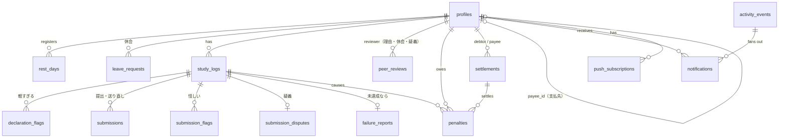

# データベース設計

正本は `supabase/migrations/`。このドキュメントは設計意図をまとめたもので、マイグレーションを変えたらここも更新する。

## 1. ER 図



## 2. テーブル

型の表記は Postgres。`timestamptz` はすべて `default now()`。**ポイントは円と同じ単位の整数**（1pt = 1 円）。

### group_settings（1 行だけ）
| 列 | 型 | 既定 | 説明 |
|---|---|---|---|
| id | boolean PK | `true`, `check (id)` | 1 行に固定するためのダミー |
| declaration_cutoff | time | `12:00` | 宣言締切 (JST)。「次の宣言締切」の基準にもなる |
| last_declaration_reminder | time | `11:00` | 2 回目の宣言リマインド |
| deadline_min_hours | int | 6 | 「次の宣言締切」までの最低時間。足りなければ翌日の 12:00 |
| deadline_reminder_times | time[] | `{08:00,11:00,11:45}` | 「次の宣言締切」が期限のものを、まだ対応していない人へ知らせる時刻 |
| rest_days_per_week | int | 1 | 週あたりの休息日上限（週は日曜〜土曜） |
| passing_score | int | 70 | 合格点 |
| max_attempts | int | 3 | 1 学習日の最大提出回数（送り直しは数えない） |
| judge_grace_minutes | int | 60 | 締切後、判定待ちの提出を待つ時間 |
| flag_window_hours | int | 3 | 宣言から何時間「軽すぎる」を押せるか |
| revision_minutes | int | 60 | 「軽すぎる」から書き直すまでの期限 |
| dispute_window_hours | int | 3 | 合格から何時間「怪しい」を押せるか |
| resend_minutes | int | 60 | 最初の「怪しい」から証拠を送り直せる時間 |
| penalty_no_declaration | int | 500 | P1 |
| penalty_slacked | int | 700 | P2・P5 |
| penalty_unrealistic_streak | int | 500 | P3 |
| unrealistic_streak_threshold | int | 4 | P3 が始まる連続回数 |
| penalty_excuse_rejected | int | 500 | P4 |
| penalty_unrevised | int | 500 | P6 |
| penalty_late_payment | int | 500 | P7（1 週ごと） |
| penalty_fake_evidence | int | 200 | P8 |
| min_explanation_chars | int | 30 | 次の計画・理由の最小文字数 |
| settlement_weekday | int | 6 | 精算する曜日（0 = 日曜 … 6 = 土曜） |
| settlement_time | time | `23:00` | 精算する時刻 |
| image_retention_days | int | 60 | 証拠画像の保持日数 |
| storage_soft_limit_mb | int | 800 | これを超えたら古い画像から消す |

### profiles
| 列 | 型 | 説明 |
|---|---|---|
| id | uuid PK → auth.users | |
| display_name | text not null | |
| avatar_url | text | |
| paypay_link | text | `https://` で始まるもの |
| payee_id | uuid → profiles null | 支払先。**管理者が入力する**（グループで話し合って決める）。`check (payee_id <> id)` |
| is_admin | boolean default false | 最初のユーザーを true にする（トリガー） |
| trial_ends_at | timestamptz | お試し期間の終わり = 登録後の最初の日曜 0:00 JST（日曜に登録したら翌週の日曜） |
| notifications_verified_at | timestamptz null | テスト通知を本人が確認した時刻（F0）。null のあいだはアプリを使えない |
| created_at | timestamptz | |

`auth.users` の insert トリガーで作る（`display_name` は `raw_user_meta_data` から取る）。

### rest_days
| 列 | 型 | 説明 |
|---|---|---|
| user_id | uuid → profiles | PK (user_id, date) |
| date | date | JST の学習日 |
| created_at | timestamptz | |

### leave_requests（休会）
| 列 | 型 | 説明 |
|---|---|---|
| id | uuid PK | |
| user_id | uuid → profiles | |
| start_date, end_date | date | 長さの上限なし。開始日は申請日の翌日以降 |
| reason | text | 30 字以上 |
| status | text | `under_review` / `approved` / `rejected` / `cancelled` |
| review_due_at | timestamptz | 申請時刻の「次の宣言締切」 |
| approved_at, resolved_at | timestamptz | |
| cancelled_from | date | 途中でやめたとき、この日以降は休会でない |

ある日が休会かどうか = `status = 'approved'` で期間内、`approved_at` がその日の始まり（0:00 JST）より前、`cancelled_from` より前。

### study_logs（1 ユーザー × 1 学習日）
| 列 | 型 | 説明 |
|---|---|---|
| id | uuid PK | |
| user_id | uuid → profiles | |
| date | date | JST。**`current_date` を既定値にしない**（UTC になるため）。RPC が決める |
| status | text | `pending`（進行中） / `passed`（合格・確定待ち。疑義中もここ） / `completed`（達成で確定） / `missed`（未達成） / `no_declaration`（宣言なし。P6 で無効になった宣言も含む） / `invalidated`（証拠不認定, P8） |
| declaration | text | `no_declaration` のときは null |
| target_end_time | timestamptz | 同上。宣言時刻 + 30 分〜翌日 12:00 |
| passphrase | text | 今日の合言葉。宣言時に発行し、書き直しても変えない |
| original_declaration | text | 書き直す前の宣言（指摘されたときだけ） |
| revision_due_at | timestamptz | 「軽すぎる」が押されたとき `now() + revision_minutes` |
| revised_at | timestamptz | |
| declared_at | timestamptz | 経過時間の起点 |
| passed_at | timestamptz | AI が合格にした時刻 |
| dispute_window_ends_at | timestamptz | `passed_at + dispute_window_hours`。過ぎて疑義がなければ `completed` |
| completed_at, missed_at | timestamptz | |

制約: `unique (user_id, date)`、`check` で status と declaration の組み合わせを検査。
「理由申告待ち・審査中」は `failure_reports` が、「疑義あり・最終審査」は `submission_disputes` が持つ。

### declaration_flags（宣言への「軽すぎる」）
| 列 | 型 | 説明 |
|---|---|---|
| study_log_id | uuid → study_logs | PK (study_log_id, flagger_id) |
| flagger_id | uuid → profiles | 本人以外 |
| comment | text not null | |
| created_at | timestamptz | |

最初の 1 件で `study_logs.revision_due_at` が入る。書き直した後は新しい指摘を受け付けない（RPC で検査）。

### submissions（提出 1 回分。「怪しい」のあとの送り直しも同じテーブル）
| 列 | 型 | 説明 |
|---|---|---|
| id | uuid PK | |
| study_log_id | uuid → study_logs | |
| user_id | uuid → profiles | 非正規化（RLS と Storage パスの検査用） |
| kind | text | `regular`（通常の提出） / `resend`（「怪しい」のあとの送り直し） |
| attempt_no | int null | `regular` のときだけ 1 から。`unique (study_log_id, attempt_no)` |
| image_paths | text[] | Storage のパス `{user_id}/{date}/{uuid}.webp`（URL ではない）。1〜3 件。保持期間を過ぎたら空にする |
| learned_text, struggled_text | text | `regular` で必須 |
| explanation | text | `resend` の説明 |
| self_rating | int | 1〜5（`regular`） |
| status | text | `judging` / `passed` / `rejected` / `error` |
| reject_reason | text null | `no_passphrase`（合言葉なし） / `low_score` |
| ai_score | int | 0〜100 |
| ai_passphrase_found | boolean | |
| ai_feedback | text | |
| ai_model | text | 判定に使ったモデル ID |
| judge_error | text | |
| elapsed_minutes | int | 宣言から提出までの分数（表示用・判定材料） |
| submitted_at | timestamptz | **締切判定に使う時刻** |
| judged_at | timestamptz | |

Gemini がエラーのときは同じ提出を `error` → 再判定するので、新しい attempt は使わない。

### submission_flags（合格した提出への「怪しい」。複数人が押せる）
| 列 | 型 | 説明 |
|---|---|---|
| study_log_id | uuid → study_logs | PK (study_log_id, flagger_id) |
| flagger_id | uuid → profiles | 本人以外 |
| comment | text not null | |
| created_at | timestamptz | `dispute_window_ends_at` より前 |
| withdrawn_at | timestamptz null | 「取り下げる（納得した）」を押した時刻 |

### submission_disputes（疑義。最初の「怪しい」で作る）
| 列 | 型 | 説明 |
|---|---|---|
| study_log_id | uuid PK → study_logs | |
| status | text | `resending`（送り直し受付中） / `final_review`（最終審査） / `upheld`（達成で確定） / `invalidated`（P8） |
| first_flagged_at | timestamptz | |
| resend_due_at | timestamptz | `first_flagged_at + resend_minutes` |
| review_due_at | timestamptz | 最終審査が始まった時刻の「次の宣言締切」 |
| resolved_at | timestamptz | |

- `resending` 中に全員の `withdrawn_at` が埋まったら `upheld`。
- `resend_due_at` を過ぎて取り下げがそろっていなければ `final_review` にして `peer_reviews('dispute')` の行を作る。
- 最終審査は `reject`（理由必須）が 1 件でもあれば `invalidated`。全員 `accept` か、期限までに `reject` がなければ `upheld`（ほかの審査と逆なので注意）。

### failure_reports（未達成の理由申告。study_log が `missed` になったときに作る）
| 列 | 型 | 説明 |
|---|---|---|
| study_log_id | uuid PK → study_logs | |
| user_id | uuid → profiles | |
| status | text | `awaiting_report`（申告待ち） / `under_review`（審査中） / `resolved`（確定） |
| category | text null | `unrealistic` / `slacked` / `sudden_plan` / `other` / `not_reported`（期限切れ） |
| reason_text | text | 急遽予定・その他の理由、サボりのひとこと |
| next_plan_text | text | 「宣言が妥当じゃなかった」ときの次の計画（必須） |
| unrealistic_streak | int | `unrealistic` のとき、これを含めて何回連続か（申告時に計算して保存） |
| report_due_at | timestamptz | `missed_at` の「次の宣言締切」 |
| reported_at | timestamptz | |
| review_due_at | timestamptz | `reported_at` の「次の宣言締切」（審査があるときだけ） |
| outcome | text null | `no_penalty` / `penalized` |
| resolved_at | timestamptz | |

`check` で category と必須テキストの組み合わせ、文字数を検査する。申告後は書き換えない。

### peer_reviews（審査。理由申告・休会・疑義の最終審査で共通）
| 列 | 型 | 説明 |
|---|---|---|
| id | uuid PK | |
| subject_type | text | `excuse`（理由申告） / `leave`（休会） / `dispute`（疑義の最終審査） |
| subject_id | uuid | `excuse`・`dispute` は study_log_id、`leave` は leave_request_id |
| reviewer_id | uuid → profiles | 対象の本人は除く（RPC で検査） |
| verdict | text null | null = まだ押していない / `accept` / `reject` |
| comment | text | `dispute` の `reject` では必須（`check`）。ほかは任意 |
| decided_at | timestamptz | |

`unique (subject_type, subject_id, reviewer_id)`。審査が始まった時点で、休会中でないほかのメンバーぶんの行を作って固定する。
`reject` が 1 行でもあれば即却下。全行 `accept` なら承認。**期限切れのとき**: `excuse`・`leave` は却下、`dispute` は承認（達成で確定）。
`subject_id` は種類によって参照先が変わるので外部キーは張らず、審査を始める RPC が整合を保証する。

### penalties（ペナルティ台帳）
| 列 | 型 | 説明 |
|---|---|---|
| id | uuid PK | |
| user_id | uuid → profiles | |
| study_log_id | uuid → study_logs null | P1〜P6・P8 のとき |
| late_settlement_id | uuid → settlements null | P7 のとき、未払いの精算 |
| dedupe_key | text **unique** not null | `log:{study_log_id}`（1 学習日 1 件）/ `late:{settlement_id}:{締めた日}`（1 週 1 件）。二重ペナルティを DB で防ぐ |
| points | int `check (points > 0)` | = 円 |
| reason | text | `no_declaration` / `unrevised` / `slacked` / `not_reported` / `unrealistic_streak` / `excuse_rejected` / `excuse_expired` / `fake_evidence` / `late_payment` |
| waived | text null | `trial`（お試し期間中。記録だけして精算しない） |
| settlement_id | uuid → settlements null | null = 未精算 |
| created_at | timestamptz | |

ポイントは**カウンター列を持たず、台帳から集計する**（ずれない・あとから監査できる）。お試し期間中も行は作り（「本番なら 〇pt」の表示用）、`waived = 'trial'` の行は精算・ランキングから除く。

### settlements（毎週の精算。1 人 1 週 1 件）
| 列 | 型 | 説明 |
|---|---|---|
| id | uuid PK | |
| debtor_id | uuid → profiles | 払う人 |
| payee_id | uuid → profiles | 支払先（作成時点の `profiles.payee_id` をコピー） |
| period_end | date | 締めた日（土曜）。`unique (debtor_id, period_end)` |
| amount_yen | int | 束ねた penalties の points の合計 |
| status | text | `open` / `sent`（送金した） / `completed`（受け取った）。「届いていない」で `sent` → `open` |
| created_at, sent_at, completed_at | timestamptz | |

支払先が入力されていない人の精算は作らずに持ち越し、管理者に通知する。

### activity_events（グループのタイムライン ＝ 通知の元）
| 列 | 型 | 説明 |
|---|---|---|
| id | uuid PK | |
| type | text | 下の一覧 |
| actor_id | uuid → profiles | |
| study_log_id, submission_id, settlement_id, leave_request_id | uuid null | |
| payload | jsonb | 表示用（スコア・講評・締切・理由・金額など） |
| dedupe_key | text **unique** null | リマインドなどの重複防止（例: `reminder_review:{log}:{reviewer}:11:45`） |
| created_at | timestamptz | |

type（requirements N1 の表の 1 行 = 1 種類）:
- 宣言: `declared` / `rest_day_registered` / `no_declaration` / `declaration_flagged` / `declaration_revised` / `revision_expired`
- 提出: `submitted` / `judged_passed` / `judged_rejected` / `completion_confirmed`
- 疑義: `submission_flagged` / `evidence_resent` / `flag_withdrawn` / `dispute_final_review_started` / `review_vote_cast` / `dispute_upheld` / `dispute_invalidated`
- 未達成: `missed` / `reported` / `review_requested` / `review_approved` / `review_rejected` / `report_expired`
- 休会: `leave_requested` / `leave_approved` / `leave_rejected` / `leave_ending`
- 精算: `payee_assigned` / `settlement_created` / `weekly_summary` / `settlement_sent` / `settlement_completed` / `settlement_not_received` / `late_payment`
- その他: `penalized` / `trial_ending`
- リマインド: `reminder_declare_midnight` / `reminder_declare_last_call` / `reminder_submit` / `reminder_revision_due` / `reminder_resend_due` / `reminder_report_due` / `reminder_review_due` / `reminder_late_payment`

`reminder_*` と `review_vote_cast` は本人（または未回答者）にだけ届けるので、タイムラインには出さない。誰に届けるかは `lib/notify` の受信者ルール（requirements N1 の表）で決める。

### notifications（受信者ごと）
| 列 | 型 | 説明 |
|---|---|---|
| id | uuid PK | |
| recipient_id | uuid → profiles | |
| event_id | uuid → activity_events | `unique (recipient_id, event_id)` |
| title, body, url | text | 表示用に作った文言 |
| requires_action | boolean | 本人の対応が必要か（Push で `requireInteraction` を付ける） |
| read_at | timestamptz | |
| pushed_at | timestamptz | Push を送った時刻 |
| created_at | timestamptz | |

### push_subscriptions
| 列 | 型 | 説明 |
|---|---|---|
| id | uuid PK | |
| user_id | uuid → profiles | |
| endpoint | text **unique** | |
| p256dh, auth | text | |
| user_agent | text | 設定画面で端末を見分けるため |
| verified_at | timestamptz null | この端末でテスト通知を確認した時刻 |
| created_at, last_success_at | timestamptz | |

### ビュー: penalty_summary
`user_id, display_name, total_points, unsettled_points, this_week_points, trial_points, open_settlement_id`
ダッシュボードのランキングと「奢り確定」バッジに使う。`waived` の行は `trial_points` にだけ数える。`security_invoker = true` にする。

## 3. RPC（Postgres 関数）

状態を変える処理はすべてここに置く。`security definer` で、**`service_role` だけに EXECUTE を GRANT** する（Server Action / Route Handler から呼ぶ）。どの関数も、記録した `activity_events` の行を返す。

### 共通の関数
| 関数 | 処理 |
|---|---|
| `jst_today()` | `(now() at time zone 'Asia/Tokyo')::date` |
| `next_deadline(ts)` | `ts` のあとに来る最初の宣言締切 (12:00 JST)。残りが `deadline_min_hours` 未満なら翌日の 12:00 |
| `add_penalty(user_id, study_log_id, reason, points)` | `dedupe_key` つきで insert。本人がお試し期間中なら `waived = 'trial'` |
| `reviewers_for(user_id)` | 本人以外で、今日休会中でないメンバー |

### 宣言・休み
| 関数 | 処理 |
|---|---|
| `declare_goal(user_id, declaration, end_time_hhmm)` | 今日 (JST)、宣言締切前、休息日・休会でない、未宣言であることを検査。`target_end_time` を「今日 HH:mm、早ければ翌日」に変換して範囲（+30 分〜翌日 12:00）を検査。合言葉を発行して insert |
| `register_rest_day(user_id, date)` / `cancel_rest_day` | 明日以降か、週の上限内か、その日に宣言していないか |
| `request_leave(user_id, start, end, reason)` / `cancel_leave(...)` | 休会の申請と取り消し。審査は `cast_review('leave', ...)` |
| `flag_declaration(flagger_id, study_log_id, comment)` | 本人以外か、宣言から `flag_window_hours` 以内かつ提出締切前か、まだ書き直していないかを検査。最初の指摘なら `revision_due_at` を入れる |
| `revise_declaration(user_id, study_log_id, declaration)` | 本人の書き直し待ちか、期限内かを検査。`original_declaration` を残して上書き |

### 提出・疑義
| 関数 | 処理 |
|---|---|
| `create_submission(user_id, study_log_id, paths[], ...)` | `pending` か、`now() < target_end_time` か、試行回数が上限未満か、パスが `{user_id}/` で始まるかを検査 → `regular` / `judging` で insert。経過時間を計算 |
| `record_judgement(submission_id, score, passphrase_found, feedback, model)` | 合格 = 点数 >= 合格点 かつ 合言葉あり。`regular` の合格なら log を `passed` にして `dispute_window_ends_at` を入れる |
| `record_judge_error(submission_id, message)` | `error` にする |
| `flag_submission(flagger_id, study_log_id, comment)` | 本人以外か、`passed` で `dispute_window_ends_at` 前か、`final_review` に入っていないかを検査。最初の 1 件なら `submission_disputes(resending)` を作る |
| `resend_evidence(user_id, study_log_id, paths[], explanation)` | 本人の `resending` で `resend_due_at` 前か → `resend` の提出を作る（回数制限なし。判定は `/api/judge`） |
| `withdraw_flag(flagger_id, study_log_id)` | 自分の指摘を取り下げる。全員取り下げたら `upheld` → log を `completed` |

### 未達成・審査
| 関数 | 処理 |
|---|---|
| `file_failure_report(user_id, study_log_id, category, reason, next_plan)` | 本人の `awaiting_report` か、期限内か、必須テキストと文字数を検査。<br>・`unrealistic`: 連続回数を計算 → しきい値以上なら penalty、`resolved`<br>・`slacked`: penalty、`resolved`<br>・`sudden_plan` / `other`: `under_review` にして、`peer_reviews('excuse')` の行を作る |
| `cast_review(reviewer_id, subject_type, subject_id, verdict, comment)` | 審査者本人の未回答の行か、期限内か（`dispute` の `reject` は comment 必須）を検査。`reject` なら即却下、全員 `accept` なら承認として、種類ごとの後処理（excuse: penalty の有無 / leave: 休会の成立 / dispute: 達成で確定 or P8）を行う |

### 精算
| 関数 | 処理 |
|---|---|
| `assign_payee(admin_id, user_id, payee_id)` | 管理者だけ。支払先を設定して全員に通知 |
| `mark_settlement_sent(debtor_id, settlement_id)` / `confirm_settlement(payee_id, settlement_id)` / `report_not_received(payee_id, settlement_id)` | 本人確認つきで状態を進める・戻す |

### 定期実行（tick から呼ぶ。すべて冪等）
| 関数 | 処理 |
|---|---|
| `run_declaration_reminders()` | 0:00 と 11:00 を過ぎていて未宣言・休息日でも休会中でもない人に、`dedupe_key` つきでリマインドを作る |
| `close_declarations()` | 12:00 を過ぎた今日、レコードも休息日も休会もないメンバー → `no_declaration` + penalty (P1) |
| `expire_revisions()` | `revision_due_at` を過ぎて書き直していない → `no_declaration` + penalty (P6)。判定待ちの提出は取り消す。残り 15 分のリマインドも作る |
| `due_submit_reminders()` | 提出締切の 1 時間前で、まだ合格していない人にリマインドを作る |
| `close_overdue_logs()` | `pending` で `target_end_time` を過ぎ、締切前の提出で判定待ち・エラーのもの（猶予内）がない → `missed` + `failure_reports(awaiting_report)` |
| `confirm_passed_logs()` | `passed` で `dispute_window_ends_at` を過ぎ、疑義のないもの → `completed` |
| `advance_disputes()` | `resend_due_at` を過ぎた `resending` → `final_review`（`peer_reviews('dispute')` を作る）。`review_due_at` を過ぎた `final_review` → `upheld`。送り直しの残り 15 分のリマインドも作る |
| `expire_reports()` | `report_due_at` を過ぎた `awaiting_report` → `not_reported` + penalty (P5) |
| `expire_reviews()` | `review_due_at` を過ぎた `excuse`・`leave` の審査 → 却下（excuse は penalty） |
| `due_deadline_reminders()` | `deadline_reminder_times`（8:00・11:00・11:45）に、期限が「次の宣言締切」のもの（理由申告・審査・最終審査）で未対応の人へリマインドを作る |
| `run_weekly_settlement()` | 土曜 23:00 以降、その週に 1 回だけ。まず前の週までの `open` の精算に P7 を付け、`waived` でない未精算の penalties を人ごとに束ね、`payee_id` へ settlements を作る |

**P3 の連続回数**: 対象の学習日より前の `study_logs` を `status in ('completed','missed','invalidated')` に絞って日付の新しい順に見て、`missed` かつ `failure_reports.category = 'unrealistic'` が続く数 + 1。`completed`（達成）かほかの理由の未達成で止まる。理由申告待ち・審査中・確定待ちの日があればそこでも止める（確定していないため）。

同時実行対策: 確定系は `for update skip locked` で対象行をロックし、penalties・settlements の一意制約を最終防衛線にする。

## 4. RLS とアクセス権

| テーブル | authenticated の select | authenticated の書き込み |
|---|---|---|
| group_settings | 全行 | なし（管理者の更新は Server Action が `is_admin` を確認して service role で） |
| profiles | 全行 | update: 本人の行の `display_name, avatar_url, paypay_link` **だけ**（列単位 GRANT）。`payee_id` は管理者が Server Action 経由で |
| rest_days, leave_requests, study_logs, declaration_flags, submissions, submission_flags, submission_disputes, failure_reports, peer_reviews, penalties, settlements, activity_events | 全行 | なし（申告・審査・送金の記録も Server Action 経由） |
| notifications | `recipient_id = auth.uid()` | update: 本人の行の `read_at` だけ |
| push_subscriptions | `user_id = auth.uid()` | なし（登録・確認・削除は Server Action） |

`anon` ロールにはどのテーブルも許可しない。

### Storage: `study-evidence`（private）
- insert: `bucket_id = 'study-evidence' and (storage.foldername(name))[1] = auth.uid()::text`
- select: 認証済みユーザー全員（表示は署名付き URL）
- update / delete: なし（削除は cron が service role で行う）
- バケットの制限: `file_size_limit = 1MB`、`allowed_mime_types = {image/webp, image/jpeg, image/png}`

## 5. pg_cron

```sql
-- 5 分ごとに Vercel の tick を呼ぶ（URL とシークレットは Vault から読む）
select cron.schedule('tick', '*/5 * * * *', $$
  select net.http_post(
    url     := (select decrypted_secret from vault.decrypted_secrets where name = 'tick_url'),
    headers := jsonb_build_object(
      'Authorization', 'Bearer ' || (select decrypted_secret from vault.decrypted_secrets where name = 'cron_secret'),
      'Content-Type', 'application/json'),
    body    := '{}'::jsonb,
    timeout_milliseconds := 30000
  );
$$);
```

## 6. Realtime
`notifications`、`study_logs`、`submissions`、`submission_flags`、`submission_disputes`、`failure_reports`、`peer_reviews`、`activity_events` を `supabase_realtime` パブリケーションに追加する。RLS が効くので、クライアントには読める行だけが届く。
