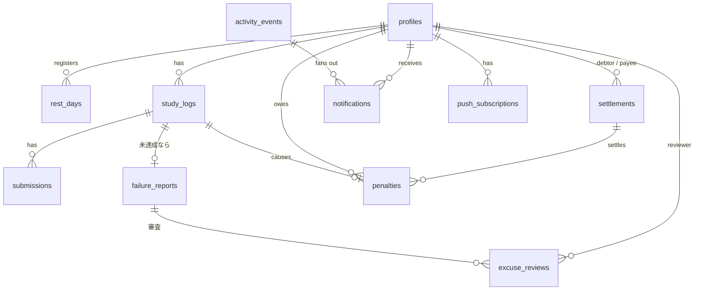

# データベース設計

正本は `supabase/migrations/`。このドキュメントは設計意図をまとめたもので、マイグレーションを変えたらここも更新する。

## 1. ER 図



## 2. テーブル

型の表記は Postgres。`timestamptz` はすべて `default now()`。**ポイントは円と同じ単位の整数**（1pt = 1 円）。

### group_settings（1 行だけ）
| 列 | 型 | 既定 | 説明 |
|---|---|---|---|
| id | boolean PK | `true`, `check (id)` | 1 行に固定するためのダミー |
| declaration_cutoff | time | `12:00` | 宣言締切 (JST) |
| last_declaration_reminder | time | `11:00` | 2 回目の宣言リマインド |
| rest_days_per_week | int | 1 | 週あたりの休息日上限（月曜始まり） |
| passing_score | int | 70 | 合格点 |
| max_attempts | int | 3 | 1 学習日の最大提出回数 |
| judge_grace_minutes | int | 60 | 締切後、判定待ちの提出を待つ時間 |
| penalty_no_declaration | int | 500 | P1 |
| penalty_slacked | int | 700 | P2・P5 |
| penalty_unrealistic_streak | int | 500 | P3 |
| unrealistic_streak_threshold | int | 4 | P3 が始まる連続回数 |
| penalty_excuse_rejected | int | 500 | P4 |
| report_hours | int | 24 | 理由申告の期限 |
| review_hours | int | 24 | 審査の期限 |
| min_explanation_chars | int | 30 | 次の計画・理由の最小文字数 |
| settlement_time | time | `09:00` | 月の最終日に精算を作る時刻 |
| image_retention_days | int | 60 | 証拠画像の保持日数 |

### profiles
| 列 | 型 | 説明 |
|---|---|---|
| id | uuid PK → auth.users | |
| display_name | text not null | |
| avatar_url | text | |
| paypay_link | text | `https://` で始まるもの |
| day_start_time | time default `07:00` | 1 日の始まり。宣言リマインドの時刻 |
| payee_id | uuid → profiles null | 支払先。`check (payee_id <> id)`。null ならランダム |
| is_admin | boolean default false | 最初のユーザーを true にする（トリガー） |
| push_prefs | jsonb default `{}` | 通知の種類ごとの Push ON/OFF。キーがなければ既定値 |
| created_at | timestamptz | |

`auth.users` の insert トリガーで作る（`display_name` は `raw_user_meta_data` から取る）。

### rest_days
| 列 | 型 | 説明 |
|---|---|---|
| user_id | uuid → profiles | PK (user_id, date) |
| date | date | JST の学習日 |
| created_at | timestamptz | |

### study_logs（1 ユーザー × 1 学習日）
| 列 | 型 | 説明 |
|---|---|---|
| id | uuid PK | |
| user_id | uuid → profiles | |
| date | date | JST。**`current_date` を既定値にしない**（UTC になるため）。RPC が決める |
| status | text | `pending`（進行中） / `completed`（達成） / `missed`（未達成） / `no_declaration`（宣言なし） |
| declaration | text | `no_declaration` のときは null |
| target_end_time | timestamptz | 同上 |
| declared_at, completed_at, missed_at | timestamptz | |

制約: `unique (user_id, date)`、`check` で status と declaration の組み合わせを検査。
「理由申告待ち・審査中」などの細かい状態は `failure_reports` が持つ。

### submissions（提出 1 回分）
| 列 | 型 | 説明 |
|---|---|---|
| id | uuid PK | |
| study_log_id | uuid → study_logs | |
| user_id | uuid → profiles | 非正規化（RLS と Storage パスの検査用） |
| attempt_no | int | 1 から。`unique (study_log_id, attempt_no)` |
| image_paths | text[] | Storage のパス（URL ではない）。1〜3 件 |
| learned_text, struggled_text | text | |
| self_rating | int | 1〜5 |
| status | text | `judging` / `passed` / `rejected` / `error` |
| ai_score | int | 0〜100 |
| ai_feedback | text | |
| ai_model | text | 判定に使ったモデル ID |
| judge_error | text | |
| submitted_at | timestamptz | **締切判定に使う時刻** |
| judged_at | timestamptz | |

Gemini がエラーのときは同じ提出を `error` → 再判定するので、新しい attempt は使わない。

### failure_reports（未達成の理由申告。study_log が `missed` になったときに作る）
| 列 | 型 | 説明 |
|---|---|---|
| study_log_id | uuid PK → study_logs | |
| user_id | uuid → profiles | |
| status | text | `awaiting_report`（申告待ち） / `under_review`（審査中） / `resolved`（確定） |
| category | text null | `unrealistic` / `slacked` / `sudden_plan` / `other` / `not_reported`（期限切れ） |
| reason_text | text | 急遽予定・その他の理由、サボりのひとこと |
| next_plan_text | text | 「宣言が妥当じゃなかった」ときの次の計画（必須） |
| unrealistic_streak | int | `unrealistic` のとき、これを含めて何回連続か（申告時に計算して保存） |
| report_due_at | timestamptz | `missed_at + report_hours` |
| reported_at | timestamptz | |
| review_due_at | timestamptz | `reported_at + review_hours`（審査があるときだけ） |
| outcome | text null | `no_penalty` / `penalized` |
| resolved_at | timestamptz | |

`check` で category と必須テキストの組み合わせ、文字数を検査する。申告後は書き換えない。

### excuse_reviews（審査。申告した時点のメンバーぶんの行を、申告と同時に作る）
| 列 | 型 | 説明 |
|---|---|---|
| study_log_id | uuid → failure_reports | PK (study_log_id, reviewer_id) |
| reviewer_id | uuid → profiles | `check` で申告者本人を除く（RPC で検査） |
| verdict | text null | null = まだ押していない / `accept` / `reject` |
| comment | text | 任意 |
| decided_at | timestamptz | |

全行が `accept` → 承認。`reject` が 1 行でもあれば即却下。`review_due_at` を過ぎて null が残っていれば却下。

### penalties（ペナルティ台帳）
| 列 | 型 | 説明 |
|---|---|---|
| id | uuid PK | |
| user_id | uuid → profiles | |
| study_log_id | uuid → study_logs **unique** | 1 学習日につき最大 1 件（二重ペナルティを DB で防ぐ） |
| points | int `check (points > 0)` | = 円 |
| reason | text | `no_declaration` / `slacked` / `not_reported` / `unrealistic_streak` / `excuse_rejected` / `excuse_expired` |
| settlement_id | uuid → settlements null | null = 未精算 |
| created_at | timestamptz | |

ポイントは**カウンター列を持たず、台帳から集計する**（ずれない・あとから監査できる）。

### settlements（月末の精算。1 人 1 か月 1 件）
| 列 | 型 | 説明 |
|---|---|---|
| id | uuid PK | |
| debtor_id | uuid → profiles | 払う人 |
| payee_id | uuid → profiles | 支払先 |
| payee_selection | text | `preset`（本人が決めていた） / `random` |
| month | date | 対象月の 1 日。`unique (debtor_id, month)` |
| amount_yen | int | 束ねた penalties の points の合計 |
| status | text | `open` / `sent`（送金した） / `completed`（受け取った） |
| created_at, sent_at, completed_at | timestamptz | |

### activity_events（グループのタイムライン ＝ 通知の元）
| 列 | 型 | 説明 |
|---|---|---|
| id | uuid PK | |
| type | text | 下の一覧 |
| actor_id | uuid → profiles | |
| study_log_id, submission_id, settlement_id | uuid null | |
| payload | jsonb | 表示用（スコア・講評・締切・理由・金額など） |
| dedupe_key | text **unique** null | リマインドなどの重複防止（例: `reminder_day_start:{user}:{date}`） |
| created_at | timestamptz | |

type: `declared` / `rest_day_registered` / `judged_passed` / `judged_rejected` / `no_declaration` / `missed` / `reported` / `review_requested` / `review_approved` / `review_rejected` / `penalized` / `settlement_created` / `settlement_sent` / `settlement_completed` / `reminder_day_start` / `reminder_last_call` / `reminder_submit` / `reminder_report_due` / `reminder_review_due`

`reminder_*` は本人（または未回答者）にだけ届けるので、タイムラインには出さない。

### notifications（受信者ごと）
| 列 | 型 | 説明 |
|---|---|---|
| id | uuid PK | |
| recipient_id | uuid → profiles | |
| event_id | uuid → activity_events | `unique (recipient_id, event_id)` |
| title, body, url | text | 表示用に作った文言 |
| read_at | timestamptz | |
| pushed_at | timestamptz | Push を送った時刻（送らなければ null） |
| created_at | timestamptz | |

### push_subscriptions
| 列 | 型 | 説明 |
|---|---|---|
| id | uuid PK | |
| user_id | uuid → profiles | |
| endpoint | text **unique** | |
| p256dh, auth | text | |
| user_agent | text | 設定画面で端末を見分けるため |
| created_at, last_success_at | timestamptz | |

### ビュー: penalty_summary
`user_id, display_name, total_points, unsettled_points, this_month_points, open_settlement_id`
ダッシュボードのランキングと「奢り確定」バッジに使う。`security_invoker = true` にする。

## 3. RPC（Postgres 関数）

状態を変える処理はすべてここに置く。`security definer` で、**`service_role` だけに EXECUTE を GRANT** する（Server Action / Route Handler から呼ぶ）。どの関数も、記録した `activity_events` の行を返す。

| 関数 | 処理 |
|---|---|
| `declare_goal(user_id, declaration, end_time_hhmm)` | 今日 (JST)、宣言締切前、休息日でない、未宣言であることを検査。`target_end_time` を「今日 HH:mm、早ければ翌日」に変換して範囲 (+30分〜翌03:00) を検査 → insert |
| `register_rest_day(user_id, date)` / `cancel_rest_day` | 明日以降か、週の上限内か、その日に宣言していないか |
| `create_submission(user_id, paths[], ...)` | pending か、`now() < target_end_time` か、試行回数が上限未満か、パスが `{user_id}/` で始まるか → `judging` で insert |
| `record_judgement(submission_id, score, feedback, model)` | 合格点で合否を決め、合格なら log を `completed` にする |
| `record_judge_error(submission_id, message)` | `error` にする |
| `file_failure_report(user_id, study_log_id, category, reason, next_plan)` | 本人の `awaiting_report` か、期限内か、必須テキストと文字数を検査。<br>・`unrealistic`: 連続回数を計算 → しきい値以上なら penalty、`resolved`<br>・`slacked`: penalty、`resolved`<br>・`sudden_plan` / `other`: `under_review` にして、ほかのメンバー全員の `excuse_reviews` 行を作る |
| `review_excuse(reviewer_id, study_log_id, verdict, comment)` | 審査者本人の未回答の行か、期限内かを検査。`reject` なら即却下 + penalty。全員 `accept` なら承認 |
| `run_declaration_reminders()` | 各自の `day_start_time` と 11:00 を過ぎていて未宣言・休息日でない人に、`dedupe_key` つきでリマインドを作る |
| `due_submit_reminders()` | 提出締切の 1 時間前で、まだ合格していない人にリマインドを作る |
| `close_declarations()` | 12:00 を過ぎた今日、レコードも休息日もないメンバー → `no_declaration` + penalty (P1) |
| `close_overdue_logs()` | `pending` で `target_end_time` を過ぎ、締切前の提出で判定待ち・エラーのもの（猶予内）がない → `missed` + `failure_reports(awaiting_report)` |
| `expire_reports()` | `report_due_at` を過ぎた `awaiting_report` → `not_reported` + penalty (P5)。締切 3 時間前のリマインドもここで作る |
| `expire_reviews()` | `review_due_at` を過ぎた `under_review` → 却下 + penalty。締切 3 時間前のリマインドもここで作る |
| `run_monthly_settlement()` | 月の最終日の `settlement_time` 以降に 1 回だけ。未精算の penalties を人ごとに束ね、支払先（`payee_id`、なければランダム）を決めて settlements を作る |
| `mark_settlement_sent(debtor_id, settlement_id)` / `confirm_settlement(payee_id, settlement_id)` | 本人確認つきで状態を進める |

**P3 の連続回数**: 対象の学習日より前の `study_logs` を `status in ('completed','missed')` に絞って日付の新しい順に見て、`missed` かつ `failure_reports.category = 'unrealistic'` が続く数 + 1。`completed` かほかの理由で止まる。理由申告待ち・審査中の日があればそこでも止める（確定していないため）。

同時実行対策: 確定系は `for update skip locked` で対象行をロックし、penalties・settlements の一意制約を最終防衛線にする。

## 4. RLS とアクセス権

| テーブル | authenticated の select | authenticated の書き込み |
|---|---|---|
| group_settings | 全行 | なし（管理者の更新は Server Action が `is_admin` を確認して service role で） |
| profiles | 全行 | update: 本人の行の `display_name, avatar_url, paypay_link, day_start_time, payee_id, push_prefs` **だけ**（列単位 GRANT） |
| rest_days, study_logs, submissions, failure_reports, excuse_reviews, penalties, settlements, activity_events | 全行 | なし（申告・審査・送金の記録も Server Action 経由） |
| notifications | `recipient_id = auth.uid()` | update: 本人の行の `read_at` だけ |
| push_subscriptions | `user_id = auth.uid()` | なし（登録・削除は Server Action） |

`anon` ロールにはどのテーブルも許可しない。

### Storage: `study-evidence`（private）
- insert: `bucket_id = 'study-evidence' and (storage.foldername(name))[1] = auth.uid()::text`
- select: 認証済みユーザー全員（表示は署名付き URL）
- update / delete: なし（削除は cron が service role で行う）
- バケットの制限: `file_size_limit = 1MB`、`allowed_mime_types = {image/webp, image/jpeg, image/png}`

## 5. pg_cron

```sql
-- 5 分ごとに Vercel の tick を呼ぶ（URL とシークレットは Vault から読む）
select cron.schedule('tick', '*/5 * * * *', $$
  select net.http_post(
    url     := (select decrypted_secret from vault.decrypted_secrets where name = 'tick_url'),
    headers := jsonb_build_object(
      'Authorization', 'Bearer ' || (select decrypted_secret from vault.decrypted_secrets where name = 'cron_secret'),
      'Content-Type', 'application/json'),
    body    := '{}'::jsonb,
    timeout_milliseconds := 30000
  );
$$);
```

## 6. Realtime
`notifications`、`study_logs`、`failure_reports`、`excuse_reviews`、`activity_events` を `supabase_realtime` パブリケーションに追加する。RLS が効くので、クライアントには読める行だけが届く。
