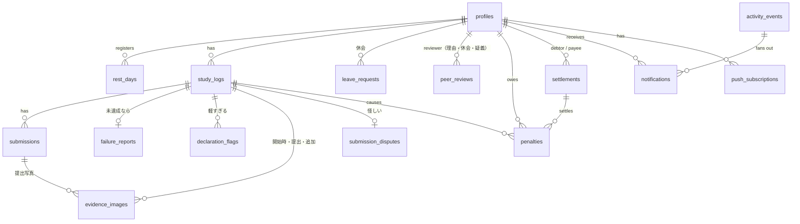

# データベース設計

正本は `supabase/migrations/`。このドキュメントは設計意図をまとめたもので、マイグレーションを変えたらここも更新する。

## 1. ER 図



## 2. テーブル

型の表記は Postgres。`timestamptz` はすべて `default now()`。**ポイントは円と同じ単位の整数**（1pt = 1 円）。

### group_settings（1 行だけ）
| 列 | 型 | 既定 | 説明 |
|---|---|---|---|
| id | boolean PK | `true`, `check (id)` | 1 行に固定するためのダミー |
| declaration_cutoff | time | `12:00` | 宣言締切 (JST) |
| last_declaration_reminder | time | `11:00` | 2 回目の宣言リマインド |
| rest_days_per_week | int | 1 | 週あたりの休息日上限（週は日曜〜土曜。精算の区切りと揃える） |
| passing_score | int | 70 | 合格点 |
| max_attempts | int | 3 | 1 学習日の最大提出回数 |
| judge_grace_minutes | int | 60 | 締切後、判定待ちの提出を待つ時間 |
| penalty_no_declaration | int | 500 | P1 |
| penalty_slacked | int | 700 | P2・P5 |
| penalty_unrealistic_streak | int | 500 | P3 |
| unrealistic_streak_threshold | int | 4 | P3 が始まる連続回数 |
| penalty_excuse_rejected | int | 500 | P4 |
| penalty_unrevised | int | 500 | P6 |
| penalty_late_payment | int | 500 | P7（1 週ごと） |
| flag_window_hours | int | 3 | 宣言から何時間「軽すぎる」を押せるか |
| revision_minutes | int | 60 | 指摘されてから書き直すまでの期限 |
| report_hours | int | 5 | 理由申告の期限 |
| review_hours | int | 5 | 審査の期限（理由・休会） |
| min_explanation_chars | int | 30 | 次の計画・理由の最小文字数 |
| settlement_weekday | int | 6 | 精算する曜日（0 = 日曜 … 6 = 土曜） |
| settlement_time | time | `23:00` | 精算する時刻 |
| image_retention_days | int | 60 | 証拠画像の保持日数 |
| storage_soft_limit_mb | int | 800 | これを超えたら古い画像から消す |
| dispute_window_hours | int | 3 | 合格から何時間「怪しい」を押せるか |
| extra_evidence_minutes | int | 60 | 追加の証拠を出せる時間 |
| penalty_fake_evidence | int | 700 | P8 |
| duplicate_threshold | int | 6 | 使い回しとみなす知覚ハッシュの距離（小さいほど厳しい） |

### profiles
| 列 | 型 | 説明 |
|---|---|---|
| id | uuid PK → auth.users | |
| display_name | text not null | |
| avatar_url | text | |
| paypay_link | text | `https://` で始まるもの |
| payee_id | uuid → profiles null | 支払先。`check (payee_id <> id)`。null ならランダム |
| is_admin | boolean default false | 最初のユーザーを true にする（トリガー） |
| push_prefs | jsonb default `{}` | 通知の種類ごとの Push ON/OFF。キーがなければ既定値 |
| created_at | timestamptz | |

`auth.users` の insert トリガーで作る（`display_name` は `raw_user_meta_data` から取る）。

### rest_days
| 列 | 型 | 説明 |
|---|---|---|
| user_id | uuid → profiles | PK (user_id, date) |
| date | date | JST の学習日 |
| created_at | timestamptz | |

### study_logs（1 ユーザー × 1 学習日）
| 列 | 型 | 説明 |
|---|---|---|
| id | uuid PK | |
| user_id | uuid → profiles | |
| date | date | JST。**`current_date` を既定値にしない**（UTC になるため）。RPC が決める |
| status | text | `pending`（進行中・学習中） / `completed`（達成） / `missed`（未達成） / `no_declaration`（宣言なし。P6 で無効になった宣言も含む） / `invalidated`（証拠不認定, P8） |
| declaration | text | `no_declaration` のときは null |
| target_end_time | timestamptz | 同上 |
| passphrase | text | 今日の合言葉。宣言時に発行し、書き直しても変えない |
| started_at | timestamptz | 開始時の写真が受け付けられた時刻（学習中になった時刻） |
| original_declaration | text | 書き直す前の宣言（指摘されたときだけ） |
| revision_due_at | timestamptz | 指摘されたとき `now() + revision_minutes`。書き直したら null に戻さず `revised_at` を入れる |
| revised_at | timestamptz | |
| declared_at, completed_at, missed_at | timestamptz | |

制約: `unique (user_id, date)`、`check` で status と declaration の組み合わせを検査。
「理由申告待ち・審査中」などの細かい状態は `failure_reports` が、「疑義あり」は `submission_disputes` が持つ。疑義の審査中は `completed` のままだが、精算・連続回数の計算では確定するまで達成として扱わない。

### declaration_flags（宣言への「軽すぎる」）
| 列 | 型 | 説明 |
|---|---|---|
| study_log_id | uuid → study_logs | PK (study_log_id, flagger_id) |
| flagger_id | uuid → profiles | 本人以外 |
| comment | text not null | |
| created_at | timestamptz | |

最初の 1 件で `study_logs.revision_due_at` が入る。書き直した後は新しい指摘を受け付けない（RPC で検査）。

### leave_requests（休会）
| 列 | 型 | 説明 |
|---|---|---|
| id | uuid PK | |
| user_id | uuid → profiles | |
| start_date, end_date | date | 長さの上限なし。開始日は申請日の翌日以降 |
| reason | text | 30 字以上 |
| status | text | `under_review` / `approved` / `rejected` / `cancelled` |
| review_due_at | timestamptz | |
| approved_at, resolved_at | timestamptz | |
| cancelled_from | date | 途中でやめたとき、この日以降は休会でない |

ある日が休会かどうか = `status = 'approved'` で期間内、`approved_at` がその日の始まり（00:00 JST）より前、`cancelled_from` より前。

### evidence_images（証拠画像。開始時・提出・追加証拠）
| 列 | 型 | 説明 |
|---|---|---|
| id | uuid PK | |
| user_id | uuid → profiles | |
| study_log_id | uuid → study_logs | |
| submission_id | uuid → submissions null | `kind = 'result'` のとき |
| kind | text | `start`（開始時） / `result`（提出） / `extra`（「怪しい」への追加証拠） |
| path | text null | Storage のパス `{user_id}/{date}/{kind}/{uuid}.webp`。保持期間を過ぎて消したら null |
| phash | bigint | 知覚ハッシュ（64bit の dHash）。**画像を消しても残す** |
| passphrase_found | boolean null | Gemini が合言葉を見つけたか（`start` は撮影時、`result` は判定時） |
| created_at | timestamptz | |

使い回しの検出: `bit_count((a.phash # b.phash)::bit(64)) <= duplicate_threshold` の画像が、グループ内の過去の画像（今の学習日の `start` との比較も含む）にあるか。6 人 × 数年でも数万行なので全件比較で足りる。

### submissions（提出 1 回分）
| 列 | 型 | 説明 |
|---|---|---|
| id | uuid PK | |
| study_log_id | uuid → study_logs | |
| user_id | uuid → profiles | 非正規化（RLS と Storage パスの検査用） |
| attempt_no | int | 1 から。`unique (study_log_id, attempt_no)` |
| learned_text, struggled_text | text | |
| self_rating | int | 1〜5 |
| status | text | `judging` / `passed` / `rejected` / `error` |
| reject_reason | text null | `duplicate`（使い回し） / `no_passphrase`（合言葉なし） / `low_score` |
| duplicate_of | uuid → evidence_images null | 似ていた過去の画像 |
| ai_score | int | 0〜100 |
| ai_passphrase_found | boolean | |
| ai_progress_ok | boolean | 開始時の写真から進んでいるか |
| elapsed_minutes | int | 開始から提出までの分数（判定材料・表示用） |
| ai_feedback | text | |
| ai_model | text | 判定に使ったモデル ID |
| judge_error | text | |
| submitted_at | timestamptz | **締切判定に使う時刻** |
| judged_at | timestamptz | |

Gemini がエラーのときは同じ提出を `error` → 再判定するので、新しい attempt は使わない。

### submission_disputes（提出への「怪しい」指摘。1 学習日に 1 件まで）
| 列 | 型 | 説明 |
|---|---|---|
| study_log_id | uuid PK → study_logs | |
| flagger_id | uuid → profiles | 本人以外 |
| comment | text not null | |
| status | text | `awaiting_evidence`（追加の証拠待ち） / `under_review` / `upheld`（達成のまま） / `invalidated`（P8） |
| flagged_at | timestamptz | `completed_at + dispute_window_hours` より前であること |
| evidence_due_at | timestamptz | `flagged_at + extra_evidence_minutes` |
| extra_text | text | 本人の説明（任意） |
| evidence_submitted_at | timestamptz | |
| review_due_at | timestamptz | 審査開始 + review_hours |
| resolved_at | timestamptz | |

### failure_reports（未達成の理由申告。study_log が `missed` になったときに作る）
| 列 | 型 | 説明 |
|---|---|---|
| study_log_id | uuid PK → study_logs | |
| user_id | uuid → profiles | |
| status | text | `awaiting_report`（申告待ち） / `under_review`（審査中） / `resolved`（確定） |
| category | text null | `unrealistic` / `slacked` / `sudden_plan` / `other` / `not_reported`（期限切れ） |
| reason_text | text | 急遽予定・その他の理由、サボりのひとこと |
| next_plan_text | text | 「宣言が妥当じゃなかった」ときの次の計画（必須） |
| unrealistic_streak | int | `unrealistic` のとき、これを含めて何回連続か（申告時に計算して保存） |
| report_due_at | timestamptz | `missed_at + report_hours` |
| reported_at | timestamptz | |
| review_due_at | timestamptz | `reported_at + review_hours`（審査があるときだけ） |
| outcome | text null | `no_penalty` / `penalized` |
| resolved_at | timestamptz | |

`check` で category と必須テキストの組み合わせ、文字数を検査する。申告後は書き換えない。

### peer_reviews（審査。理由申告・休会・「怪しい」の 3 種類で共通）
| 列 | 型 | 説明 |
|---|---|---|
| id | uuid PK | |
| subject_type | text | `excuse`（理由申告） / `leave`（休会） / `dispute`（怪しい指摘） |
| subject_id | uuid | `excuse`・`dispute` は study_log_id、`leave` は leave_request_id |
| reviewer_id | uuid → profiles | 対象の本人は除く（RPC で検査） |
| verdict | text null | null = まだ押していない / `accept` / `reject` |
| comment | text | 任意 |
| decided_at | timestamptz | |

`unique (subject_type, subject_id, reviewer_id)`。審査が始まった時点で、休会中でないほかのメンバーぶんの行を作って固定する。
全行が `accept` → 承認。`reject` が 1 行でもあれば即却下。期限を過ぎて null が残っていれば却下。
`subject_id` は種類によって参照先が変わるので外部キーは張らず、審査を始める RPC が整合を保証する。

### penalties（ペナルティ台帳）
| 列 | 型 | 説明 |
|---|---|---|
| id | uuid PK | |
| user_id | uuid → profiles | |
| study_log_id | uuid → study_logs null | P1〜P6 のとき |
| late_settlement_id | uuid → settlements null | P7 のとき、未払いの精算 |
| dedupe_key | text **unique** not null | `log:{study_log_id}`（1 学習日 1 件）/ `late:{settlement_id}:{締めた日}`（1 週 1 件）。二重ペナルティを DB で防ぐ |
| points | int `check (points > 0)` | = 円 |
| reason | text | `no_declaration` / `unrevised` / `slacked` / `not_reported` / `unrealistic_streak` / `excuse_rejected` / `excuse_expired` / `fake_evidence` / `late_payment` |
| settlement_id | uuid → settlements null | null = 未精算 |
| created_at | timestamptz | |

ポイントは**カウンター列を持たず、台帳から集計する**（ずれない・あとから監査できる）。

### settlements（毎週の精算。1 人 1 週 1 件）
| 列 | 型 | 説明 |
|---|---|---|
| id | uuid PK | |
| debtor_id | uuid → profiles | 払う人 |
| payee_id | uuid → profiles | 支払先 |
| payee_selection | text | `preset`（本人が決めていた） / `random` |
| period_end | date | 締めた日（土曜）。`unique (debtor_id, period_end)` |
| amount_yen | int | 束ねた penalties の points の合計 |
| status | text | `open` / `sent`（送金した） / `completed`（受け取った）。「届いていない」で `sent` → `open` |
| created_at, sent_at, completed_at | timestamptz | |

### activity_events（グループのタイムライン ＝ 通知の元）
| 列 | 型 | 説明 |
|---|---|---|
| id | uuid PK | |
| type | text | 下の一覧 |
| actor_id | uuid → profiles | |
| study_log_id, submission_id, settlement_id | uuid null | |
| payload | jsonb | 表示用（スコア・講評・締切・理由・金額など） |
| dedupe_key | text **unique** null | リマインドなどの重複防止（例: `reminder_review:{log}:{reviewer}:60m`） |
| created_at | timestamptz | |

type: `declared` / `study_started` / `start_photo_rejected` / `duplicate_detected` / `submission_flagged` / `extra_evidence_submitted` / `dispute_review_started` / `dispute_upheld` / `dispute_invalidated` / `reminder_extra_evidence_due` / `declaration_flagged` / `declaration_revised` / `leave_requested` / `leave_approved` / `leave_rejected` / `settlement_not_received` / `late_payment` / `reminder_revision_due` / `reminder_late_payment` / `rest_day_registered` / `judged_passed` / `judged_rejected` / `no_declaration` / `missed` / `reported` / `review_requested` / `review_approved` / `review_rejected` / `penalized` / `settlement_created` / `settlement_sent` / `settlement_completed` / `reminder_declare_midnight` / `reminder_declare_last_call` / `reminder_submit` / `reminder_report_due` / `reminder_review_due` / `review_vote_cast` / `leave_vote_cast` / `leave_ending`

`reminder_*` と `*_vote_cast` は本人（または未回答者）にだけ届けるので、タイムラインには出さない。誰に届けるかは `lib/notify` の受信者ルール（requirements N1 の表）で決める。

### notifications（受信者ごと）
| 列 | 型 | 説明 |
|---|---|---|
| id | uuid PK | |
| recipient_id | uuid → profiles | |
| event_id | uuid → activity_events | `unique (recipient_id, event_id)` |
| title, body, url | text | 表示用に作った文言 |
| read_at | timestamptz | |
| pushed_at | timestamptz | Push を送った時刻（送らなければ null） |
| created_at | timestamptz | |

### push_subscriptions
| 列 | 型 | 説明 |
|---|---|---|
| id | uuid PK | |
| user_id | uuid → profiles | |
| endpoint | text **unique** | |
| p256dh, auth | text | |
| user_agent | text | 設定画面で端末を見分けるため |
| created_at, last_success_at | timestamptz | |

### ビュー: penalty_summary
`user_id, display_name, total_points, unsettled_points, this_week_points, open_settlement_id`
ダッシュボードのランキングと「奢り確定」バッジに使う。`security_invoker = true` にする。

## 3. RPC（Postgres 関数）

状態を変える処理はすべてここに置く。`security definer` で、**`service_role` だけに EXECUTE を GRANT** する（Server Action / Route Handler から呼ぶ）。どの関数も、記録した `activity_events` の行を返す。

| 関数 | 処理 |
|---|---|
| `declare_goal(user_id, declaration, end_time_hhmm)` | 今日 (JST)、宣言締切前、休息日でない、未宣言であることを検査。`target_end_time` を「今日 HH:mm、早ければ翌日」に変換して範囲 (+30分〜翌03:00) を検査 → insert |
| `register_rest_day(user_id, date)` / `cancel_rest_day` | 明日以降か、週の上限内か、その日に宣言していないか |
| `start_study(user_id, study_log_id, path, phash, passphrase_found)` | 本人の pending で未開始か、締切前か、合言葉が見つかったか、使い回しでないかを検査 → `evidence_images(start)` と `started_at` |
| `create_submission(user_id, images[{path, phash}], ...)` | 開始済みか、`now() < target_end_time` か、試行回数が上限未満か、パスが `{user_id}/` で始まるかを検査 → `judging` で insert。**使い回しならここで `rejected(duplicate)` にして返す**（Gemini を呼ばない） |
| `record_judgement(submission_id, score, passphrase_found, progress_ok, feedback, model)` | 合格 = 点数 >= 合格点 かつ 合言葉あり。合格なら log を `completed` にする |
| `record_judge_error(submission_id, message)` | `error` にする |
| `file_failure_report(user_id, study_log_id, category, reason, next_plan)` | 本人の `awaiting_report` か、期限内か、必須テキストと文字数を検査。<br>・`unrealistic`: 連続回数を計算 → しきい値以上なら penalty、`resolved`<br>・`slacked`: penalty、`resolved`<br>・`sudden_plan` / `other`: `under_review` にして、`peer_reviews('excuse')` の行を作る |
| `cast_review(reviewer_id, subject_type, subject_id, verdict, comment)` | 審査者本人の未回答の行か、期限内かを検査。`reject` なら即却下、全員 `accept` なら承認として、種類ごとの後処理（excuse: penalty の有無 / leave: 休会の成立 / dispute: 達成のまま or P8）を行う |
| `flag_submission(flagger_id, study_log_id, comment)` | 本人以外か、`completed` で合格から `dispute_window_hours` 以内か、まだ指摘がないかを検査 → `awaiting_evidence` |
| `submit_extra_evidence(user_id, study_log_id, text, images[])` | 本人の `awaiting_evidence` で期限内か → 画像を記録し、審査を始める（peer_reviews の行を作る） |
| `expire_disputes()` | 追加の証拠の期限が来たものは審査を始める。審査の期限切れは P8。残り 15 分・1 時間・15 分のリマインドもここで作る |
| `flag_declaration(flagger_id, study_log_id, comment)` | 本人以外か、宣言から `flag_window_hours` 以内かつ提出締切前か、まだ書き直していないかを検査。最初の指摘なら `revision_due_at` を入れる |
| `revise_declaration(user_id, study_log_id, declaration)` | 本人の書き直し待ちか、期限内かを検査。`original_declaration` を残して上書き |
| `expire_revisions()` | `revision_due_at` を過ぎて書き直していない → `no_declaration` + penalty (P6)。判定待ちの提出は取り消す。残り 15 分のリマインドもここで作る |
| `request_leave(user_id, start, end, reason)` / `cancel_leave(...)` / `expire_leave_reviews()` | 休会。審査は `cast_review('leave', ...)` |
| `report_not_received(payee_id, settlement_id)` | 支払先本人の `sent` の精算を `open` に戻す |
| `run_declaration_reminders()` | 0:00 と 11:00 を過ぎていて未宣言・休息日でも休会中でもない人に、`dedupe_key` つきでリマインドを作る |
| `due_submit_reminders()` | 提出締切の 1 時間前で、まだ合格していない人にリマインドを作る |
| `close_declarations()` | 12:00 を過ぎた今日、レコードも休息日も休会もないメンバー → `no_declaration` + penalty (P1) |
| `close_overdue_logs()` | `pending` で `target_end_time` を過ぎ、締切前の提出で判定待ち・エラーのもの（猶予内）がない → `missed` + `failure_reports(awaiting_report)` |
| `expire_reports()` | `report_due_at` を過ぎた `awaiting_report` → `not_reported` + penalty (P5)。残り 1 時間・15 分のリマインドもここで作る |
| `expire_reviews()` | `review_due_at` を過ぎた `under_review` → 却下 + penalty。残り 1 時間・15 分のリマインドもここで作る |
| `run_weekly_settlement()` | 土曜 23:00 以降、その週に 1 回だけ。まず前の週までの `open` の精算に P7 を付け、未精算の penalties を人ごとに束ね、支払先（`payee_id`、なければランダム）を決めて settlements を作る |
| `mark_settlement_sent(debtor_id, settlement_id)` / `confirm_settlement(payee_id, settlement_id)` | 本人確認つきで状態を進める |

**P3 の連続回数**: 対象の学習日より前の `study_logs` を `status in ('completed','missed')` に絞って日付の新しい順に見て、`missed` かつ `failure_reports.category = 'unrealistic'` が続く数 + 1（`no_declaration`・休息日・休会日はもともと対象外）。`completed` かほかの理由で止まる。理由申告待ち・審査中の日があればそこでも止める（確定していないため）。

同時実行対策: 確定系は `for update skip locked` で対象行をロックし、penalties・settlements の一意制約を最終防衛線にする。

## 4. RLS とアクセス権

| テーブル | authenticated の select | authenticated の書き込み |
|---|---|---|
| group_settings | 全行 | なし（管理者の更新は Server Action が `is_admin` を確認して service role で） |
| profiles | 全行 | update: 本人の行の `display_name, avatar_url, paypay_link, payee_id, push_prefs` **だけ**（列単位 GRANT） |
| rest_days, study_logs, declaration_flags, submissions, evidence_images, submission_disputes, failure_reports, peer_reviews, leave_requests, penalties, settlements, activity_events | 全行 | なし（申告・審査・送金の記録も Server Action 経由） |
| notifications | `recipient_id = auth.uid()` | update: 本人の行の `read_at` だけ |
| push_subscriptions | `user_id = auth.uid()` | なし（登録・削除は Server Action） |

`anon` ロールにはどのテーブルも許可しない。

### Storage: `study-evidence`（private）
- insert: `bucket_id = 'study-evidence' and (storage.foldername(name))[1] = auth.uid()::text`
- select: 認証済みユーザー全員（表示は署名付き URL）
- update / delete: なし（削除は cron が service role で行う）
- バケットの制限: `file_size_limit = 1MB`、`allowed_mime_types = {image/webp, image/jpeg, image/png}`

## 5. pg_cron

```sql
-- 5 分ごとに Vercel の tick を呼ぶ（URL とシークレットは Vault から読む）
select cron.schedule('tick', '*/5 * * * *', $$
  select net.http_post(
    url     := (select decrypted_secret from vault.decrypted_secrets where name = 'tick_url'),
    headers := jsonb_build_object(
      'Authorization', 'Bearer ' || (select decrypted_secret from vault.decrypted_secrets where name = 'cron_secret'),
      'Content-Type', 'application/json'),
    body    := '{}'::jsonb,
    timeout_milliseconds := 30000
  );
$$);
```

## 6. Realtime
`notifications`、`study_logs`、`failure_reports`、`submission_disputes`、`peer_reviews`、`activity_events` を `supabase_realtime` パブリケーションに追加する。RLS が効くので、クライアントには読める行だけが届く。
