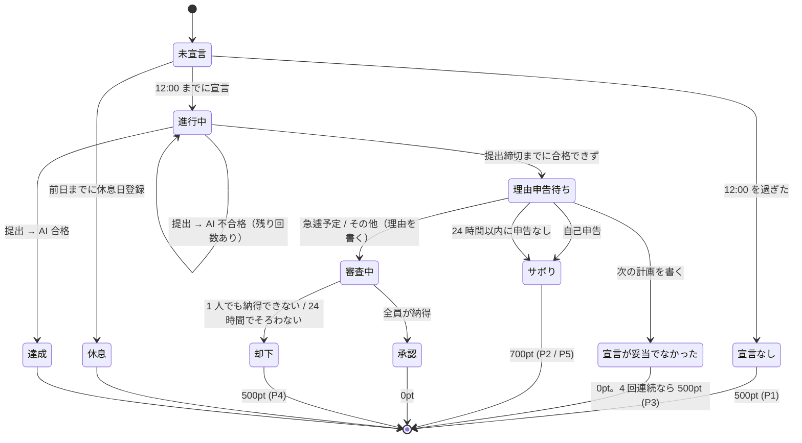

# 要件定義 — Commit or Treat (仮)

友人グループ（3〜6名）で学習を強制継続させるクローズド Web アプリ。
毎日「宣言 → 提出 → AI 判定」を回す。守れなかったら理由を申告し、内容に応じてペナルティが付く。**1pt = 1 円**で、月の最終日に PayPay でまとめて払う。
**外部チャットツールは使わず、通知もアプリ内（アプリ内通知 + Web Push）で完結させる。**

## 0. 前提・制約

| 項目 | 内容 |
|---|---|
| 利用者 | 1 グループのみ（3〜6名）。1 デプロイ = 1 グループ |
| コスト | **0 円運用**。各サービスの無料枠内に収める |
| タイムゾーン | **Asia/Tokyo 固定**。「日付」はすべて JST の暦日 |
| 端末 | スマホ主体。**PWA としてホーム画面に追加して使う**（iOS の Push 通知はホーム画面追加が必須）。PC でも使える |

## 1. 用語

| 用語 | 意味 |
|---|---|
| 学習日 (`date`) | JST の暦日。1 ユーザー 1 学習日につき 1 レコード（`study_logs`） |
| 1 日の始まり | 本人が設定する時刻（既定 **07:00**）。この時刻に宣言を促す通知が届く |
| 宣言 | その日の学習内容と提出締切を登録すること |
| 宣言締切 | **12:00 JST**。過ぎたら宣言できない |
| 提出締切 (`target_end_time`) | 宣言時に本人が決める成果物の提出期限 |
| 休息日 | 事前登録した「宣言しなくてよい日」。週あたり上限あり |
| 提出 (submission) | 証拠画像＋振り返りの 1 回分。1 学習日に複数回あり得る |
| 未達成 | 宣言はしたが、提出締切までに AI 判定で合格できなかった状態 |
| 理由申告 | 未達成のあとに本人が出す、できなかった理由の説明 |
| 審査 | 「急遽予定」「その他」の理由を、ほかのメンバー全員が見て納得するかどうか決めること |
| 支払先 | 月末にペナルティを払う相手。事前に決めておくか、未設定ならシステムがランダムに決める |
| 精算 | 月の最終日に、その月の未精算ポイントを合計して支払先に払うこと |

## 2. ペナルティのルール（1pt = 1 円）

| # | 状況 | ペナルティ |
|---|---|---|
| P1 | 12:00 までに宣言しなかった（休息日を除く） | **500pt** |
| P2 | 未達成。理由は「**サボった**」 | **700pt** |
| P3 | 未達成。理由は「**宣言が妥当じゃなかった**」。次の計画を具体的に書く | 0pt。ただし **4 回連続になったら、4 回目から 1 回ごとに 500pt** |
| P4 | 未達成。理由は「**急遽予定ができた**」または「**その他**」。理由を具体的に書く | ほかのメンバー**全員が「納得」したら 0pt**。**1 人でも「納得できない」を押した、または 24 時間以内に全員の納得がそろわなかったら 500pt** |
| P5 | 未達成のまま、24 時間以内に理由を申告しなかった | **700pt**（サボったとみなす） |

- 1 学習日に付くペナルティは 1 件まで。
- 金額はグループ設定で変えられる（既定値は上の表のとおり）。

### P3 の「連続」の数え方
- 宣言した学習日だけを古い順に並べ、「未達成で、理由が『宣言が妥当じゃなかった』」の日が何日続いたかを数える。
- **達成した日、またはほかの理由で未達成になった日があったらリセット**する。
- 宣言しなかった日 (P1) と休息日は数えない（リセットもしない）。

## 3. 1 日のライフサイクル

## 4. 機能要件

### F1. 認証・メンバー管理
- メール＋パスワードでログイン。
- **サインアップには招待コードが必須**。サーバー側でコードを検証してからユーザーを作成する（Supabase の公開サインアップは OFF）。
- プロフィール: 表示名（必須）、アバター、PayPay 受け取りリンク、1 日の始まりの時刻、支払先（F8）。
- ペナルティ・ステータス・審査結果などのゲーム状態は**本人が直接書き換えられない**こと。

### F2. 休息日
- 翌日以降の日付を休息日として登録・取消できる（**当日の登録は不可**）。
- 上限: **週 1 日**（月曜始まり。グループ設定で変更可）。
- 登録時に全員へ通知。

### F3. 朝の宣言
- **1 日の始まりの時刻になった瞬間、まだ宣言していなければ本人に通知する**（この通知は OFF にできない）。11:00 にまだ宣言していなければもう一度通知する。
- 入力: 学習内容（テキスト）、提出締切時刻（time ピッカー）。
- 前回の未達成で「宣言が妥当じゃなかった」と申告していた場合は、そのとき書いた「次の計画」を宣言フォームに表示する。
- 宣言できるのは 12:00 まで。休息日には宣言できない。
- 提出締切の範囲: **宣言時刻 + 30 分以降、翌日 03:00 まで**（夜型対応）。
- 宣言後の内容変更は不可（逃げ道防止）。
- 12:00 を過ぎても宣言がなければ **500pt (P1)**。全員へ通知。

### F4. 成果物提出
- 入力: 証拠画像 1〜3 枚、学んだこと、できなかったこと・疑問点、自己評価（1〜5）。
- 画像はブラウザで圧縮してからアップロード（長辺 1200px 以下、WebP、200KB 前後）。
- 提出は `target_end_time` より前でなければならない（**提出時刻で判定**し、AI 判定の完了時刻は問わない）。
- 提出後すぐ AI 判定を実行する。

### F5. AI 判定
- 宣言内容と提出内容（画像＋テキスト）を突き合わせ、0〜100 点と講評を返す。
- **70 点以上で合格**。合否はサーバーが点数から決める（モデルの返した合否は使わない）。
- 合格 → 達成。全員へ通知。
- 不合格 → **締切までなら再提出できる（1 学習日に最大 3 回）**。全員へ通知（講評と残り回数つき）。
- Gemini API のエラー（レート制限・障害）は試行回数に含めない。後から再判定できる。
- 提出締切までに合格できなければ**未達成**になり、本人に理由申告を求める（F6）。

### F6. 理由申告
- 未達成になったら、本人は **24 時間以内**に理由を 1 つ選んで申告する。
  | 理由 | 必須の入力 | その後 |
  |---|---|---|
  | 宣言が妥当じゃなかった | **次どうするか**（具体的に。30 字以上） | 0pt。4 回連続なら 500pt (P3) |
  | サボった | なし（任意でひとこと） | 700pt (P2) |
  | 急遽予定ができた | **何があったか**（具体的に。30 字以上） | 審査 (F7) |
  | その他 | **理由**（具体的に。30 字以上） | 審査 (F7) |
- 申告は一度出したら変更できない。
- 24 時間以内に申告しなければ「サボった」とみなして 700pt (P5)。締切の 3 時間前に本人へ通知する。
- 申告内容は全員が見られる（タイムラインと履歴）。

### F7. 審査（急遽予定・その他）
- 申告と同時に、本人以外の全員へ審査依頼の通知を送る。
- 各メンバーは「納得」か「納得できない」を押す。「納得できない」にはひとことコメントを付けられる（任意）。一度押したら変更できない。
- **全員が「納得」を押したら承認**（0pt）。
- **1 人でも「納得できない」を押したら、その時点で却下**（500pt）。
- **申告から 24 時間たっても全員の「納得」がそろっていなければ却下**（500pt）。締切の 3 時間前に、まだ押していないメンバーへ通知する。
- 審査に加わるのは申告した時点のメンバー全員。

### F8. 精算（月の最終日）
- **1pt = 1 円**。月の最終日に、その時点で確定している未精算ポイントを合計して精算を作る。
  - その時点で審査中・理由申告待ちのものは、確定した月の分として翌月に回す。
- 精算 1 件 = 「誰が・誰に・いくら払うか」。**支払先は 1 人**。
  - 本人が設定画面で**支払先を決めておいた**場合はその人。
  - 未設定なら、ほかのメンバーから**システムがランダムに 1 人選ぶ**（選んだ結果は記録し、選び直せない）。
- 支払う人は、支払先の PayPay リンクから送金し、「送金した」を押す。**受け取った人が「受け取った」を押したら精算完了**。
- 精算の作成時に支払う人と支払先の両方へ通知する。未完了の精算がある人には「奢り確定」バッジを付ける。
- 実行時刻: 月の最終日の 09:00（グループ設定で変更可）。

### F9. 締切監視（定期実行）
5 分ごとに以下を冪等に処理する。
1. 1 日の始まりの通知（F3）と 11:00 の通知
2. 12:00 の宣言なしを確定する (P1)
3. 提出締切を過ぎた進行中の学習日を未達成にする（締切前に出した提出が判定待ちの間は最大 60 分待つ）
4. 未達成になった人へ理由申告を求める通知、申告締切 3 時間前の通知、24 時間たっても申告がなければ P5
5. 審査締切 3 時間前の通知、24 時間でそろわなければ却下
6. 月の最終日の精算 (F8)
7. 保持期間（既定 60 日）を過ぎた証拠画像の削除

### N1. 通知（アプリ内で完結）
外部サービス（Discord・LINE・メール）は使わない。通知は 2 つの経路で届ける。

| 経路 | 仕組み | 用途 |
|---|---|---|
| **アプリ内通知** | ヘッダーのベル＋未読バッジ、通知一覧ページ。Supabase Realtime で即時反映 | すべての通知の正本。既読管理 |
| **Web Push** | PWA + Service Worker + VAPID（`web-push`）。アプリを閉じていても OS の通知として届く | 本人がオンにしている種類だけ |

加えて、ダッシュボードに**グループのタイムライン**（誰が何をしたか・誰が失敗したか・どんな理由を申告したか）を出し、晒し上げはここで行う。

| イベント | 届く相手 | 既定の Push |
|---|---|---|
| **1 日の始まり・11:00 の宣言リマインド** | 本人 | **ON（OFF にできない）** |
| 宣言した / 休息日を登録した | 本人以外の全員 | OFF |
| 合格した | 本人以外の全員 | OFF |
| 不合格だった（講評・残り回数つき） | 本人 + 全員 | 本人 ON |
| 提出締切の 1 時間前（まだ合格していない） | 本人 | ON |
| 宣言なしで 500pt | 全員 | ON |
| 未達成になった → 理由を申告して | 本人 | ON |
| 理由を申告した（サボり・宣言が妥当でなかった） | 本人以外の全員 | OFF |
| **審査依頼**（急遽予定・その他） | 本人以外の全員 | ON |
| 審査の結果（承認 / 却下） | 全員 | 本人 ON |
| 理由申告・審査の締切 3 時間前 | 本人 / まだ押していない人 | ON |
| ペナルティが付いた | 全員 | ON |
| 精算ができた | 支払う人・支払先 | ON |
| 送金した → 受け取りの確認をして | 支払先 | ON |
| 精算が完了した | 全員 | OFF |

- 通知の種類ごとに Push の ON/OFF を本人が設定できる（宣言リマインド以外。アプリ内通知は常に届く）。
- 1 人が複数の端末を登録できる。期限切れの購読（HTTP 404/410）は自動で削除する。
- 初回ログイン時に「ホーム画面に追加 → 通知を許可」の手順を案内する（iOS は Safari の共有メニューから）。

### F10. ダッシュボード (`/`)
- メンバー全員の本日のステータスカード: 未宣言 / 休息 / 進行中（締切までの残り時間） / 達成 / 理由申告待ち / 審査中 / 確定（ペナルティ額）。
- **自分がやること**: 宣言・提出・理由申告・審査・送金・受け取りの確認のうち、今残っているもの。
- 今月のペナルティランキング（今月の未精算 pt の多い順）と累計。
- 「奢り確定」バッジ、PayPay ボタン。
- タイムライン、各メンバーの履歴（日ごとの宣言・提出・講評・画像・理由・審査結果）。

### F11. グループ設定
ペナルティの額 (P1〜P5)、P3 の連続回数、理由申告・審査の期限、休息日の上限、合格点、最大提出回数、精算の実行時刻、画像の保持日数。
変更できるのは `is_admin` のメンバーのみ（最初のユーザー）。

## 5. 非機能要件

| 区分 | 要件 |
|---|---|
| コスト | Vercel Hobby / Supabase Free（DB・Auth・Storage・Realtime・pg_cron）/ Gemini 無料枠 / Web Push（ブラウザ標準・無料）のみ。GitHub Actions は使わない（→ [decisions.md](decisions.md) ADR-003） |
| セキュリティ | 書き込みはすべてサーバー経由。クライアントは RLS 越しに読むだけ。cron エンドポイントは共有シークレットで認証 |
| 公正さ | 判定・締切の基準時刻はサーバー（DB の `now()`）。クライアントの時計は信用しない。理由申告・審査は一度出したら変更できない |
| 冪等性 | cron が重複・遅延しても二重ペナルティにならない（DB の一意制約で保証） |
| ストレージ | Supabase Storage 1GB 以内（試算: 最大 ~10MB/日 × 保持 60 日 ≈ 600MB） |
| プライバシー | Gemini 無料枠では入力がモデル改善に使われ得る。証拠画像に個人情報を写さないようメンバーに周知 |

## 6. スコープ外（MVP では作らない）
- 複数グループ対応
- 実際の送金処理（PayPay API 連携）。アプリは送金リンクを開いて、送金・受け取りの記録をするだけ
- AI 判定への異議申し立て
- ネイティブアプリ（PWA で代替）
- メール・外部チャットへの通知

## 7. 未決事項
以下は仮の値・解釈で設計している。違っていたら直す。
- [ ] 1 日の始まりの既定値（07:00）と、11:00 の 2 回目の通知
- [ ] 理由申告の期限（24 時間）と、申告しなかったときの扱い（サボり 700pt）
- [ ] P3 の数え方（4 回目から毎回 500pt、達成したらリセット）
- [ ] 支払先を決めるのは本人か、グループで決めるか（今の設計は本人が設定画面で選ぶ）
- [ ] 精算の実行時刻（月の最終日 09:00）と、最終日当日の分を翌月に回すこと
- [ ] 支払いに期限を設けるか（今の設計は期限なし。未完了のあいだ「奢り確定」バッジが付くだけ）
- [ ] 休息日の上限（週 1 日でよいか）
- [ ] 最初の数日を「お試し期間（ペナルティなし）」にするか
- [ ] Web Push を許可しない／iOS でホーム画面に追加しないメンバーへの対応（アプリ内通知だけで足りるか）
- [ ] パスワードリセットの方法（Supabase 無料枠のメール送信は 1 時間あたりの上限が厳しい → 管理者がリセットする運用でもよい）
