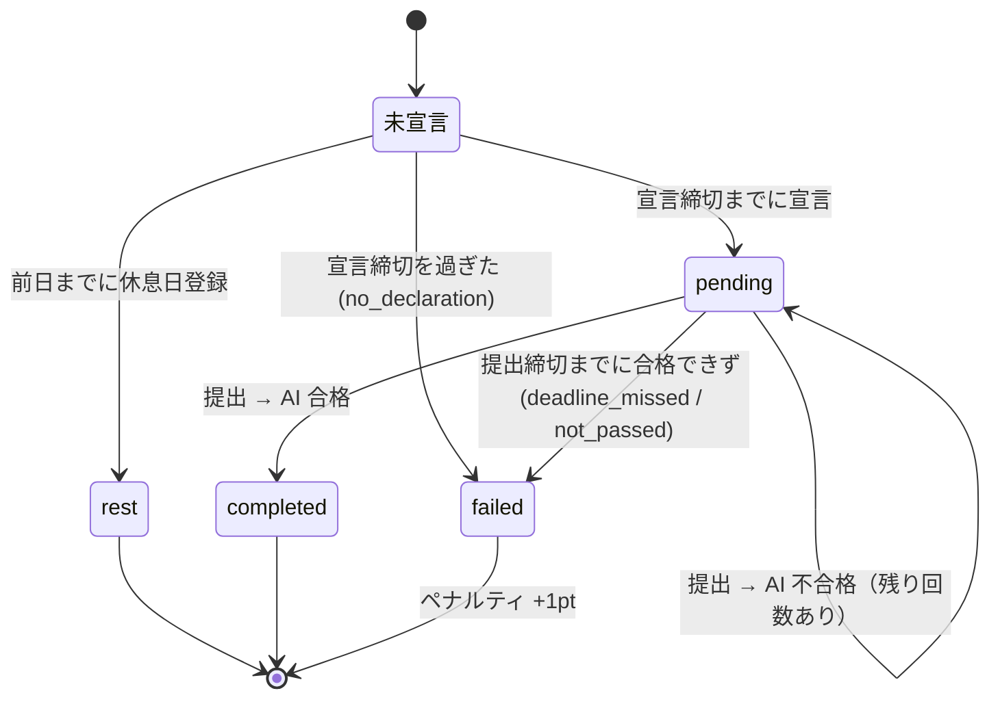

# 要件定義 — Commit or Treat (仮)

友人グループ（3〜6名）で学習を強制継続させるクローズド Web アプリ。
毎日「宣言 → 提出 → AI 判定」を回し、守れなかったらペナルティが貯まり、3pt ごとにメンバー全員へ PayPay で定額を払う。
**外部チャットツールは使わず、通知もアプリ内（アプリ内通知 + Web Push）で完結させる。**

## 0. 前提・制約

| 項目 | 内容 |
|---|---|
| 利用者 | 1 グループのみ（3〜6名）。1 デプロイ = 1 グループ |
| コスト | **0 円運用**。各サービスの無料枠内に収める |
| タイムゾーン | **Asia/Tokyo 固定**。「日付」はすべて JST の暦日 |
| 端末 | スマホ主体。**PWA としてホーム画面に追加して使う**（iOS の Push 通知はホーム画面追加が必須）。PC でも使える |

## 1. 用語

| 用語 | 意味 |
|---|---|
| 学習日 (`date`) | JST の暦日。1 ユーザー 1 学習日につき 1 レコード（`study_logs`） |
| 宣言 | その日の学習内容と締切時刻を登録すること |
| 宣言締切 | 宣言できる最終時刻。既定 **12:00 JST**（グループ設定で変更可） |
| 提出締切 (`target_end_time`) | 宣言時に本人が決める成果物の提出期限 |
| 休息日 | 事前登録した「宣言しなくてよい日」。週あたり上限あり |
| 提出 (submission) | 証拠画像＋振り返りの 1 回分。1 学習日に複数回あり得る |
| 精算 (settlement) | 未精算ポイントが 3pt 貯まるごとに発生する「全員へ定額送金」義務 |

## 2. 1 日のライフサイクル

- 「未宣言」は DB にレコードがない状態。宣言締切を過ぎた時点で cron が `failed` レコードを作る。
- `failed` になった瞬間にペナルティ +1pt（1 学習日で最大 1pt）。

## 3. 機能要件

### F1. 認証・メンバー管理
- メール＋パスワードでログイン。
- **サインアップには招待コードが必須**。サーバー側でコードを検証してからユーザーを作成する（Supabase の公開サインアップは OFF）。
- プロフィール: 表示名（必須）、アバター、PayPay 受け取りリンク。
- ペナルティ・ステータスなどのゲーム状態は**本人が直接書き換えられない**こと。

### F2. 休息日
- 翌日以降の日付を休息日として登録・取消できる（**当日の登録は不可**）。
- 上限: **週 1 日**（月曜始まり。グループ設定で変更可）。
- 登録時に全員へ通知（N1）。

### F3. 朝の宣言
- 入力: 学習内容（テキスト）、提出締切時刻（time ピッカー）。
- 宣言できるのは宣言締切（既定 12:00）まで。休息日には宣言できない。
- 提出締切の範囲: **宣言時刻 + 30 分以降、翌日 03:00 まで**（夜型対応）。
- 宣言後の内容変更は不可（逃げ道防止）。
- 全員へ通知（N1）。

### F4. 成果物提出
- 入力: 証拠画像 1〜3 枚、学んだこと、できなかったこと・疑問点、自己評価（1〜5）。
- 画像はブラウザで圧縮してからアップロード（長辺 1200px 以下、WebP、200KB 前後）。
- 提出は `target_end_time` より前でなければならない（**提出時刻で判定**し、AI 判定の完了時刻は問わない）。
- 提出後すぐ AI 判定を実行する。

### F5. AI 判定
- 宣言内容と提出内容（画像＋テキスト）を突き合わせ、0〜100 点と講評を返す。
- **70 点以上で合格**。合否はサーバーが点数から決める（モデルの返した合否は使わない）。
- 合格 → `completed`。全員へ通知。
- 不合格 → **締切までなら再提出できる（1 学習日に最大 3 回）**。全員へ通知（講評と残り回数つき）。
- Gemini API のエラー（レート制限・障害）は試行回数に含めない。後から再判定できる。

### F6. 締切監視（定期実行）
5 分ごとに以下を冪等に処理する。
1. **宣言漏れ**: 宣言締切を過ぎても、休息日でもなくレコードもないメンバー → `failed (no_declaration)`、+1pt。
   全員へ通知。
2. **提出締切超過**: `pending` のまま `target_end_time` を過ぎた → `failed`、+1pt。
   - 締切前に出された提出が判定待ち／エラーの間は確定させない（猶予 60 分）。
   全員へ通知。
3. **精算の発生**: 未精算ポイントが 3pt 以上になったら精算を作る（F7）。
4. **リマインド**: 本人だけに通知 — 宣言締切の 1 時間前でまだ宣言していない／提出締切の 1 時間前でまだ合格していない。
5. **画像の掃除**: 保持期間（既定 60 日）を過ぎた証拠画像を削除。

### F7. ペナルティと精算（全員へ定額）
- ペナルティは台帳（1 件 = 1pt）で記録し、累計と未精算を集計で出す。
- 未精算が **3pt** に達するごとに精算が 1 件できる。精算では、債務者が**自分以外の全メンバーに定額（既定 500 円、グループ設定）**を PayPay で送る。
- 債務者は各メンバーの PayPay リンクから送金する。**受け取った側が「受領確認」を押す**と、その人への支払いが完了になる。
- 全員分が確認されたら精算完了。対象の 3pt は「精算済み」になる。
- 未完了の精算がある人に「奢り確定」バッジを付ける。
- 精算の発生時・受領確認時・完了時に通知（N1）。

### N1. 通知（アプリ内で完結）
外部サービス（Discord・LINE・メール）は使わない。通知は 2 つの経路で届ける。

| 経路 | 仕組み | 用途 |
|---|---|---|
| **アプリ内通知** | ヘッダーのベル＋未読バッジ、通知一覧ページ。Supabase Realtime で即時反映 | すべての通知の正本。既読管理 |
| **Web Push** | PWA + Service Worker + VAPID（`web-push`）。アプリを閉じていても OS の通知として届く | 本人がオンにしている種類だけ |

加えて、ダッシュボードに**グループのタイムライン**（誰が何をしたか・誰が失敗したか）を出し、晒し上げはここで行う。

| イベント | 届く相手 | 既定の Push |
|---|---|---|
| 宣言した / 休息日を登録した | 本人以外の全員 | OFF |
| 合格した | 本人以外の全員 | OFF |
| 不合格だった（講評・残り回数つき） | 本人 + 全員 | 本人 ON |
| **失敗が確定した**（宣言なし / 締切超過） | 全員 | ON |
| 宣言締切・提出締切の 1 時間前 | 本人のみ | ON |
| 精算が発生した（奢り確定） | 全員 | ON |
| 自分宛ての送金が「受領確認待ち」になった | 受取人 | ON |
| 精算が完了した | 全員 | OFF |

- 通知の種類ごとに Push の ON/OFF を本人が設定できる（アプリ内通知は常に届く）。
- 1 人が複数の端末を登録できる。期限切れの購読（HTTP 404/410）は自動で削除する。
- 初回ログイン時に「ホーム画面に追加 → 通知を許可」の手順を案内する（iOS は Safari の共有メニューから）。

### F8. ダッシュボード (`/`)
- メンバー全員の本日のステータスカード: 未宣言 / 休息 / 進行中（締切までの残り時間） / 達成 / 失敗。
- ペナルティランキング（未精算の多い順、同点なら累計順）。
- 「奢り確定」バッジと、自分宛ての未確認の受け取り・自分が払う相手一覧（PayPay ボタン付き）。
- 各メンバーの履歴（日ごとの宣言・提出・講評・画像）を見られる。

### F9. グループ設定
宣言締切時刻、週あたりの休息日上限、合格点、最大提出回数、精算の金額、画像の保持日数。
変更できるのは `is_admin` のメンバーのみ（最初のユーザー）。

## 4. 非機能要件

| 区分 | 要件 |
|---|---|
| コスト | Vercel Hobby / Supabase Free（DB・Auth・Storage・Realtime・pg_cron）/ Gemini 無料枠 / Web Push（ブラウザ標準・無料）のみ。GitHub Actions は使わない（→ [decisions.md](decisions.md) ADR-003） |
| セキュリティ | 書き込みはすべてサーバー経由。クライアントは RLS 越しに読むだけ。cron エンドポイントは共有シークレットで認証 |
| 公正さ | 判定・締切の基準時刻はサーバー（DB の `now()`）。クライアントの時計は信用しない |
| 冪等性 | cron が重複・遅延しても二重ペナルティにならない（DB の一意制約で保証） |
| ストレージ | Supabase Storage 1GB 以内（試算: 最大 ~10MB/日 × 保持 60 日 ≈ 600MB） |
| プライバシー | Gemini 無料枠では入力がモデル改善に使われ得る。証拠画像に個人情報を写さないようメンバーに周知 |

## 5. スコープ外（MVP では作らない）
- 複数グループ対応
- 実際の送金処理（PayPay API 連携）。アプリは送金リンクを開いて受領確認を記録するだけ
- AI 判定への異議申し立て・メンバー投票
- ネイティブアプリ（PWA で代替）
- メール・外部チャットへの通知

## 6. 未決事項
- [ ] 休息日の上限（週 1 日でよいか）と「前日まで」という登録期限
- [ ] 精算の金額（500 円/人でよいか）
- [ ] 最初の数日を「お試し期間（ペナルティなし）」にするか
- [ ] Web Push を許可しない／iOS でホーム画面に追加しないメンバーへの対応（アプリ内通知だけで足りるか）
- [ ] パスワードリセットの方法（Supabase 無料枠のメール送信は 1 時間あたりの上限が厳しい → 管理者がリセットする運用でもよい）
