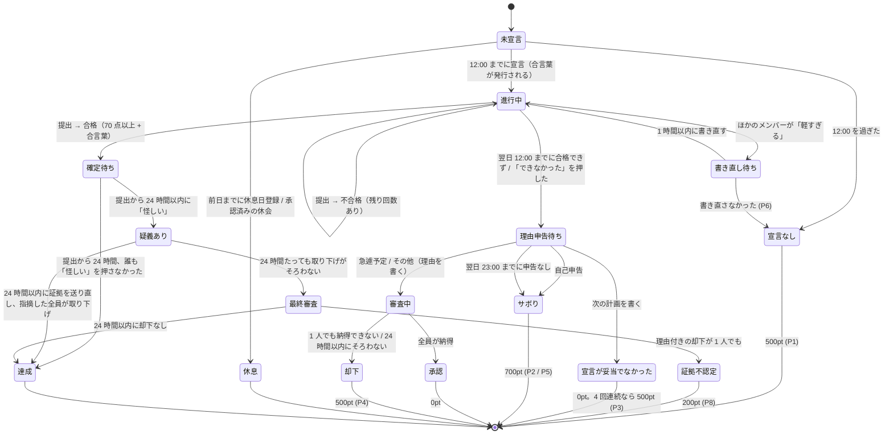

# 要件定義 — Commit or Treat (仮)

友人グループ（3〜6名）で学習を強制継続させるクローズド Web アプリ。
毎日「宣言 → 提出 → AI 判定」を回す。守れなかったら理由を申告し、内容に応じてペナルティが付く。**1pt = 1 円**で、毎週土曜 23:59 に締めて PayPay でまとめて払う。
**外部チャットツールは使わず、通知もアプリ内（アプリ内通知 + Web Push）で完結させる。通知を ON にしないとアプリは使えない。**

## 0. 前提・制約

| 項目 | 内容 |
|---|---|
| 利用者 | 1 グループのみ（3〜6名）。1 デプロイ = 1 グループ |
| コスト | **0 円運用**。各サービスの無料枠内に収める |
| タイムゾーン | **Asia/Tokyo 固定**。「日付」はすべて JST の暦日 |
| 端末 | スマホ主体。**PWA としてホーム画面に追加して使う**（iOS の Push 通知はホーム画面追加が必須）。PC でも使える |

## 1. 用語

| 用語 | 意味 |
|---|---|
| 学習日 (`date`) | JST の暦日。1 ユーザー 1 学習日につき 1 レコード（`study_logs`） |
| 1 日の始まり | **0:00 JST**。日付が変わった瞬間に、宣言を促す通知が届く |
| 宣言 | その日の学習内容を登録すること |
| 宣言締切 | **12:00 JST**。過ぎたら宣言できない |
| **次の宣言までに片付ける** | 学習日は宣言の翌日まで続く。夜中に勉強したい日もあるので、**提出は次の日の宣言の締切（12:00）まで**。次の日の宣言は、前の日が合格するか、「できなかった」を押して理由を申告するまでできない（ADR-032） |
| 提出締切 (`target_end_time`) | **次の日の宣言の締切（既定 12:00）**。宣言したときに自動で決まる（本人は選ばない） |
| 合言葉 | 宣言したときに発行される、その人のその日だけの言葉。提出写真に写す |
| 休息日 | 事前登録した「宣言しなくてよい日」。週 1 日まで |
| 休会 | ほかの全員の承認を得て、連続した期間を休むこと。期間中は休息日と同じ扱い |
| 指摘（軽すぎる） | ほかのメンバーが宣言に「軽すぎる」を押すこと。押されたら本人は宣言を書き直す |
| 疑義（怪しい） | ほかのメンバーが合格した提出に「怪しい」を押すこと |
| 提出 (submission) | 証拠画像＋振り返りの 1 回分。1 学習日に複数回あり得る |
| 未達成 | 宣言はしたが、提出締切までに AI 判定で合格できなかった状態。本人が「できなかった」を押したときも未達成になる |
| 理由申告 | 未達成のあとに本人が出す、できなかった理由の説明 |
| 審査 | 理由申告・休会・疑義について、ほかのメンバーが納得するかどうか決めること |
| 支払先 | 精算でペナルティを払う相手。**グループで話し合って、誰が誰に払うかを事前に入力しておく** |
| 精算 | 毎週土曜 23:59 に、確定済みの未精算ポイントを合計して支払先に払うこと |
| お試し期間 | 登録してから**次の日曜 0:00 まで**。ペナルティは付かない（「本番なら 〇pt」と表示だけする） |

## 2. ペナルティのルール（1pt = 1 円）

| # | 状況 | ペナルティ |
|---|---|---|
| P1 | 12:00 までに宣言しなかった（休息日・休会を除く） | **500pt** |
| P2 | 未達成。理由は「**サボった**」 | **700pt** |
| P3 | 未達成。理由は「**宣言が妥当じゃなかった**」。次の計画を具体的に書く | 0pt。ただし **4 回連続になったら、4 回目から 1 回ごとに 500pt** |
| P4 | 未達成。理由は「**急遽予定ができた**」または「**その他**」。理由を具体的に書く | ほかのメンバー**全員が「納得」したら 0pt**。**1 人でも「納得できない」を押した、または申告から 24 時間以内に全員の納得がそろわなかったら 500pt** |
| P5 | 未達成のまま、学習日の翌日 23:00 までに理由を申告しなかった | **700pt**（サボったとみなす） |
| P6 | 宣言に「軽すぎる」の指摘を受けたのに、1 時間以内に書き直さなかった | **500pt**（宣言なしと同じ扱い） |
| P7 | 精算を、次の精算（翌週土曜 23:59）までに「送金した」にしなかった | **500pt**。払うまで毎週加算 |
| P8 | 提出に「怪しい」と指摘され、送り直した証拠でも納得されず、メンバーが理由を付けて却下した | **200pt** |

- 1 学習日に付くペナルティは 1 件まで（P7 は学習日と関係なく付く）。
- **お試し期間中はどのペナルティも付かない**（判定・通知・審査はすべて本番どおり動く）。
- 金額はグループ設定で変えられる（既定値は上の表のとおり）。

### P3 の「連続」の数え方
- 宣言した学習日だけを古い順に並べ、「未達成で、理由が『宣言が妥当じゃなかった』」の日が何日続いたかを数える。
- **達成した日があったらリセット**する。ほかの理由で未達成になった日もリセットする。
- 宣言しなかった日 (P1・P6)、休息日、休会中の日は数えない（リセットもしない）。

## 3. 1 日のライフサイクル

### 1 日のタイムライン（既定値）
学習日 D は、次の日 D+1 の 12:00（宣言の締切）まで続く。D+1 の宣言は、D が合格するか、「できなかった」を押して理由を申告してからでないとできない（ADR-032）。

| 時刻 | 出来事 |
|---|---|
| D 0:00 | 1 日の始まり。未宣言なら通知（前の日が終わっていなければ「先に済ませて」） |
| D 〜12:00 | 宣言（11:00 にまだなら通知）。12:00 を過ぎたら宣言なし (P1) |
| 宣言から 3 時間 | 「軽すぎる」を押せる。押されたら 1 時間以内に書き直し (P6) |
| 宣言 〜 **D+1 12:00** | 提出（夜中でもいい）。不合格なら回数の上限まで出し直せる。D+1 11:00 にまだなら通知。出せなかったら「できなかった」 |
| 提出から 24 時間 | 「怪しい」を押せる。押されなければ達成で確定 |
| 最初の「怪しい」から 24 時間 | 何度でも証拠を送り直せる。そのあと最終審査 24 時間 |
| 未達成 〜 **D+1 23:00** | 理由申告（D+1 の 22:00・22:45 に通知）。なければ P5 |
| 申告から 24 時間 | 理由の審査（期限の 3 時間前・1 時間前に未回答の人へ通知）。そろわなければ却下 |
| 土曜 23:59 | 精算と週の振り返り。**その時点で決まっているペナルティだけ**を払い、決着していない日の分は次の週に回る |

時刻はすべてグループ設定で変えられる。

## 4. 機能要件

### F0. 利用開始前の通知設定（必須）
**通知が届く状態になるまで、アプリのどの画面も使えない。** 初回だけでなく、アプリを開くたびに確認する。

1. **（iOS）ホーム画面に追加**しているか。Safari で開いているときは追加の手順を表示して止める。
2. **通知の許可**を求める。「許可しない」を選んだ場合は、OS の設定から許可し直す手順を表示して止める。
3. Push の購読を登録する。
4. **テスト通知**を送る。端末の設定画面の開き方と、**バナー（ポップアップ）とサウンドの両方を ON にする手順**を OS ごとに（iPhone・Android・Windows・Mac）折りたたみで表示し、使っている端末の OS を開いておく。各 OS に「鳴らない・出ないとき」（消音・集中モード・応答不可・音量など）と「ブロックを解除する」手順も付ける。文言は `src/components/notifications/settings-guide.tsx`（2026-10 時点の各社のヘルプに合わせた）。
   - iPhone: 設定 → 通知 → Commit or Treat → 通知を許可・ロック画面/通知センター/バナー・バナースタイル（持続的）・サウンド
   - Android: 設定 → アプリ → Chrome（アプリとして追加したら Commit or Treat）→ 通知 → カテゴリ「サイト」→「デフォルト」と「画面にポップアップ表示」
   - Windows: 設定 → システム → 通知 → Google Chrome → 通知バナーを表示・通知が届いたら音を鳴らす（応答不可はオフ）
   - Mac: システム設定 → 通知 → Google Chrome → 通知を許可・通知音を鳴らす。**Chrome は自分では音を鳴らさず、この macOS の設定だけで決まる**
5. 本人が「**ポップアップで表示され、音も鳴った**」を押したら完了。届かなければ手順 4 をやり直す。

- その後もアプリを開くたびに、許可が取り消されていないか、購読が有効かを確かめる。だめならこの画面に戻す。Push の送信が失敗した（購読の期限切れ）ときも、次に開いたときにここへ戻す。
- Web の仕組み上、**バナーやサウンドが OS 側で OFF にされているかどうかはアプリから検出できない**。そのため、テスト通知を本人が確認する手順を必須にする。同じ手順は設定画面からも見られるようにする。
- 自分の対応が必要な通知は、画面に残り続けるように送る（`requireInteraction`。Android・PC で有効。iOS は OS の動作に従う）。

### F1. 認証・メンバー管理
- **Google アカウントでログイン**（パスワードは使わない。忘れる心配もない）。
- **グループは複数作れる（M10・ADR-034）**。ログインしてまだどのグループにも入っていない人は、**招待コードで入る**か、**新しいグループを作る**かを選ぶ。作った人がそのグループの管理者になる。
- **1 人が同時に入れるグループは 1 つだけ**。退会したあとは、同じアカウントで別のグループを作ったり入ったり（同じグループに入り直したり）できる（ADR-035）。メンバーには自分のグループのデータだけが見え、ほかのグループのデータは見えない。
- 招待コードを入れた人は、コードを発行した人のグループに入る。コードはサーバーで確かめる。グループに入るまでは、どのデータも見えない。
- アプリ全体の上限（既定: グループ 10 個・合計 50 人）を超えると、作ることも参加することもできない。無料枠を全グループで共有するため（運営者が SQL で変える）。
- **招待コードはメンバーなら誰でも、招待したいときにその場で発行できる**。コードは **1 回だけ使え、発行から 15 分（設定で変更可）で使えなくなる**。発行した画面にコードと参加用のリンク（`/join?code=…`）、残り時間を表示し、リンクは共有シートか LINE などで送る。コードが見られるのはそのときだけ（閉じたら発行し直す）。
- メンバーがグループの上限（既定 6 人）に達していたら、発行も参加もできない。
- サーバーの環境変数 `INVITE_CODE` は、グループが 1 つもない最初の状態でだけ使える（最初のグループを作る）。ふだんは使わない（ADR-026・ADR-034）。
- **退会**: 設定画面から自分で退会できる。精算が全部終わっていて、終わっていない日（提出待ち・「怪しい」の受付中・理由の申告や審査の途中）がないときだけ。最後の管理者は、ほかにメンバーがいるなら先にほかの人を管理者にする。
- **管理者が外す**: 管理者は、連絡が取れなくなった人などをグループから外せる（お金や終わっていない日があっても外せる。終わっていない日はペナルティなしで閉じ、未払いは記録に残る）。
- 退会・外したあとも、その人の記録は元のグループに残る（全員が振り返りやタイムラインで見られる）。その人を支払先にしていた人には、支払先を決め直すよう知らせる。まだ票を入れていなかった審査は、残りの人の票で決める。
- ログイン前に招待リンクを開いた人は、ログインのあと元のリンクに戻る。
- 表示名とアバターは Google のものを初期値にし、参加時に変えられる。
- iPhone のホーム画面アプリ（PWA）でも Google ログインから正しく戻れることを実機で確かめる。だめなら、メールのワンタイムコードでのログインを予備に用意する。
- プロフィール: 表示名（必須）、アバター、PayPay 受け取りリンク。
- ペナルティ・ステータス・審査結果などのゲーム状態は**本人が直接書き換えられない**こと。
- 登録した日から**次の日曜 0:00 までお試し期間**（日曜に登録したら翌週の日曜まで）。

### F2. 休息日
- 翌日以降の日付を休息日として登録・取消できる（**当日の登録は不可**）。
- 上限: **週 1 日**（週は日曜〜土曜で、精算の区切りと揃える）。
- 登録時に全員へ通知。

### F2b. 休会
- テスト期間・旅行など、休息日では足りないときに使う。
- 本人が**期間（開始日〜終了日）と理由**（30 字以上）を書いて申請する。**期間の長さに上限はなく、理由に応じて本人が決める**。開始日は明日以降。
- **ほかの全員が「納得・承認」を押したら成立**。1 人でも「却下」、または申請した日の 23:59 までにそろわなければ不成立（ペナルティはなし。申請し直せる）。
- **期間中の各日は、その日が始まる前に承認済みのときだけ**休会扱いになる。
- 休会中の人は宣言しなくてよく、ほかの人の審査にも加わらない（審査者から外す）。
- 途中でやめる（残りの日を取り消す）ことはいつでもできる。
- 休会日は休息日の週の上限に数えない。

### F3. 宣言
- **0:00（日付が変わった瞬間）に、まだ宣言していなければ本人に通知する**（休息日・休会中は除く）。11:00 にまだ宣言していなければもう一度通知する。前の日が終わっていなければ、通知でそれを先に済ませるよう伝える。
- 入力: 学習内容（テキスト）だけ。
- **前の日が終わっていないと宣言できない**: 前の日が「進行中」（まだ合格していない）なら、提出して合格するか「できなかった」を押す。「できなかった」なら理由を申告する。そのあとで宣言できる（ADR-032）。
- 前回の未達成で「宣言が妥当じゃなかった」と申告していた場合は、そのとき書いた「次の計画」を宣言フォームに表示する。
- 宣言できるのは 12:00 まで。休息日には宣言できない。
- 提出締切は **次の日の宣言の締切（12:00）** で、宣言したときに自動で決まる。夜中に勉強して提出してもいい。
- 宣言した瞬間に**今日の合言葉**を発行する（F4a）。
- 宣言後の内容変更は不可（逃げ道防止）。例外は F3b の書き直しだけ。
- 12:00 を過ぎても宣言がなければ **500pt (P1)**。全員へ通知。

### F3b. 宣言への指摘（軽すぎる）
- ほかのメンバーは、宣言から 3 時間以内（かつ提出締切の前）なら、その宣言に「**軽すぎる**」を押せる。理由のコメントは必須。
- 1 人でも押したら、本人に通知する（残り 15 分でもう一度）。本人は **1 時間以内に宣言の内容を書き直す**（提出締切と合言葉は変わらない）。書き直したら、指摘した人とほかの全員に通知する。
- 書き直さなかったら、宣言なしとみなして **500pt (P6)**。
- 指摘は 1 つの宣言に 1 回だけ（書き直した宣言には指摘できない）。
- 指摘されたことと、書き直す前と後の宣言は、全員が見られる。
- 書き直し待ちのあいだも提出はできる。AI 判定は書き直した後の宣言で行う。

### F4. 提出と証拠

#### F4a. 今日の合言葉
- 宣言した瞬間に、その人のその日だけの合言葉を発行する（例: 「さくら 47」= ランダムな単語 + 2 桁の数字）。
- **合言葉はいつでも全員に見える**（ダッシュボード・宣言カード）。その日にならないと分からないので、見えていても証拠として働く。
- **提出写真の少なくとも 1 枚に、合言葉を写す**（紙に手書きして一緒に写す。PC 作業なら付箋や画面の端に表示する）。
- 昔の写真・ネットの画像・他人の写真は合言葉が写っていないので、これだけで使い回しを防げる（画像どうしの比較はしない）。

#### F4b. 成果物の提出
- 入力: 証拠画像 1〜3 枚（うち 1 枚以上に合言葉）、学んだこと、できなかったこと・疑問点、自己評価（1〜5）。
- 画像はブラウザで圧縮してからアップロード（長辺 1200px 以下、WebP、200KB 前後）。カメラで撮るのを基本にする（`capture` 属性。ギャラリーからの選択も許す）。
- 提出は `target_end_time`（次の日の 12:00）より前でなければならない（**提出時刻で判定**し、AI 判定の完了時刻は問わない）。前の日の分は、次の日の宣言の前に提出画面から出せる。
- **宣言から提出までの経過時間**を記録し、全員に見せる（最低時間は設けない）。
- 提出後すぐ AI 判定を実行する。

### F5. AI 判定
- Gemini に渡すもの: 宣言（書き直し後）、合言葉、提出写真、学んだこと・できなかったこと、自己評価、宣言からの経過時間。
- Gemini が返すもの: 点数 (0〜100)、写真に合言葉が写っているか、講評。
- **合格の条件 = 70 点以上 かつ 合言葉が写っている**。合否はサーバーが決める（モデルの返した合否は使わない）。
- 合格 → **確定待ち**（F5b）。全員へ通知。
- 不合格 → **締切までなら再提出できる（1 学習日に最大 3 回）**。全員へ通知（講評と残り回数つき）。
- Gemini API のエラー（レート制限・障害）は試行回数に含めない。後から再判定できる。
- **AI が判定できないとき**（判定エラーのまま 30 分たった、または提出締切が来た）は、その提出を**仮合格**にする（点数なし）。ほかのメンバーに確認を頼み、24 時間のあいだ「怪しい」を押せる。AI が止まってもアプリは止めない（ADR-033）。
- 提出締切までに合格できなければ**未達成**になり、本人に理由申告を求める（F6）。
- 締切の前でも、本人は「**できなかった**」を押してその日を未達成にできる（判定中は押せない）。理由申告に進み、申告すると次の日の宣言ができる。

### F5b. 提出への「怪しい」指摘
1. **合格した提出から 24 時間**、ほかのメンバーは「**怪しい**」を押せる（理由のコメントは必須。複数人が押せる）。
2. **24 時間たって誰も押さなければ、そのまま達成で確定**する。
3. 誰かが押したら「疑義あり」になり、本人にすぐ通知する（誰が・どんな理由で押したか）。ほかのメンバーにも通知する。
4. 本人は、**最初の「怪しい」から 24 時間以内なら、何度でも証拠を送り直せる**（写真 1〜3 枚 + 説明。合言葉入り）。送り直すたびに AI が合言葉と内容を確かめ、結果を指摘した人に通知する。
5. 指摘した人は、送り直された証拠を見て「**取り下げる（納得した）**」を押せる。**指摘した全員が取り下げたら達成で確定**。
6. 24 時間たっても取り下げがそろわなければ、**メンバーの最終審査**（24 時間）になる。審査者（休会中でないほかの全員）は「認める」か「却下」を押す。**却下には理由が必須**。
   - 全員が「認める」→ 達成で確定。
   - **1 人でも理由付きで「却下」→ 証拠不認定。本人に理由を示したうえで 200pt (P8)**。
   - 24 時間以内に却下がなければ、達成で確定（理由付きの却下がない = 却下されていない）。
7. 確定するまで、その日は精算・連続回数の計算で「達成」として数えない。

### F6. 理由申告
- 未達成になったら、本人は**学習日の翌日 23:00 まで**に理由を 1 つ選んで申告する。申告するまで次の宣言はできない。
  | 理由 | 必須の入力 | その後 |
  |---|---|---|
  | 宣言が妥当じゃなかった | **次どうするか**（具体的に。30 字以上） | 0pt。4 回連続なら 500pt (P3) |
  | サボった | なし（任意でひとこと） | 700pt (P2) |
  | 急遽予定ができた | **何があったか**（具体的に。30 字以上） | 審査 (F7) |
  | その他 | **理由**（具体的に。30 字以上） | 審査 (F7) |
- 申告は一度出したら変更できない。
- 翌日 23:00 までに申告しなければ「サボった」とみなして 700pt (P5)。
- 申告内容は全員が見られる（タイムラインと履歴）。

### F7. 審査（急遽予定・その他・休会）
- 申告・申請と同時に、審査者全員へ審査依頼の通知を送る。誰かが押すたびに、本人へ通知する（「〇〇が納得しました（2/4）」）。
- 各メンバーは「納得」か「納得できない」を押す。「納得できない」にはひとことコメントを付けられる（任意）。一度押したら変更できない。
- **全員が「納得」を押したら承認**。
- **1 人でも「納得できない」を押したら、その時点で却下**。
- **申告から 24 時間以内に全員の「納得」がそろっていなければ却下**（休会の審査は、申請した日の 23:59 まで）。
- 審査に加わるのは、申告・申請した時点で休会中でないほかのメンバー全員。

### F8. 精算（毎週土曜 23:59）
- **1pt = 1 円**。毎週土曜 23:59、**土曜の決着が済んだあと**に、その週の未精算ポイントを人ごとに合計して精算を作る。0pt の人には作らない。
  - **精算の時点で決まっているペナルティだけを入れる**。学習日は翌日以降に決着することがあるので（ADR-032）、まだ決着していない日の分は、決まったあとの週の精算に入る。
- 精算 1 件 = 「誰が・誰に・いくら払うか」。**支払先は 1 人**。
- **支払先はグループで話し合って決め、「誰が誰に払うか」を事前に入力しておく**（管理者が設定画面で入力。変更したら全員に通知）。
  - 全員の支払先が入力されていないと、お試し期間を終えられない（管理者とメンバーに通知し続ける）。
- 支払う人は、支払先の PayPay リンクから送金し、「送金した」を押す。**受け取った人が「受け取った」を押したら精算完了**。
- **相殺はしない**。A が B に、B が A に払う週でも、お互いに全額を送る。
- 支払先は、届いていなければ「届いていない」を押して `open` に戻せる。
- **次の精算（翌週土曜 23:59）までに「送金した」になっていなければ 500pt (P7)**。払うまで毎週加算する。P7 のポイントは次の精算に入る。
- 未完了の精算がある人には「奢り確定」バッジを付ける。

### F9. 定期実行
5 分ごとに以下を冪等に処理する。
1. 宣言リマインド（0:00・11:00）
2. 12:00 の宣言なしを確定する (P1)
3. 提出締切（翌日 12:00）を過ぎた進行中の学習日を未達成にする（締切前に出した提出が判定待ちの間は最大 60 分待つ）
4. 「怪しい」の受付終了（提出から 24 時間）→ 達成で確定
5. 「怪しい」の送り直し期限（24 時間）→ 最終審査へ。最終審査の期限（24 時間）→ 確定
6. 指摘の書き直し期限 (P6)
7. 理由申告の期限（翌日 23:00、P5）、審査の期限（理由・最終審査は 24 時間、休会は申請した日の 23:59）
8. 毎週土曜 23:59 の精算 (F8) と、未払いの精算への P7
9. 期限の手前のリマインド（N1）
10. 保持期間（既定 60 日）を過ぎた証拠画像の削除

### N1. 通知（アプリ内で完結）
外部サービス（Discord・LINE・メール）は使わない。通知は 2 つの経路で届ける。

| 経路 | 仕組み | 用途 |
|---|---|---|
| **アプリ内通知** | ヘッダーのベル＋未読バッジ、通知一覧ページ。Supabase Realtime で即時反映 | すべての通知の正本。既読管理 |
| **Web Push** | PWA + Service Worker + VAPID（`web-push`）。アプリを閉じていても OS の通知（バナー + サウンド）として届く | **すべての通知**。OFF にはできない（F0） |

加えて、ダッシュボードに**グループのタイムライン**（誰が何をしたか・誰が失敗したか・どんな理由を申告したか）を出し、晒し上げはここで行う。

**原則: 誰かが何かをしたら、関係する人に必ず届く（双方向）。** 自分の行動は他のメンバーに、相手の反応は自分に返ってくる。期限があるものは、発生した瞬間と期限の手前で知らせる。
**期限のあるものは、発生時と期限の手前に、まだ対応していない人へ知らせる**（理由申告: 期限の日の 22:00・22:45、理由・最終審査: 期限の 3 時間前・1 時間前、休会の審査: 22:00・23:00・23:30）。

| 場面 | いつ | 誰に | 例 |
|---|---|---|---|
| **宣言** | 0:00 にまだ宣言していない | 本人 | 「今日の宣言をしよう（12:00 まで）」。前の日が終わっていなければ「昨日の分を済ませてから」 |
| | 11:00 にまだ宣言していない | 本人 | 「あと 1 時間で宣言締切。過ぎたら 500pt」 |
| | 宣言した | ほかの全員 | 「〇〇が宣言しました:『線形代数 3 章』（締切 10/21(水) 12:00）」 |
| | 休息日を登録した | ほかの全員 | 「〇〇が 10/20 を休息日にしました」 |
| | 12:00 を過ぎて宣言なし | 全員 | 「〇〇が宣言しませんでした。500pt」 |
| **指摘** | 「軽すぎる」が押された | 本人 | 「〇〇が『軽すぎる』と指摘: …。1 時間以内に書き直して」 |
| | 同上 | ほかの全員 | 「〇〇が △△ の宣言に指摘しました」 |
| | 書き直しの残り 15 分 | 本人 | 「書き直しの期限まであと 15 分」 |
| | 書き直した | 指摘した人・ほかの全員 | 「〇〇が宣言を書き直しました:『…』」 |
| | 書き直さずに期限切れ | 全員 | 「〇〇が書き直しませんでした。500pt」 |
| **提出** | 提出締切（翌日 12:00）の 1 時間前でまだ合格していない | 本人 | 「締切 10/21(水) 12:00 まであと 1 時間」 |
| | 提出した（判定前） | ほかの全員 | 「〇〇が提出しました」 |
| | AI が合格 | 本人・ほかの全員 | 「〇〇が合格しました（85 点）。怪しければ 24 時間以内に指摘を」 |
| | AI が不合格 | 本人（講評・残り回数）・ほかの全員 | 「〇〇の提出は不合格（55 点）。残り 2 回」 |
| | 24 時間たって確定した | 本人 | 「達成が確定しました」 |
| **怪しい** | 「怪しい」が押された | 本人 | 「〇〇が『怪しい』と指摘: …。24 時間以内なら何度でも証拠を送り直せます」 |
| | 同上 | ほかの全員 | 「〇〇が △△ の提出に『怪しい』を押しました」 |
| | 証拠を送り直した | 指摘した人 | 「△△ が証拠を送り直しました。納得したら取り下げを」 |
| | 取り下げた | 本人 | 「〇〇が指摘を取り下げました（1/2）」 |
| | 送り直しの残り 1 時間 | 本人 | |
| | 最終審査が始まった | 審査者全員 | 「△△ の提出を最終審査して（10/22(木) 14:00 まで）」 |
| | 誰かが認める / 却下を押した | 本人 | 「〇〇が却下しました。理由: …」 |
| | 結果が出た | 全員 | 「△△ の達成が認められました」 / 「証拠不認定。200pt」 |
| **未達成** | 未達成になった（締切切れ・「できなかった」） | 本人 | 「未達成です。10/21(水) 23:00 までに理由を申告して」 |
| | 同上 | ほかの全員 | 「〇〇が未達成でした」 |
| | 申告の期限の手前（期限の日の 22:00・22:45） | 本人 | 「申告しないとサボり扱い（700pt）」 |
| | 申告した（サボり・宣言が妥当でなかった） | ほかの全員 | 「〇〇: 宣言が妥当じゃなかった。次は…」 |
| | 申告した（急遽予定・その他） | 審査者全員 | 「〇〇の理由を審査して（10/22(木) 15:05 まで）」 |
| | 審査の期限の 3 時間前・1 時間前 | まだ押していない審査者 | 「審査の期限が近づいています」 |
| | 誰かが納得 / 納得できないを押した | 本人 | 「〇〇が納得しました（2/4）」 |
| | 審査の結果が出た | 全員 | 「〇〇の理由は承認されました」 / 「却下。500pt」 |
| | 申告せずに期限切れ | 全員 | 「〇〇が申告しませんでした。700pt」 |
| **休会** | 申請した | 審査者全員 | 「〇〇が 10/20〜10/27 の休会を申請: …」 |
| | 審査の期限の手前 | まだ押していない審査者 | |
| | 誰かが承認 / 却下を押した | 本人 | 「〇〇が承認しました（3/4）」 |
| | 結果が出た | 全員 | 「〇〇の休会が決まりました」 |
| | 休会の最終日 | 本人 | 「明日から再開です」 |
| **精算** | 支払先の割り当てを変えた | 全員 | 「支払先が変わりました: 〇〇 → △△」 |
| | 土曜 23:59 に精算ができた | 支払う人 / 支払先 | 「〇〇に 1,200 円送って」 / 「〇〇から 1,200 円届きます」 |
| | 同上 | 全員 | 「今週のペナルティ結果」（ランキング） |
| | 送金した | 支払先 | 「〇〇が送金しました。受け取ったら確認を」 |
| | 受け取った | 支払う人 | 「〇〇が受け取りを確認しました」 |
| | 届いていない | 支払う人 | 「〇〇に届いていません」 |
| | 未払いで P7 が付く 24 時間前 | 支払う人 | |
| | P7 が付いた | 全員 | 「〇〇が未払いで 500pt 追加」 |
| **振り返り** | 土曜 23:59 に週の振り返りができた | 全員 | 「今週の振り返りができました（達成率 6/7）」 |
| **お試し** | お試し期間の最終日 | 本人 | 「明日 0:00 から本番です」 |

- 1 人が複数の端末を登録できる。期限切れの購読（HTTP 404/410）は自動で削除し、次にアプリを開いたとき F0 に戻す。

### F10. ダッシュボード (`/`)
- メンバー全員の本日のステータスカード: 未宣言 / 休息 / 休会 / 進行中（締切までの残り時間・**合言葉**） / 確定待ち（「怪しい」の残り時間） / 疑義あり / 達成 / 理由申告待ち / 審査中 / 確定（ペナルティ額）。
- **自分がやること**: 宣言・宣言の書き直し・提出・証拠の送り直し・理由申告・審査（理由・休会・最終審査）・「怪しい」の取り下げ・送金・受け取りの確認のうち、今残っているもの。
- 今日のほかのメンバーの宣言（「軽すぎる」ボタン付き）と、確定待ちの提出（「怪しい」ボタン付き）。
- 今週のペナルティランキング（今週の未精算 pt の多い順）と累計。お試し期間中の人は「本番なら 〇pt」。
- 「奢り確定」バッジ、PayPay ボタン。
- タイムライン（新しい順に **5 件**。「もっと見る」で `/timeline` に全部を 30 件ずつ）。休息日は、今も有効なものだけを出す（取り消したものは出さない）。各メンバーの振り返り画面 (F12) への入口。

### F12. 記録と振り返り
**すべての出来事を消さずに残し、あとから振り返れるようにする。**

#### 残す記録
| 何を | 残る内容 |
|---|---|
| 宣言 | 内容・締切・宣言した時刻・合言葉。書き直したら、元の宣言と書き直し後の両方と、指摘した人・理由 |
| 学習の中身 | 提出ごとの写真・学んだこと・できなかったこと・自己評価・経過時間 |
| 判定 | 提出 1 回ごとの AI の点数・合言葉の有無・講評（不合格だった回も全部） |
| 「怪しい」 | 誰が・いつ・どんな理由で押したか、送り直した証拠のすべて、取り下げ、最終審査の各票と却下理由 |
| 未達成 | 理由のカテゴリ・説明・次の計画、審査の各票（誰が納得 / 納得できない、そのコメント） |
| 休み | 休息日、休会の申請理由・期間・各票・結果 |
| ペナルティと精算 | いつ・何の理由で何 pt か、どの精算で払ったか、送金・受け取りの記録 |
| タイムライン | 上のすべての出来事を時刻順に（`activity_events`） |

- **記録は書き換えも削除もしない**（追記だけ。DB で更新・削除を禁止する）。状態が変わるときは、新しい行や時刻の列を足す。
- メンバーが抜けても記録は消さない（その所属を終わらせるだけ。記録は元のグループに残る）。
- 写真の原寸は保持期間（60 日）を過ぎたら消すが、**小さいサムネイル（長辺 320px、~20KB）は永久に残す**。文字の記録はすべて永久に残す。

#### 振り返り画面
- **カレンダー**: 1 日 1 マスで、達成 / 未達成 / 宣言なし / 休み を色分け。マスを押すとその日の詳細へ。
- **その日の詳細（1 日のタイムライン）**: 宣言 → 指摘・書き直し → 提出（回ごとの写真・点数・講評） → 「怪しい」・送り直し・審査 → 理由申告・審査の票とコメント → ペナルティ、を時刻順に 1 本で表示。
- **統計**（週・月・全期間で切り替え）:
  - 達成率、連続達成日数（今の記録・最長記録）
  - 平均点、宣言から提出までの平均経過時間
  - ペナルティの合計と、理由ごとの内訳
  - 未達成の理由の内訳（宣言が妥当でなかった / サボった / 急遽予定 / その他）
- **指摘・却下の一覧**: 自分が受けた「軽すぎる」「怪しい」「納得できない」「却下」と AI の不合格の講評を、理由つきで一覧にする。種類と期間で絞り込める。
- **次の計画の追跡**: 「宣言が妥当じゃなかった」で書いた次の計画と、その次の日に実際に何を宣言して達成できたかを並べて表示する。
- **検索**: 宣言・学んだこと・できなかったことを文字で検索する（例: 「線形代数」でいつ何をやったかを一覧）。
- **週の振り返り**: 毎週土曜 23:59（精算と同時）に、1 人ずつその週のまとめを作って残す。
  - 中身: その週の数字（達成率・点数・ペナルティ）、学んだこと・できなかったことの要約、来週への一言（Gemini が作る）。
  - 本人は振り返りメモを書き足せる。
  - 全員に通知し、過去の週もさかのぼって読める。
- **書き出し**: 自分の記録をすべて CSV / JSON でダウンロードできる。
- ほかのメンバーの振り返り画面も見られる（グループ内は全員公開）。

#### 表とグラフ
数字は表とグラフで見せる。スマホで見やすいことを優先し、期間（直近 4 週 / 3 か月 / 全期間）を切り替えられるようにする。

**個人の振り返り画面**（上から順に並べる）

| # | 見せ方 | 中身 | 分かること |
|---|---|---|---|
| G1 | **数字のカード** 4 枚 | 今週の達成率・連続達成日数（最長も小さく）・平均点・今週のペナルティ | 今の調子がひと目で |
| G2 | **達成カレンダー**（壁掛けカレンダーの形） | 上に日〜土、1 週 = 1 行（古い週が上）。1 日 1 マスで、マスに日付を出す。参加前・まだ来ていない日は点線の枠。達成 = 緑（点数が高いほど濃い）、未達成 = 赤、宣言なし = 濃い赤、休み・休会 = 灰色。マスに ✓ / ✕ / − の記号も付ける | 続いているか、崩れた時期はいつか |
| G3 | **週ごとの達成率**（棒グラフ） | 1 週 = 1 本。グループ平均を線で重ねる | 伸びているか、みんなと比べてどうか |
| G4 | **点数の推移**（折れ線） | 合格した日の点数と 7 日平均。合格ライン 70 点を横線で | 学習の質が上がっているか |
| G5 | **宣言から提出までの時間**（棒グラフ） | 1 日 = 1 本 | どれくらい時間をかけているか |
| G6 | **提出した時刻の分布**（時間帯ごとの棒グラフ） | 0 時〜23 時に何回提出したか | 朝型か夜型か、締切ぎりぎりか |
| G7 | **ペナルティ**（週ごとの積み上げ棒 + 累計の折れ線） | 理由ごとに色分け（宣言なし・サボり・審査却下 など） | 何でお金を失っているか |
| G8 | **未達成の理由**（横棒グラフ） | 宣言が妥当でなかった / サボった / 急遽予定 / その他 の回数 | 自分の失敗のパターン |
| G9 | **指摘・却下の数**（月ごとの棒グラフ）+ 一覧表 | 「軽すぎる」「怪しい」「納得できない」「却下」「AI 不合格」。表は日付・種類・誰が・理由 | どんな点を突っ込まれやすいか |
| G10 | **学習ログの表** | 日付・宣言・結果・点数・提出回数・経過時間・ペナルティ・理由。列で並べ替え・結果で絞り込み。行を押すとその日の詳細へ | 全部の記録を一覧で |

**グループの比較画面**

| # | 見せ方 | 中身 |
|---|---|---|
| G11 | **メンバー比較表** | 行 = メンバー。達成率・連続達成日数・平均点・ペナルティ合計・未達成の内訳、直近 4 週の達成率の小さな折れ線。列で並べ替え |
| G12 | **グループのカレンダー** | 直近 4 週を 1 週ずつの表で（新しい週が上）。上に曜日と日付、行 = メンバー、マスは G2 と同じ色。期間の切り替えに関係なく 4 週（長い傾向は G13 で）。誰がいつ崩れたかが並んで見える |
| G13 | **週ごとの達成率の比較**（メンバーごとの折れ線） | メンバーの推移を重ねて表示（選んだ人だけ強調） |
| G14 | **ペナルティランキング**（横棒グラフ） | 今週・今月・累計を切り替え |

**週の振り返りページ**には G1・G2（その週の 7 マス）・G7・AI の要約・本人のメモを載せる。

**見やすさのルール**
- 色だけに頼らない（✓ / ✕ の記号、凡例、数字のラベルを付ける。色の見分けにくい人にも読めるように）。
- グラフをタップすると、その日・その週の数字が出る。マスやバーからその日の詳細へ移れる。
- ダークモードでも見やすい色にする。
- データが少ないうち（使い始めの週）は「まだデータが足りません」と表示し、空のグラフを出さない。

### F11. グループ設定
**グループごとに**決める。グループ名、管理者（何人でもいいが 0 人にはできない）、メンバーの上限人数、招待コードの有効時間、ペナルティの額 (P1〜P8)、P3 の連続回数、指摘できる時間と書き直しの期限、「怪しい」を押せる時間と送り直しの期限、合格点、最大提出回数、精算の実行時刻、画像の保持日数、**支払先の割り当て（誰が誰に払うか）**。
変更できるのはそのグループの `is_admin` のメンバーだけ（はじめはグループを作った人。管理者がほかの人を管理者にしたり、自分が外れたりできる）。

## 5. 非機能要件

| 区分 | 要件 |
|---|---|
| コスト | Vercel Hobby / Supabase Free（DB・Auth・Storage・Realtime・pg_cron）/ Gemini 無料枠 / Web Push（ブラウザ標準・無料）のみ。GitHub Actions は使わない（→ [decisions.md](decisions.md) ADR-003） |
| セキュリティ | 書き込みはすべてサーバー経由。クライアントは RLS 越しに読むだけ。cron エンドポイントは共有シークレットで認証 |
| 公正さ | 判定・締切の基準時刻はサーバー（DB の `now()`）。クライアントの時計は信用しない。理由申告・審査は一度出したら変更できない |
| 冪等性 | cron が重複・遅延しても二重ペナルティにならない（DB の一意制約で保証） |
| ストレージ | Supabase Storage 1GB 以内。原寸: 通常 ~3.6MB/日（6 人 × 3 枚 × 200KB）× 保持 60 日 ≈ 220MB（最悪 ~600MB）。サムネイル: 6 人 × 1 枚 × 20KB × 365 日 ≈ 45MB/年を永久保存。合計 800MB を超えたら原寸の古い順に消す |
| 記録の保全 | 記録は追記だけ。履歴のテーブルは DB のトリガーで UPDATE（状態列以外）・DELETE を禁止する。DB は数 MB/年なので無料枠 (500MB) に何年でも収まる |
| プライバシー | Gemini 無料枠では入力がモデル改善に使われ得る。証拠画像に個人情報を写さないようメンバーに周知 |

## 6. スコープ外（MVP では作らない）
- 複数グループ対応
- 実際の送金処理（PayPay API 連携）。アプリは送金リンクを開いて、送金・受け取りの記録をするだけ
- 画像どうしの比較による使い回し検出（合言葉で防ぐ）
- ネイティブアプリ（PWA で代替）
- メール・外部チャットへの通知

## 7. 未決事項
以下は仮の値・解釈で設計している。違っていたら直す。
- [x] 1 日のタイムライン → 提出は翌日 12:00 まで、「怪しい」・送り直し・審査は 24 時間、理由申告は翌日 23:00（ADR-032 で決定）
