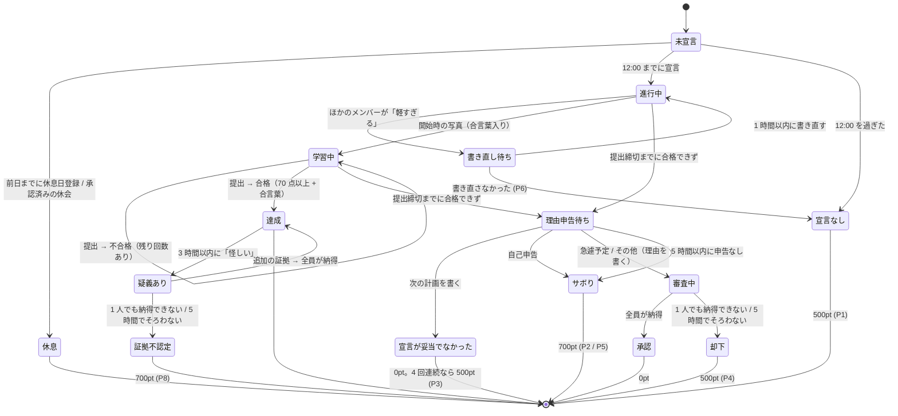

# 要件定義 — Commit or Treat (仮)

友人グループ（3〜6名）で学習を強制継続させるクローズド Web アプリ。
毎日「宣言 → 提出 → AI 判定」を回す。守れなかったら理由を申告し、内容に応じてペナルティが付く。**1pt = 1 円**で、毎週土曜 23:00 に締めて PayPay でまとめて払う。
**外部チャットツールは使わず、通知もアプリ内（アプリ内通知 + Web Push）で完結させる。**

## 0. 前提・制約

| 項目 | 内容 |
|---|---|
| 利用者 | 1 グループのみ（3〜6名）。1 デプロイ = 1 グループ |
| コスト | **0 円運用**。各サービスの無料枠内に収める |
| タイムゾーン | **Asia/Tokyo 固定**。「日付」はすべて JST の暦日 |
| 端末 | スマホ主体。**PWA としてホーム画面に追加して使う**（iOS の Push 通知はホーム画面追加が必須）。PC でも使える |

## 1. 用語

| 用語 | 意味 |
|---|---|
| 学習日 (`date`) | JST の暦日。1 ユーザー 1 学習日につき 1 レコード（`study_logs`） |
| 1 日の始まり | **0:00 JST**。日付が変わった瞬間に、宣言を促す通知が届く |
| 宣言 | その日の学習内容と提出締切を登録すること |
| 宣言締切 | **12:00 JST**。過ぎたら宣言できない |
| 提出締切 (`target_end_time`) | 宣言時に本人が決める成果物の提出期限 |
| 休息日 | 事前登録した「宣言しなくてよい日」。週あたり上限あり |
| 休会 | ほかの全員の承認を得て、連続した期間を休むこと。期間中は休息日と同じ扱い |
| 指摘 | ほかのメンバーが宣言に「軽すぎる」を押すこと。押されたら本人は宣言を書き直す |
| 提出 (submission) | 証拠画像＋振り返りの 1 回分。1 学習日に複数回あり得る |
| 未達成 | 宣言はしたが、提出締切までに AI 判定で合格できなかった状態 |
| 理由申告 | 未達成のあとに本人が出す、できなかった理由の説明 |
| 審査 | 「急遽予定」「その他」の理由を、ほかのメンバー全員が見て納得するかどうか決めること |
| 支払先 | 精算でペナルティを払う相手。事前に決めておくか、未設定ならシステムがランダムに決める |
| 精算 | 毎週土曜 23:00 に、確定済みの未精算ポイントを合計して支払先に払うこと |

## 2. ペナルティのルール（1pt = 1 円）

| # | 状況 | ペナルティ |
|---|---|---|
| P1 | 12:00 までに宣言しなかった（休息日を除く） | **500pt** |
| P2 | 未達成。理由は「**サボった**」 | **700pt** |
| P3 | 未達成。理由は「**宣言が妥当じゃなかった**」。次の計画を具体的に書く | 0pt。ただし **4 回連続になったら、4 回目から 1 回ごとに 500pt** |
| P4 | 未達成。理由は「**急遽予定ができた**」または「**その他**」。理由を具体的に書く | ほかのメンバー**全員が「納得」したら 0pt**。**1 人でも「納得できない」を押した、または 5 時間以内に全員の納得がそろわなかったら 500pt** |
| P5 | 未達成のまま、5 時間以内に理由を申告しなかった | **700pt**（サボったとみなす） |
| P6 | 宣言に「軽すぎる」の指摘を受けたのに、1 時間以内に書き直さなかった | **500pt**（宣言なしと同じ扱い） |
| P7 | 精算を、次の精算（翌週土曜 23:00）までに「送金した」にしなかった | **500pt**。払うまで毎週加算 |
| P8 | 提出に「怪しい」と指摘され、審査で証拠が認められなかった | **700pt**（サボりと同じ） |

- 1 学習日に付くペナルティは 1 件まで（P7 は学習日と関係なく付く）。
- 金額はグループ設定で変えられる（既定値は上の表のとおり）。

### P3 の「連続」の数え方
- 宣言した学習日だけを古い順に並べ、「未達成で、理由が『宣言が妥当じゃなかった』」の日が何日続いたかを数える。
- **達成した日、またはほかの理由で未達成になった日があったらリセット**する。
- 宣言しなかった日 (P1・P6)、休息日、休会中の日は数えない（リセットもしない）。

## 3. 1 日のライフサイクル

## 4. 機能要件

### F1. 認証・メンバー管理
- メール＋パスワードでログイン。
- **サインアップには招待コードが必須**。サーバー側でコードを検証してからユーザーを作成する（Supabase の公開サインアップは OFF）。
- プロフィール: 表示名（必須）、アバター、PayPay 受け取りリンク、支払先（F8）。
- ペナルティ・ステータス・審査結果などのゲーム状態は**本人が直接書き換えられない**こと。

### F2. 休息日
- 翌日以降の日付を休息日として登録・取消できる（**当日の登録は不可**）。
- 上限: **週 1 日**（週は日曜〜土曜で、精算の区切りと揃える。グループ設定で変更可）。
- 登録時に全員へ通知。

### F2b. 休会
- テスト期間・旅行など、休息日では足りないときに使う。
- 本人が**期間（開始日〜終了日）と理由**（30 字以上）を書いて申請する。**期間の長さに上限はなく、理由に応じて本人が決める**。妥当かどうかはほかのメンバーが判断する。開始日は明日以降。
- 審査は理由申告の審査 (F7) と同じ: **ほかの全員が「納得・承認」を押したら成立**。1 人でも「却下」、または 5 時間以内にそろわなければ不成立（ペナルティはなし。必要なら申請し直せる）。
- **期間中の各日は、その日が始まる前に承認済みのときだけ**休会扱いになる（承認待ちのあいだに来た日は通常どおり宣言が必要）。
- 休会中の人は宣言しなくてよく、ほかの人の審査にも加わらない（審査者から外す）。
- 途中でやめる（残りの日を取り消す）ことはいつでもできる。
- 休会日は休息日の週の上限に数えない。

### F3. 朝の宣言
- **0:00（日付が変わった瞬間）に、まだ宣言していなければ本人に通知する**（休息日・休会中は除く。この通知は OFF にできない）。11:00 にまだ宣言していなければもう一度通知する。
- 入力: 学習内容（テキスト）、提出締切時刻（time ピッカー）。
- 前回の未達成で「宣言が妥当じゃなかった」と申告していた場合は、そのとき書いた「次の計画」を宣言フォームに表示する。
- 宣言できるのは 12:00 まで。休息日には宣言できない。
- 提出締切の範囲: **宣言時刻 + 30 分以降、翌日 03:00 まで**（夜型対応）。
- 宣言後の内容変更は不可（逃げ道防止）。例外は F3b の書き直しだけ。
- 12:00 を過ぎても宣言がなければ **500pt (P1)**。全員へ通知。

### F3b. 宣言への指摘（軽すぎる）
- ほかのメンバーは、宣言から 3 時間以内（かつ提出締切の前）なら、その宣言に「**軽すぎる**」を押せる。理由のコメントは必須。
- 1 人でも押したら、本人に通知する（残り 15 分でもう一度）。本人は **1 時間以内に宣言の内容を書き直す**（提出締切は変えられない）。書き直したら、指摘した人とほかの全員に通知する。
- 書き直さなかったら、宣言なしとみなして **500pt (P6)**。
- 指摘は 1 つの宣言に 1 回だけ（書き直した宣言には指摘できない）。
- 指摘されたことと、書き直す前と後の宣言は、全員が見られる。
- 書き直し待ちのあいだも提出はできる。AI 判定は書き直した後の宣言で行う。

### F4. 証拠の仕組み
不正の手口と、それぞれへの対策:

| 手口 | 対策 |
|---|---|
| 昔の写真・ネットの画像を使う | **今日の合言葉**を写真に写す (F4a) |
| 過去の自分や他人の提出写真を使い回す | **使い回し画像の自動検出** (F4d) |
| 数分で済ませて「やった」ことにする | **開始時の写真**と終了時の写真の差、かかった時間を全員に見せる (F4b) |
| AI をだます | ほかのメンバーによる**「怪しい」指摘** (F5b) |

#### F4a. 今日の合言葉
- 宣言した瞬間に、その人のその日だけの合言葉を発行する（例: 「さくら 47」= ランダムな単語 + 2 桁の数字）。書き直しても変わらない。
- **開始時の写真と、提出写真のうち少なくとも 1 枚に、合言葉を写す**（紙に手書きして一緒に写す。PC 作業なら付箋や画面の端に表示する）。
- 合言葉が写っているかどうかは Gemini が確かめる。写っていなければ不合格。
- 合言葉は本人の宣言・提出画面にだけ大きく表示する（ほかの人も履歴で見られるが、予測はできない）。

#### F4b. 開始時の写真（学習開始）
- 学習を始めるときに「**開始**」を押し、写真を 1 枚撮る。教材の開いたページ・白紙のノートなど、始める前の状態に合言葉を添えて写す。
- アップロード時に Gemini が合言葉を確かめる。写っていなければその場で撮り直しを求める（試行回数には数えない）。
- 開始時刻はサーバーが記録する。**開始していないと提出できない**。
- 開始したら、ほかの全員に「〇〇が学習を開始しました」と通知する。
- 提出時には「開始 → 提出」の経過時間を表示し、AI の判定材料にもする。最低時間は設けないが、経過時間はタイムラインと履歴で全員に見える（短すぎれば「怪しい」指摘の対象になる）。

#### F4c. 成果物の提出
- 入力: 証拠画像 1〜3 枚（うち 1 枚以上に合言葉）、学んだこと、できなかったこと・疑問点、自己評価（1〜5）。
- 画像はブラウザで圧縮してからアップロード（長辺 1200px 以下、WebP、200KB 前後）。カメラで撮るのを基本にする（`capture` 属性。ギャラリーからの選択も許すが、合言葉で防ぐ）。
- 提出は `target_end_time` より前でなければならない（**提出時刻で判定**し、AI 判定の完了時刻は問わない）。
- 提出後すぐ判定する（F4d → F5）。

#### F4d. 使い回し画像の自動検出
- サーバーがアップロードされた画像ごとに**知覚ハッシュ**（見た目が似ていれば近い値になる指紋）を計算して記録する。
- **グループ全員の過去の画像**（開始時の写真を含む）と比べ、ほぼ同じ画像があれば、AI に送る前に不合格にする（試行回数に数える）。講評に「〇月〇日の画像とほぼ同じです」と出す。
- 同じ日の開始時の写真と提出写真がほぼ同じ場合も不合格（何も進んでいない）。

### F5. AI 判定
- Gemini に渡すもの: 宣言（書き直し後）、合言葉、開始時の写真、提出写真、学んだこと・できなかったこと、自己評価、開始からの経過時間。
- Gemini が返すもの: 点数 (0〜100)、提出写真に合言葉が写っているか、開始時から進んでいるか、講評。
- **合格の条件 = 70 点以上 かつ 合言葉が写っている**。合否はサーバーが決める（モデルの返した合否は使わない）。
- 合格 → 達成。全員へ通知。
- 不合格 → **締切までなら再提出できる（1 学習日に最大 3 回）**。全員へ通知（講評と残り回数つき）。
- Gemini API のエラー（レート制限・障害）は試行回数に含めない。後から再判定できる。
- 提出締切までに合格できなければ**未達成**になり、本人に理由申告を求める（F6）。

### F5b. 提出への「怪しい」指摘
- AI が合格にした提出に、ほかのメンバーは**合格から 3 時間以内**なら「**怪しい**」を押せる。理由のコメントは必須。指摘は 1 つの提出に 1 回だけ。
- 押されたら、その日は「**疑義あり**」になり、本人に通知する。本人は **1 時間以内に追加の証拠**（写真最大 3 枚と説明）を出せる（出さなくてもよい）。
- 追加の証拠が出たとき、または 1 時間たったときに、**審査**を始める。審査は F7 と同じ: 審査者全員（指摘した人を含む）が「納得」したら達成のまま。**1 人でも「納得できない」、または 5 時間以内にそろわなければ、証拠が認められなかったとして 700pt (P8)**。
- 審査中もその日は「達成」として数えない（精算・連続回数の計算は確定まで待つ）。

### F6. 理由申告
- 未達成になったら、本人は **5 時間以内**に理由を 1 つ選んで申告する。
  | 理由 | 必須の入力 | その後 |
  |---|---|---|
  | 宣言が妥当じゃなかった | **次どうするか**（具体的に。30 字以上） | 0pt。4 回連続なら 500pt (P3) |
  | サボった | なし（任意でひとこと） | 700pt (P2) |
  | 急遽予定ができた | **何があったか**（具体的に。30 字以上） | 審査 (F7) |
  | その他 | **理由**（具体的に。30 字以上） | 審査 (F7) |
- 申告は一度出したら変更できない。
- 5 時間以内に申告しなければ「サボった」とみなして 700pt (P5)。未達成になった瞬間と、残り 1 時間・15 分で本人へ通知する。
- 申告内容は全員が見られる（タイムラインと履歴）。

### F7. 審査（急遽予定・その他）
- 申告と同時に、審査者全員へ審査依頼の通知を送る。誰かが押すたびに、本人へ通知する（「〇〇が納得しました（2/4）」）。
- 各メンバーは「納得」か「納得できない」を押す。「納得できない」にはひとことコメントを付けられる（任意）。一度押したら変更できない。
- **全員が「納得」を押したら承認**（0pt）。
- **1 人でも「納得できない」を押したら、その時点で却下**（500pt）。
- **申告から 5 時間たっても全員の「納得」がそろっていなければ却下**（500pt）。残り 1 時間・15 分で、まだ押していないメンバーへ通知する。
- 審査に加わるのは、申告した時点で休会中でないほかのメンバー全員。

### F8. 精算（毎週土曜 23:00）
- **1pt = 1 円**。毎週土曜 23:00 に、その時点で確定している未精算ポイントを人ごとに合計して精算を作る。0pt の人には作らない。
  - その時点で審査中・理由申告待ちのもの（土曜当日の未達成など）は、確定した時点で翌週の分に入る。
- 精算 1 件 = 「誰が・誰に・いくら払うか」。**支払先は 1 人**。
  - 本人が設定画面で**支払先を決めておいた**場合はその人。
  - 未設定なら、ほかのメンバーから**システムがランダムに 1 人選ぶ**（選んだ結果は記録し、選び直せない）。
- 支払う人は、支払先の PayPay リンクから送金し、「送金した」を押す。**受け取った人が「受け取った」を押したら精算完了**。
- **相殺はしない**。A が B に、B が A に払う週でも、お互いに全額を送る。
- 支払先は、届いていなければ「届いていない」を押して `open` に戻せる。
- **次の精算（翌週土曜 23:00）までに「送金した」になっていなければ 500pt (P7)**。払うまで毎週加算する。P7 のポイントは次の精算に入る。
- 精算の作成時に支払う人と支払先の両方へ通知する。未完了の精算がある人には「奢り確定」バッジを付ける。
- 支払先が未設定の人は、**毎週**ランダムに選び直す。
- 実行日時: 毎週土曜 23:00（グループ設定で変更可）。

### F9. 締切監視（定期実行）
5 分ごとに以下を冪等に処理する。
1. 0:00 と 11:00 の宣言リマインド（F3）
2. 12:00 の宣言なしを確定する (P1)
3. 提出締切を過ぎた進行中の学習日を未達成にする（締切前に出した提出が判定待ちの間は最大 60 分待つ）
4. 未達成になった人へ理由申告を求める通知、残り 1 時間・15 分の通知、5 時間たっても申告がなければ P5
5. 審査の残り 1 時間・15 分の通知、5 時間でそろわなければ却下
6. 毎週土曜 23:00 の精算 (F8) と、前の週から未払いの精算への P7
6b. 指摘の書き直し期限 (P6)、休会の審査期限
6c. 「怪しい」指摘の追加証拠の期限（1 時間）と審査期限（5 時間, P8）
7. 保持期間（既定 60 日）を過ぎた証拠画像の削除

### N1. 通知（アプリ内で完結）
外部サービス（Discord・LINE・メール）は使わない。通知は 2 つの経路で届ける。

| 経路 | 仕組み | 用途 |
|---|---|---|
| **アプリ内通知** | ヘッダーのベル＋未読バッジ、通知一覧ページ。Supabase Realtime で即時反映 | すべての通知の正本。既読管理 |
| **Web Push** | PWA + Service Worker + VAPID（`web-push`）。アプリを閉じていても OS の通知として届く | 本人がオンにしている種類だけ |

加えて、ダッシュボードに**グループのタイムライン**（誰が何をしたか・誰が失敗したか・どんな理由を申告したか）を出し、晒し上げはここで行う。

**原則: 誰かが何かをしたら、関係する人に必ず届く（双方向）。** 自分の行動の結果は自分に、自分の行動は他のメンバーに、相手の反応は自分に返ってくる。期限があるものは、発生した瞬間と期限の手前で知らせる。

| 場面 | いつ | 誰に | 例 |
|---|---|---|---|
| **宣言** | 0:00（日付が変わった瞬間）にまだ宣言していない | 本人 | 「今日の宣言をしよう（12:00 まで）」 |
| | 11:00 にまだ宣言していない | 本人 | 「あと 1 時間で宣言締切。過ぎたら 500pt」 |
| | 宣言した | ほかの全員 | 「〇〇が宣言しました:『線形代数 3 章』（締切 21:00）」 |
| | 休息日を登録した | ほかの全員 | 「〇〇が 10/20 を休息日にしました」 |
| | 12:00 を過ぎて宣言なし | 全員 | 「〇〇が宣言しませんでした。500pt」 |
| **指摘** | 「軽すぎる」が押された | 本人 | 「〇〇が『軽すぎる』と指摘: …。1 時間以内に書き直して」 |
| | 同上 | ほかの全員 | 「〇〇が △△ の宣言に指摘しました」 |
| | 書き直しの残り 15 分 | 本人 | 「書き直しの期限まであと 15 分」 |
| | 書き直した | 指摘した人・ほかの全員 | 「〇〇が宣言を書き直しました:『…』」 |
| | 書き直さずに期限切れ | 全員 | 「〇〇が書き直しませんでした。500pt」 |
| **開始** | 学習を開始した | ほかの全員 | 「〇〇が学習を開始しました」 |
| | 開始時の写真に合言葉が写っていない | 本人 | 「合言葉が見えません。撮り直して」 |
| **提出** | 提出締切の 1 時間前でまだ合格していない | 本人 | 「締切 21:00 まであと 1 時間」 |
| | AI が合格 | 本人・ほかの全員 | 「〇〇が達成しました（85 点）」 |
| | AI が不合格 | 本人（講評・残り回数）・ほかの全員 | 「〇〇の提出は不合格（55 点）。残り 2 回」 |
| | 使い回し画像を検出した | 本人 | 「10/12 の画像とほぼ同じです」 |
| **怪しい** | 「怪しい」が押された | 本人 | 「〇〇が『怪しい』と指摘: …。1 時間以内に追加の証拠を出せます」 |
| | 同上 | ほかの全員 | 「〇〇が △△ の提出に疑義を出しました」 |
| | 追加の証拠の残り 15 分 | 本人 | |
| | 審査が始まった | 審査者全員 | 「△△ の提出を審査して（5 時間以内）」 |
| | 審査の残り 1 時間・15 分 | まだ押していない審査者 | |
| | 誰かが納得 / 納得できないを押した | 本人 | 「〇〇が納得しました（2/4）」 |
| | 結果が出た | 全員 | 「△△ の達成が認められました」 / 「証拠不認定。700pt」 |
| **未達成** | 未達成になった | 本人 | 「未達成です。5 時間以内に理由を申告して」 |
| | 同上 | ほかの全員 | 「〇〇が未達成でした」 |
| | 申告の残り 1 時間・15 分 | 本人 | 「申告しないとサボり扱い（700pt）」 |
| | 申告した（サボり・宣言が妥当でなかった） | ほかの全員 | 「〇〇: 宣言が妥当じゃなかった。次は…」 |
| | 申告した（急遽予定・その他） | 審査者全員 | 「〇〇の理由を審査して（5 時間以内）」 |
| | 審査の残り 1 時間・15 分 | まだ押していない審査者 | 「審査の期限まであと 1 時間」 |
| | 誰かが納得 / 納得できないを押した | 本人 | 「〇〇が納得しました（2/4）」 |
| | 審査の結果が出た | 全員 | 「〇〇の理由は承認されました」 / 「却下。500pt」 |
| | 申告せずに期限切れ | 全員 | 「〇〇が申告しませんでした。700pt」 |
| **休会** | 申請した | 審査者全員 | 「〇〇が 10/20〜10/27 の休会を申請: …」 |
| | 審査の残り 1 時間・15 分 | まだ押していない審査者 | |
| | 誰かが承認 / 却下を押した | 本人 | 「〇〇が承認しました（3/4）」 |
| | 結果が出た | 全員 | 「〇〇の休会が決まりました」 |
| | 休会の最終日 | 本人 | 「明日から再開です」 |
| **精算** | 土曜 23:00 に精算ができた | 支払う人 / 支払先 | 「〇〇に 1,200 円送って」 / 「〇〇から 1,200 円届きます」 |
| | 同上 | 全員 | 「今週のペナルティ結果」（ランキング） |
| | 送金した | 支払先 | 「〇〇が送金しました。受け取ったら確認を」 |
| | 受け取った | 支払う人 | 「〇〇が受け取りを確認しました」 |
| | 届いていない | 支払う人 | 「〇〇に届いていません」 |
| | 未払いで P7 が付く 24 時間前 | 支払う人 | |
| | P7 が付いた | 全員 | 「〇〇が未払いで 500pt 追加」 |

- **アプリ内通知はすべて届く。** Push は全種類が既定で ON。
- **自分の対応が必要な通知**（リマインド・指摘・審査依頼・送金・受け取り確認）は **Push を OFF にできない**。**ほかの人の活動のお知らせ**（宣言した・達成した など）は種類ごとに OFF にできる。
- 1 人が複数の端末を登録できる。期限切れの購読（HTTP 404/410）は自動で削除する。
- 初回ログイン時に「ホーム画面に追加 → 通知を許可」の手順を案内する（iOS は Safari の共有メニューから）。通知を許可していない人には、画面上部に警告を出し続ける。

### F10. ダッシュボード (`/`)
- メンバー全員の本日のステータスカード: 未宣言 / 休息 / 進行中（締切までの残り時間） / 学習中（開始からの経過時間） / 達成 / 疑義あり / 理由申告待ち / 審査中 / 確定（ペナルティ額）。
- **自分がやること**: 宣言・宣言の書き直し・開始・提出・追加の証拠・理由申告・審査（理由・休会・疑義）・送金・受け取りの確認のうち、今残っているもの。
- 自分の今日の合言葉（大きく表示）。
- 今日のほかのメンバーの宣言（「軽すぎる」ボタン付き）と、合格した提出（「怪しい」ボタン付き）。
- 今週のペナルティランキング（今週の未精算 pt の多い順）と累計。
- 「奢り確定」バッジ、PayPay ボタン。
- タイムライン、各メンバーの履歴（日ごとの宣言・提出・講評・画像・理由・審査結果）。

### F11. グループ設定
ペナルティの額 (P1〜P8)、P3 の連続回数、理由申告・審査の期限、指摘できる時間と書き直しの期限、「怪しい」を押せる時間と追加証拠の期限、使い回し判定の厳しさ、休息日の上限、合格点、最大提出回数、精算の実行時刻、画像の保持日数。
変更できるのは `is_admin` のメンバーのみ（最初のユーザー）。

## 5. 非機能要件

| 区分 | 要件 |
|---|---|
| コスト | Vercel Hobby / Supabase Free（DB・Auth・Storage・Realtime・pg_cron）/ Gemini 無料枠 / Web Push（ブラウザ標準・無料）のみ。GitHub Actions は使わない（→ [decisions.md](decisions.md) ADR-003） |
| セキュリティ | 書き込みはすべてサーバー経由。クライアントは RLS 越しに読むだけ。cron エンドポイントは共有シークレットで認証 |
| 公正さ | 判定・締切の基準時刻はサーバー（DB の `now()`）。クライアントの時計は信用しない。理由申告・審査は一度出したら変更できない |
| 冪等性 | cron が重複・遅延しても二重ペナルティにならない（DB の一意制約で保証） |
| ストレージ | Supabase Storage 1GB 以内。通常 ~5MB/日（6 人 × 開始 1 枚 + 提出 3 枚 × 200KB）× 保持 60 日 ≈ 300MB。再提出・追加証拠が多い最悪の場合 ~14MB/日 ≈ 850MB なので、800MB を超えたら古い順に消す。知覚ハッシュは画像を消しても DB に残すので、使い回しの検出は続く |
| プライバシー | Gemini 無料枠では入力がモデル改善に使われ得る。証拠画像に個人情報を写さないようメンバーに周知 |

## 6. スコープ外（MVP では作らない）
- 複数グループ対応
- 実際の送金処理（PayPay API 連携）。アプリは送金リンクを開いて、送金・受け取りの記録をするだけ
- AI 判定への異議申し立て
- ネイティブアプリ（PWA で代替）
- メール・外部チャットへの通知

## 7. 未決事項
以下は仮の値・解釈で設計している。違っていたら直す。
- [ ] 夜間の扱い: 審査・申告の期限 5 時間は夜中も進む（例: 23:00 に申告されると 4:00 に期限が来て、寝ている審査者が押せずに却下になる）。夜間（例: 0:00〜7:00）は期限のカウントを止めるか
- [ ] P3 の数え方（4 回目から毎回 500pt、達成したらリセット）
- [ ] 支払先を決めるのは本人か、グループで決めるか（今の設計は本人が設定画面で選ぶ）
- [ ] 証拠不認定 (P8) の額（700pt = サボりと同じでよいか）
- [ ] 開始から提出までの最低時間を設けるか（今は設けず、経過時間を見せるだけ）
- [ ] 最初の数日を「お試し期間（ペナルティなし）」にするか
- [ ] パスワードリセットの方法（Supabase 無料枠のメール送信は 1 時間あたりの上限が厳しい → 管理者がリセットする運用でもよい）
